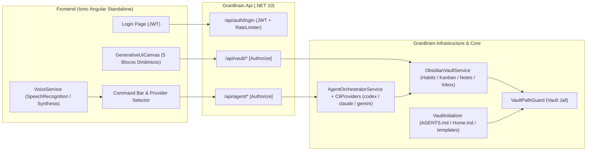

# WI 0001 — GranBrain MVP: Obsidian AI OS com Orquestrador Multi-CLI e Generative UI

## 1. Fonte canônica
- **Especificação canônica:** [backlog/tasks/0001-granbrain-mvp-obsidian-ai-os.md](../../backlog/tasks/0001-granbrain-mvp-obsidian-ai-os.md)
- **ADR aplicável:** [docs/adr/0001-granbrain-architecture.md](../../docs/adr/0001-granbrain-architecture.md) e [CLAUDE.md](../../CLAUDE.md).
- **Precedência:** Em caso de divergência, a seção `Decisões do dev` em `backlog/tasks/0001-granbrain-mvp-obsidian-ai-os.md` vence qualquer outro documento.

## 2. Decisões (não reabrir)
- **D1 (`backlog/tasks/0001-granbrain-mvp-obsidian-ai-os.md`):** Monorepo `GranBrain` em `C:\Users\igor.grandin\Documents\Projects\GranBrain` com `backend/` (`.NET 10`) e `frontend/` (`Ionic Angular`), usando `backlog/tasks/0001-granbrain-mvp-obsidian-ai-os.md` como fonte canônica.
- **D2 (`backlog/tasks/0001-granbrain-mvp-obsidian-ai-os.md`):** Cofre Obsidian desacoplado via configuração `GranBrain:VaultPath` (`G:\Meu Drive\Softwares\Obsidian\Igor Grandin`), inicializado por `VaultInitializer` de forma não-destrutiva (`AGENTS.md`, `Home.md`, `inbox/` e correção de `---` duplicado em `templates/`).
- **D3 (`backlog/tasks/0001-granbrain-mvp-obsidian-ai-os.md`):** Orquestrador Multi-IA via `IAgentCliProvider` (`codex`, `claude`, `gemini`), executando no diretório do cofre e devolvendo `AgentResponseEnvelope` com blocos de Generative UI + motor estruturado integrado de fallback/ação direta.
- **D4 (`backlog/tasks/0001-granbrain-mvp-obsidian-ai-os.md`):** Segurança Defense-in-Depth com Login JWT (`/api/auth/login`), Rate Limiting anti-brute-force (HTTP 429) e `VaultPathGuard` (`Vault Jail`) bloqueando Path Traversal com código `vault_path_violation`.
- **D5 (`backlog/tasks/0001-granbrain-mvp-obsidian-ai-os.md`):** Catálogo MVP de 5 blocos de Generative UI (`kpi-grid`, `habit-checklist`, `kanban-board`, `dynamic-form`, `markdown-note-list`) + suporte bidirecional a voz (`Web Speech API`).

## 3. Arquitetura

### Catálogo de Códigos de Erro Declarados
| Código | HTTP Status | Produtor | Cenário |
|---|---|---|---|
| `vault_path_violation` | 400 / 403 | `VaultPathGuard.ResolveSafePath` | Tentativa de acessar caminho fora de `VaultPath` (`../`, root externo) |
| `invalid_credentials` | 401 | `AuthEndpoints.Login` | Usuário ou senha incorretos no login |
| `rate_limit_exceeded` | 429 | `RateLimiterMiddleware` em `/api/auth/login` | Mais de 5 tentativas de login na janela configurada |
| `kanban_board_not_found` | 404 | `ObsidianVaultService.UpdateKanbanAsync` | Quadro Kanban solicitado não existe |
| `habit_not_found` | 404 | `ObsidianVaultService.ToggleHabitAsync` | Hábito solicitado não existe na nota diária |

## Manifesto de execução
- **SHA-base:** `975ad024d43998c6eea3b1fbc5cad789ce653b15` (o único commit entre o SHA-base e o `HEAD` da execução é o commit deste plano em `.cursor/plans/**`).
- **Invariantes:**
  - Nenhuma nota existente do usuário em `G:\Meu Drive\Softwares\Obsidian\Igor Grandin\daily`, `zettelkasten` ou `assets` pode ser apagada ou truncada.
  - Todos os testes automatizados usam diretórios temporários isolados (`Path.GetTempPath()`), nunca mutando o cofre de produção durante a suíte de testes.
  - Não fazer `git push` sem autorização explícita do usuário.
- **Seletores/contratos novos:**
  - `VaultPathGuard.ResolveSafePath(string relativeOrSubPath)`
  - `VaultInitializer.EnsureInitializedAsync(CancellationToken ct)`
  - `ObsidianVaultService` (`GetOverviewAsync`, `GetDailyHabitsAsync`, `ToggleHabitAsync`, `GetKanbanBoardAsync`, `AddKanbanTaskAsync`, `MoveKanbanTaskAsync`, `CreateStructuredNoteAsync`, `QueryNotesAsync`)
  - `AgentOrchestratorService.ExecutePromptAsync(AgentChatRequest request, CancellationToken ct)`
  - Endpoints HTTP: `POST /api/auth/login`, `POST /api/vault/bootstrap`, `GET /api/vault/overview`, `POST /api/vault/habits/toggle`, `GET /api/vault/kanban/{board}`, `POST /api/vault/kanban/{board}/tasks`, `PUT /api/vault/kanban/{board}/tasks/move`, `POST /api/vault/notes`, `GET /api/vault/notes`, `GET /api/agent/providers`, `POST /api/agent/chat`
  - Componentes Angular: `LoginComponent`, `DashboardShellComponent`, `GenerativeCanvasComponent`.

## Matriz de cobertura

| AC | Comportamento / cenário observável | Resultado esperado | Fronteira de produção | Teste ou check (planejado) | Discriminante |
|---|---|---|---|---|---|
| AC1 | Inicializar cofre cria `AGENTS.md`, `Home.md` e `inbox/`, corrige `---` duplicado em `templates/`, preserva notas existentes e é idempotente em segunda execução | Arquivos criados, YAML corrigido sem `---` duplicado, nota existente intacta e re-execução idempotente | `backend/src/GranBrain.Infrastructure/Vault/VaultInitializer.cs` | `VaultInitializerTests.EnsureInitializedAsync_CreatesGovernanceFiles_FixesTemplates_AndPreservesExistingNotes` | Falha se `AGENTS.md`/`Home.md`/`inbox` não forem criados, se o segundo `---` em `templates/Notas.md` permanecer, se nota existente for sobrescrita ou se segunda execução corromper template já sanitizado |
| AC2 | Caminho com `..`, raiz externa absoluta (`C:\Windows\win.ini`) ou diretório irmão com mesmo prefixo (`VaultRoot_leak`) é bloqueado pelo `VaultPathGuard` e mapeado para HTTP 400/403 com código `vault_path_violation` | Lança `VaultPathViolationException` (`vault_path_violation`) e endpoint HTTP retorna 400/403 com código `vault_path_violation` | `backend/src/GranBrain.Core/Security/VaultPathGuard.cs` e `backend/src/GranBrain.Api/Program.cs` | `VaultPathGuardTests.ResolveSafePath_WhenPathEscapesVaultRoot_ThrowsVaultPathViolationException` e `ApiSecurityAndAgentTests.VaultEndpoints_WhenPathViolationOrMissingEntity_ReturnsExpectedErrorCodes` | Falha se `../../Windows/win.ini`, `C:\Windows\win.ini` ou irmão `VaultRoot_leak\secret.md` não lançarem `VaultPathViolationException` ou se a API não retornar HTTP 400/403 (`vault_path_violation`) |
| AC3 | Login emite JWT para credencial válida, 401 (`invalid_credentials`) nas tentativas inválidas 1..5, 401 para rotas protegidas `/api/vault/**` e `/api/agent/**` sem token, e 429 (`rate_limit_exceeded`) na 6ª tentativa | HTTP 200 c/ token, HTTP 401 (`invalid_credentials`), HTTP 401 em `/api/vault/overview` e `/api/agent/providers` anônimos, e HTTP 429 (`rate_limit_exceeded`) na 6ª tentativa | `backend/src/GranBrain.Api/Endpoints/AuthEndpoints.cs` e `Program.cs` | `ApiSecurityAndAgentTests.AuthAndRateLimit_EnforcesJwtAndBlocksBruteForce` | Falha se `/api/vault/overview` ou `/api/agent/providers` aceitar chamada sem Bearer token, se tentativas 1..5 não retornarem 401 (`invalid_credentials`) ou se a 6ª chamada seguida a `/api/auth/login` não retornar 429 (`rate_limit_exceeded`) |
| AC4 | Criação automática da nota diária a partir do template se ausente; toggle bidirecional de hábito (`- [ ]` ↔ `- [x]`); Kanban cria/move item entre colunas; captura/formulário dinâmico (`reuniao`, `nota`, `tarefa`, `inbox`) cria `.md` com YAML frontmatter; erros `habit_not_found` e `kanban_board_not_found` retornam 404 | Arquivos `.md` no disco refletem literalmente cada mudança de estado e erros mapeiam para 404 | `backend/src/GranBrain.Infrastructure/Vault/ObsidianVaultService.cs` | `ObsidianVaultServiceTests.HabitsKanbanAndNotes_MutateMarkdownFilesCorrectly` e `ApiSecurityAndAgentTests.VaultEndpoints_WhenPathViolationOrMissingEntity_ReturnsExpectedErrorCodes` | Falha se nota diária não for criada, se toggle `- [ ]` → `- [x]` → `- [ ]` falhar, se card Kanban continuar na coluna antiga, se `CreateStructuredNoteAsync` não gravar `.md` com frontmatter YAML ou se `habit_not_found`/`kanban_board_not_found` não retornarem 404 |
| AC5 | `/api/agent/providers` lista CLIs (`codex`, `claude`, `gemini`) com status real e `/api/agent/chat` retorna `AgentResponseEnvelope` com blocos `GenerativeUiBlock`, tratando stdout não-JSON ou CLI ausente via fallback estruturado | HTTP 200 em `/api/agent/providers` com 3 itens e HTTP 200 em `/api/agent/chat` com `uiBlocks` tipados (`kpi-grid`, `habit-checklist`, `kanban-board`, `dynamic-form`, `markdown-note-list`) mesmo quando CLI não instalada ou saída em texto livre | `backend/src/GranBrain.Infrastructure/Agents/AgentOrchestratorService.cs` | `ApiSecurityAndAgentTests.AgentChat_ReturnsGenerativeUiBlocksAndExecutesVaultActions` | Falha se `/api/agent/providers` não listar `codex`, `claude`, `gemini`, se `uiBlocks` vier sem o bloco correspondente ou se CLI ausente/não-JSON quebrar o endpoint em vez de acionar o parser/fallback |
| AC6 | Frontend Ionic Angular autentica no login, alterna provedor de IA, aciona `VoiceService` (STT/TTS) e renderiza dinamicamente os 5 blocos de Generative UI disparando toggle de hábito, movimentação de Kanban e submissão de formulário dinâmico | Login emite sessão, seletor troca provedor, voz invoca síntese/reconhecimento e `<app-generative-canvas>` renderiza os 5 blocos e emite `habitToggled`, `kanbanTaskMoved` e `dynamicFormSubmitted` | `frontend/src/app/app.component.ts` e `frontend/src/app/components/generative-canvas/generative-canvas.component.ts` | `frontend/src/app/app.spec.ts` (`renders all 5 Generative UI blocks dynamically and dispatches actions`) | Falha se `<app-generative-canvas>` não renderizar `.gb-kpi-grid`, `.gb-habit-list`, `.gb-kanban-board`, `.gb-dynamic-form`, `.gb-note-list` ou não emitir `habitToggled`, `kanbanTaskMoved` e `dynamicFormSubmitted`, ou se `AppComponent` não realizar login e troca de provedor |

### Dimensões de Risco
- **Fronteira e falha (Aplicável):** Caminhos malformados (`..`, caracteres inválidos), templates sem frontmatter ou com `---` duplicado, CLIs externas indisponíveis ou retornando texto fora de JSON (coberto por parser tolerante + fallback estruturado).
- **Autorização e segurança (Aplicável):** Proteção JWT nas rotas `/api/vault/**` e `/api/agent/**`, rate limiting no `/api/auth/login` e `VaultPathGuard` em todo acesso a disco.
- **Concorrência / Transação de banco relacional / Isolamento Multi-tenant (Não aplicáveis):** Sistema single-owner baseado em arquivos Markdown locais com escrita atômica por arquivo.

---

## 4. Fatias

### Fatia 1: Core, `VaultPathGuard` (`Vault Jail`), `VaultInitializer` e `ObsidianVaultService`
- **Pré-requisitos:** nenhum.
- **Dono de escrita:** sessão principal (`main`).
- **Pode rodar em paralelo:** não (cria a solução `.NET 10` base).
- **Critérios de aceite entregues:** AC1, AC2, AC4.
- **Contratos compartilhados produzidos:**
  - `GranBrain.Core/Models/VaultModels.cs` (`HabitItemDto`, `KanbanBoardDto`, `KanbanColumnDto`, `KanbanTaskDto`, `VaultNoteSummaryDto`, `DynamicNoteCreateRequest`, `VaultOverviewDto`)
  - `GranBrain.Core/Models/GenerativeUiModels.cs` (`GenerativeUiBlock`, `AgentChatRequest`, `AgentResponseEnvelope`, `AiProviderStatusDto`)
  - `GranBrain.Core/Security/VaultPathGuard.cs` e `VaultPathViolationException`
  - `GranBrain.Infrastructure/Vault/VaultInitializer.cs` e `ObsidianVaultService.cs`
- **Write-set:**
  - `backend/GranBrain.sln`
  - `backend/src/GranBrain.Core/GranBrain.Core.csproj`
  - `backend/src/GranBrain.Core/Configuration/GranBrainOptions.cs`
  - `backend/src/GranBrain.Core/Security/VaultPathGuard.cs`
  - `backend/src/GranBrain.Core/Models/VaultModels.cs`
  - `backend/src/GranBrain.Core/Models/GenerativeUiModels.cs`
  - `backend/src/GranBrain.Core/Interfaces/IVaultService.cs`
  - `backend/src/GranBrain.Infrastructure/GranBrain.Infrastructure.csproj`
  - `backend/src/GranBrain.Infrastructure/Vault/VaultInitializer.cs`
  - `backend/src/GranBrain.Infrastructure/Vault/ObsidianVaultService.cs`
  - `backend/tests/GranBrain.UnitTests/GranBrain.UnitTests.csproj`
  - `backend/tests/GranBrain.UnitTests/VaultPathGuardTests.cs`
  - `backend/tests/GranBrain.UnitTests/VaultInitializerTests.cs`
  - `backend/tests/GranBrain.UnitTests/ObsidianVaultServiceTests.cs`
- **Checks focados:** `dotnet test backend/tests/GranBrain.UnitTests/GranBrain.UnitTests.csproj --filter "FullyQualifiedName~Vault"`
- **Discriminante da fatia:** `VaultPathGuardTests.ResolveSafePath_WhenPathEscapesVaultRoot_ThrowsVaultPathViolationException` e `ObsidianVaultServiceTests.HabitsKanbanAndNotes_MutateMarkdownFilesCorrectly` — o `/execute-ig` tem de reportá-lo como `[visto]`.

**Reuso:**
| Artefato do plano | Busca (termos · onde) | Candidato encontrado | Decisão |
|---|---|---|---|
| `GranBrain.Core`, `GranBrain.Infrastructure`, `GranBrain.UnitTests` | `*.csproj`, `*.sln` · repositório inteiro | nenhum (repositório recém-inicializado) | criar novo |
| `VaultPathGuard` | `VaultPath`, `GetFullPath` · repositório inteiro | nenhum | criar novo |
| `VaultInitializer` | `AGENTS.md`, `EnsureInitialized` · repositório inteiro | nenhum | criar novo |
| `ObsidianVaultService` | `Kanban`, `ToggleHabit`, `Zettelkasten` · repositório inteiro | nenhum | criar novo |

---

### Fatia 2: Autenticação JWT + Rate Limiting, Orquestrador Multi-CLI (`Codex`, `Claude`, `Gemini`) e `GranBrain.Api`
- **Pré-requisitos:** `fatia-1-core-vault-security`.
- **Dono de escrita:** sessão principal (`main`).
- **Pode rodar em paralelo:** não (depende dos contratos de `GranBrain.Core` e `GranBrain.Infrastructure`).
- **Critérios de aceite entregues:** AC3, AC5 (e exposição HTTP de AC1, AC2, AC4).
- **Contratos compartilhados produzidos:**
  - `GranBrain.Infrastructure/Agents/CliProcessRunner.cs` e `AgentOrchestratorService.cs`
  - `GranBrain.Api/Program.cs`, `Endpoints/AuthEndpoints.cs`, `Endpoints/VaultEndpoints.cs`, `Endpoints/AgentEndpoints.cs`
- **Write-set:**
  - `backend/src/GranBrain.Core/Interfaces/IAgentOrchestrator.cs`
  - `backend/src/GranBrain.Infrastructure/Agents/CliProcessRunner.cs`
  - `backend/src/GranBrain.Infrastructure/Agents/AgentOrchestratorService.cs`
  - `backend/src/GranBrain.Api/GranBrain.Api.csproj`
  - `backend/src/GranBrain.Api/Program.cs`
  - `backend/src/GranBrain.Api/appsettings.json`
  - `backend/src/GranBrain.Api/Endpoints/AuthEndpoints.cs`
  - `backend/src/GranBrain.Api/Endpoints/VaultEndpoints.cs`
  - `backend/src/GranBrain.Api/Endpoints/AgentEndpoints.cs`
  - `backend/tests/GranBrain.UnitTests/GranBrain.UnitTests.csproj`
  - `backend/tests/GranBrain.UnitTests/ApiSecurityAndAgentTests.cs`
- **Checks focados:** `dotnet test backend/tests/GranBrain.UnitTests/GranBrain.UnitTests.csproj --filter "FullyQualifiedName~ApiSecurityAndAgentTests"`
- **Discriminante da fatia:** `ApiSecurityAndAgentTests.AuthAndRateLimit_EnforcesJwtAndBlocksBruteForce` e `ApiSecurityAndAgentTests.AgentChat_ReturnsGenerativeUiBlocksAndExecutesVaultActions` — o `/execute-ig` tem de reportá-lo como `[visto]`.

**Reuso:**
| Artefato do plano | Busca (termos · onde) | Candidato encontrado | Decisão |
|---|---|---|---|
| `AgentOrchestratorService` | `IAgentOrchestrator`, `codex`, `claude` · `backend/` | nenhum | criar novo |
| `GranBrain.Api` (`AuthEndpoints`, `VaultEndpoints`, `AgentEndpoints`) | `MapPost`, `JwtBearer` · `backend/` | nenhum | criar novo |
| Configuração `GranBrain:VaultPath` e `GranBrain:Auth` | `VaultPath`, `JwtKey` · `backend/src/GranBrain.Api/appsettings.json` | `GranBrainOptions` criado na Fatia 1 | reusar: vincular à mesma classe `GranBrainOptions` |

---

### Fatia 3: Frontend `Ionic Angular` com Login, Voz (`Web Speech API`) e Motor de *Generative UI* + Bootstrap Real do Cofre
- **Pré-requisitos:** `fatia-2-auth-agent-api`.
- **Dono de escrita:** sessão principal (`main`).
- **Pode rodar em paralelo:** não (consome os contratos HTTP da Fatia 2).
- **Critérios de aceite entregues:** AC6 (e materialização do bootstrap AC1 no cofre real `G:\Meu Drive\Softwares\Obsidian\Igor Grandin`).
- **Contratos compartilhados consumidos:** DTOs de `/api/auth/login`, `/api/vault/*` e `/api/agent/*`.
- **Write-set:**
  - `frontend/package.json`
  - `frontend/angular.json`
  - `frontend/ionic.config.json`
  - `frontend/tsconfig.json`
  - `frontend/tsconfig.app.json`
  - `frontend/tsconfig.spec.json`
  - `frontend/src/index.html`
  - `frontend/src/main.ts`
  - `frontend/src/styles.scss`
  - `frontend/src/app/app.config.ts`
  - `frontend/src/app/app.component.ts`
  - `frontend/src/app/models/granbrain.models.ts`
  - `frontend/src/app/services/granbrain-api.service.ts`
  - `frontend/src/app/services/voice.service.ts`
  - `frontend/src/app/components/generative-canvas/generative-canvas.component.ts`
  - `frontend/src/app/app.spec.ts`
- **Checks focados:** `npm --prefix frontend test -- --watch=false` e `npm --prefix frontend run build`
- **Discriminante da fatia:** `frontend/src/app/app.spec.ts` (`GenerativeCanvasComponent renders all 5 Generative UI blocks dynamically and dispatches actions`) — o `/execute-ig` tem de reportá-lo como `[visto]`.

**Reuso:**
| Artefato do plano | Busca (termos · onde) | Candidato encontrado | Decisão |
|---|---|---|---|
| `frontend/` (Workspace Ionic Angular) | `package.json`, `angular.json` · `frontend/` | nenhum | criar novo |
| `GenerativeCanvasComponent` | `generative-canvas`, `uiBlocks` · `frontend/src/app` | nenhum | criar novo |
| `VoiceService` | `SpeechRecognition`, `speechSynthesis` · `frontend/src/app` | nenhum | criar novo |

---

## 5. Testes

1. **`VaultPathGuardTests.ResolveSafePath_WhenPathEscapesVaultRoot_ThrowsVaultPathViolationException`** (`backend/tests/GranBrain.UnitTests/VaultPathGuardTests.cs`):
   - **Linha de produção alvo:** `backend/src/GranBrain.Core/Security/VaultPathGuard.cs` (comparação com `_normalizedRootWithSeparator` impedindo `..`, caminhos absolutos externos e pastas irmãs com mesmo prefixo).
   - **Caminho do fixture:** Instancia `VaultPathGuard` com diretório temporário `C:\Temp\Vault` → chama `ResolveSafePath` com `"../../Windows/win.ini"`, `"C:\\Windows\\win.ini"` e `"..\\Vault_leak\\secret.md"` → cada chamada falha na guarda de prefixo com separador e lança `VaultPathViolationException` com `ErrorCode == "vault_path_violation"`.
2. **`VaultInitializerTests.EnsureInitializedAsync_CreatesGovernanceFiles_FixesTemplates_AndPreservesExistingNotes`** (`backend/tests/GranBrain.UnitTests/VaultInitializerTests.cs`):
   - **Linha de produção alvo:** `backend/src/GranBrain.Infrastructure/Vault/VaultInitializer.cs` (criação idempotente de `AGENTS.md`, `Home.md`, `inbox/` e sanitização de `---` duplicado em `templates/*.md`).
   - **Caminho do fixture:** Cria cofre temporário com `templates/Notas.md` contendo `---\ncreated: x\n---\n---\n` e `daily/2026-10-13.md` existente → executa `EnsureInitializedAsync` duas vezes seguidas → verifica que `AGENTS.md`, `Home.md` e `inbox/` existem, `templates/Notas.md` possui frontmatter válido sem `---\n---` duplicado e `daily/2026-10-13.md` permanece idêntico byte a byte.
3. **`ObsidianVaultServiceTests.HabitsKanbanAndNotes_MutateMarkdownFilesCorrectly`** (`backend/tests/GranBrain.UnitTests/ObsidianVaultServiceTests.cs`):
   - **Linha de produção alvo:** `backend/src/GranBrain.Infrastructure/Vault/ObsidianVaultService.cs` (`ToggleHabitAsync`, `AddKanbanTaskAsync`, `MoveKanbanTaskAsync`, `CreateStructuredNoteAsync`).
   - **Caminho do fixture:** Cofre temporário inicializado (sem nota diária do dia) → `ToggleHabitAsync` cria automaticamente `daily/YYYY-MM-DD.md` a partir do template e marca `- [x] 07:30 - Orar/Ler Bíblia` → segundo `ToggleHabitAsync` volta para `- [ ] 07:30 - Orar/Ler Bíblia` → `AddKanbanTaskAsync("Profissional", "To Do", "Corrigir OportunityId")` → `MoveKanbanTaskAsync` move para `"Doing"` → `CreateStructuredNoteAsync` cria nota `reuniao` e `inbox` com frontmatter YAML válido (`type:`, `created:`, `tags:`).
4. **`ApiSecurityAndAgentTests.AuthAndRateLimit_EnforcesJwtAndBlocksBruteForce`, `AgentChat_ReturnsGenerativeUiBlocksAndExecutesVaultActions` & `VaultEndpoints_WhenPathViolationOrMissingEntity_ReturnsExpectedErrorCodes`** (`backend/tests/GranBrain.UnitTests/ApiSecurityAndAgentTests.cs`):
   - **Linha de produção alvo:** `backend/src/GranBrain.Api/Endpoints/AuthEndpoints.cs`, `VaultEndpoints.cs`, `AgentEndpoints.cs`, `Program.cs` (RateLimiter + JWT Bearer + ExceptionHandler) e `backend/src/GranBrain.Infrastructure/Agents/AgentOrchestratorService.cs`.
   - **Caminho do fixture:** `WebApplicationFactory<Program>` apontando para cofre temporário → `GET /api/vault/overview` e `GET /api/agent/providers` sem token retornam 401 → `POST /api/auth/login` com credencial válida retorna JWT → `GET /api/agent/providers` autenticado retorna `codex`, `claude`, `gemini` → `POST /api/agent/chat` autenticado testa: (a) retorno dos 5 tipos de `GenerativeUiBlock`, (b) parser tolerante quando CLI retorna texto não-JSON ou binário não instalado → endpoints de cofre com caminho inválido (`../outside.md`), hábito inexistente e kanban inexistente retornam respectivamente 400 (`vault_path_violation`), 404 (`habit_not_found`) e 404 (`kanban_board_not_found`) → 5 tentativas de login inválido retornam 401 (`invalid_credentials`) e a 6ª tentativa retorna 429 (`rate_limit_exceeded`).
5. **`frontend/src/app/app.spec.ts`**:
   - **Linha de produção alvo:** `frontend/src/app/app.component.ts`, `frontend/src/app/services/voice.service.ts` e `frontend/src/app/components/generative-canvas/generative-canvas.component.ts`.
   - **Caminho do fixture:** Renderiza `GenerativeCanvasComponent` com os 5 blocos (`kpi-grid`, `habit-checklist`, `kanban-board`, `dynamic-form`, `markdown-note-list`), comprova os 5 seletores no DOM e dispara `habitToggled`, `kanbanTaskMoved` e `dynamicFormSubmitted`; testa `AppComponent` realizando login, alternando provedor de IA (`codex`/`claude`/`gemini`) e acionando `VoiceService`.

## 6. Gate por gatilho
- **Gatilho Backend (`.NET 10`):** Toca `backend/**` → exige `dotnet build backend/GranBrain.sln` e `dotnet test backend/GranBrain.sln` completos e verdes sobre o commit final.
- **Gatilho Frontend (`Ionic Angular`):** Toca `frontend/**` → exige `npm --prefix frontend test -- --watch=false` e `npm --prefix frontend run build` verdes sobre o commit final.
- **Gatilhos dispensados:** Suites de Docker/Postgres do `brixbroker` não se aplicam porque o `GranBrain` utiliza o cofre Obsidian em disco como persistência (ADR-0001).

# Verificações feitas antes de entregar este plano

| Passe | O que verifiquei | Onde |
|---|---|---|
| **Manifesto** | Bloco `## Manifesto de execução` antes das fatias; `SHA-base` = `975ad024d43998c6eea3b1fbc5cad789ce653b15` conferido via `git rev-parse HEAD` | Seção Manifesto de execução |
| Encanamento | Todos os projetos, interfaces (`IVaultService`, `IAgentOrchestrator`) e endpoints são criados na ordem de dependência F1 → F2 → F3 | Fatias 1, 2 e 3 |
| **Ambiente** | ✅ `.NET SDK 10.0.401` verificado (`dotnet --version`); ✅ `node.exe` e `npm.exe` em `C:\Users\igor.grandin\AppData\Local\Author Software\nvm\.nodejs`; ✅ `codex.exe` e `agy.exe` verificados; ⚠️ `claude` CLI: `NÃO VERIFICADA` localmente (tratada com detecção dinâmica em `/api/agent/providers`) | Raio-X inicial da máquina |
| Merge | Branch `feature/wi-0001-granbrain-mvp` criada a partir do `HEAD` de `master` (`975ad02`); sem divergência | `git status` / `git branch` |
| Testes | Linha de produção alvo e caminho do fixture traçados para os 5 grupos de testes; discriminante eleito em cada fatia | Seção 5 (Testes) |
| **Projeto do teste** | Repositório novo: `backend/tests/GranBrain.UnitTests` e `frontend/src/app/app.spec.ts` declarados nos blocos `Reuso` das Fatias 1 e 3 | Blocos Reuso F1 e F3 |
| Gate | `dotnet build` + `dotnet test` + `npm test` + `npm run build` definidos no gate final | Seção 6 |
| Rules | `CLAUDE.md` e `docs/adr/0001-granbrain-architecture.md` abertos e aplicados | Raiz do repositório |
| **Guarda/sentinela** | `VaultPathGuard` protege todos os acessos a arquivo do cofre e é provocado com `../../Windows/win.ini` no teste discriminante da Fatia 1 | Fatia 1 / AC2 |
| **Cápsula** | Todos os caminhos escritos completos a partir da raiz do repositório, sem reticências e sem `parent_plan:` | Plano inteiro |
| **Cobertura** | Grafo de fatias, matriz AC1..AC6 → fronteira → teste → discriminante, dimensões de risco e revisão da matriz | Seção Matriz de cobertura |
| **Reuso** | Bloco `**Reuso:**` presente em todas as 3 fatias com termos buscados e decisão | Fatias 1, 2 e 3 |
| Contradição | Passada final feita confirmando alinhamento entre DTOs do Backend e modelos do Frontend | Plano inteiro |
| **Erros declarados** | Catálogo com `vault_path_violation`, `invalid_credentials`, `rate_limit_exceeded`, `kanban_board_not_found` e `habit_not_found` e seus produtores | Seção 3 |
