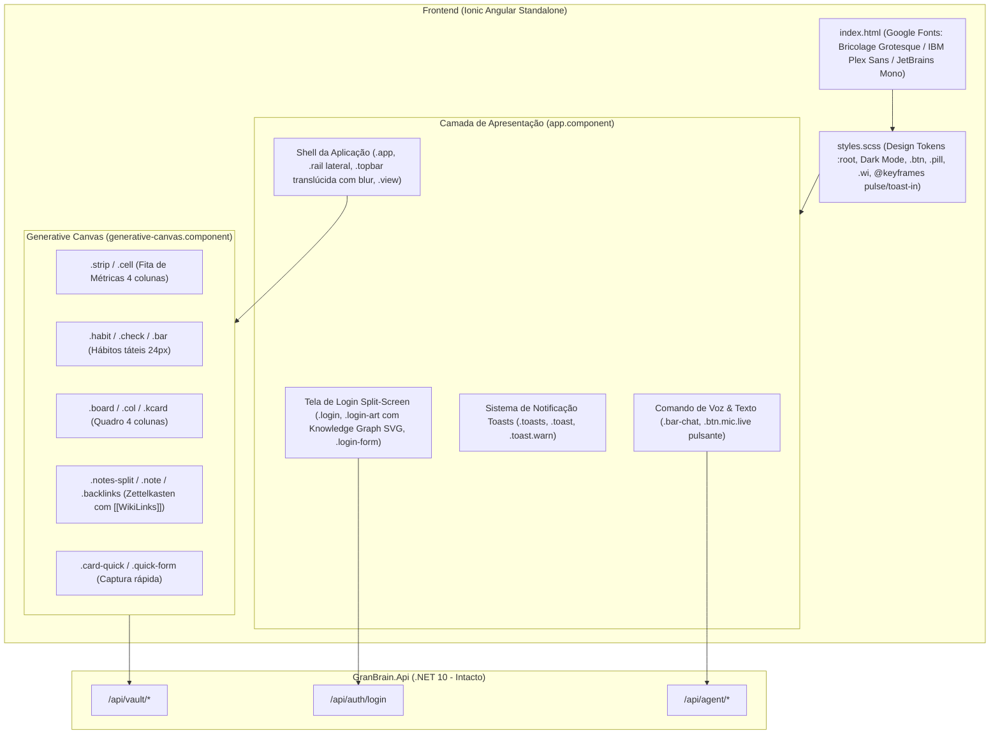

# WI 0001b — Redesign e Harmonização do Frontend com Claude Design Artifact

## 1. Fonte canônica
- **Especificação canônica:** [backlog/tasks/0001b-redesign-frontend-granbrain.md](file:///C:/Users/igor.grandin/Documents/Projects/GranBrain/backlog/tasks/0001b-redesign-frontend-granbrain.md)
- **Artefato Canônico do Claude Design:** [frontend/_imports/claude-design/granbrain-redesign/2026-10-30/original/granbrain-redesign.html](file:///C:/Users/igor.grandin/Documents/Projects/GranBrain/frontend/_imports/claude-design/granbrain-redesign/2026-10-30/original/granbrain-redesign.html) e referência externa [https://claude.ai/artifact/1puqYFtE3guy1J6CyvDXHy](https://claude.ai/artifact/1puqYFtE3guy1J6CyvDXHy).
- **ADR aplicável:** [docs/adr/0001-granbrain-architecture.md](file:///C:/Users/igor.grandin/Documents/Projects/GranBrain/docs/adr/0001-granbrain-architecture.md) e [CLAUDE.md](file:///C:/Users/igor.grandin/Documents/Projects/GranBrain/CLAUDE.md).
- **Precedência:** Em caso de divergência, a seção `Decisões do dev` em `backlog/tasks/0001b-redesign-frontend-granbrain.md` vence qualquer outro documento.

## 2. Decisões (não reabrir)
- **D1 (`backlog/tasks/0001b-redesign-frontend-granbrain.md`):** Criação da task intermediária 0001b antes da 0002 para harmonização estética completa com o Claude Design Artifact.
- **D2 (`backlog/tasks/0001b-redesign-frontend-granbrain.md`):** Versionamento do arquivo fonte `granbrain-redesign.html` em `frontend/_imports/claude-design/` para uso de `/spec-frontend`.
- **D3 (`backlog/tasks/0001b-redesign-frontend-granbrain.md`):** Preservação total da API .NET 10 do MVP 0001; refatoração restrita à camada de apresentação Angular.
- **D4 (`backlog/tasks/0001b-redesign-frontend-granbrain.md`):** Adoção integral dos design tokens e classes de `granbrain-redesign.html` como a referência de design system do GranBrain.

## 3. Arquitetura

### Catálogo de Códigos de Erro Declarados
| Código | HTTP Status | Produtor | Cenário |
|---|---|---|---|
| `invalid_credentials` | 401 | `AuthEndpoints.Login` | Credencial incorreta no formulário de login exibida no alerta `.err` |
| `rate_limit_exceeded` | 429 | `RateLimiterMiddleware` | Mais de 5 tentativas de login bloqueadas e exibidas no alerta `.err` |
| `vault_path_violation` | 400 / 403 | `VaultPathGuard.ResolveSafePath` | Tentativa de path traversal exibida em toast `.toast.warn` |
| `habit_not_found` | 404 | `ObsidianVaultService.ToggleHabitAsync` | Hábito não localizado na nota diária exibido em toast |
| `kanban_board_not_found` | 404 | `ObsidianVaultService.UpdateKanbanAsync` | Quadro kanban inexistente exibido em toast |

## Manifesto de execução
- **SHA-base:** `b91bc7660b758a6a89ca88821467c7bd7fa8899c` (o único commit entre o SHA-base e o `HEAD` da execução é o commit deste plano em `.cursor/plans/**`).
- **Invariantes:**
  - Nenhuma rota, endpoint, regra de segurança ou contrato do backend .NET 10 é alterado (`CLAUDE.md` §2 e Decisão D3).
  - Todas as variáveis CSS, fontes, raios, espaçamentos e paleta verde-petróleo derivam estritamente do artefato `frontend/_imports/claude-design/granbrain-redesign/2026-10-30/original/granbrain-redesign.html` (Decisão D4).
  - Nenhuma operação destrutiva no cofre do Obsidian (`daily/`, `zettelkasten/`, `assets/`).
  - Não fazer `git push` sem autorização explícita do dev.
- **Seletores/contratos novos:**
  - Tokens CSS em `frontend/src/styles.scss`: `--font-display`, `--font-body`, `--font-mono`, `--bg`, `--surface`, `--surface-2`, `--line`, `--line-strong`, `--fg`, `--fg-2`, `--fg-3`, `--accent`, `--accent-hover`, `--accent-fg`, `--accent-soft`, `--ok`, `--ok-soft`, `--warn`, `--warn-soft`, `--danger`, `--danger-soft`, `--info`, `--info-soft`, `--shadow`, `--radius-card`, `--radius-btn`, `--radius-pill`.
  - Classes do Shell: `.app`, `.rail`, `.brand`, `.nav-group`, `.nav-item`, `.nav-item.on`, `.wi`, `.topbar`, `.crumb`, `.user-chip`, `.view`.
  - Classes do Login: `.login`, `.login-art`, `.login-form`, `.graph`, `.pw`, `.pw-btn`, `.err`.
  - Classes dos Toasts: `.toasts`, `.toast`, `.toast.warn`.
  - Classes do Canvas: `.strip`, `.cell`, `.big`, `.habit`, `.habit.done`, `.check`, `.lbl-h`, `.bar`, `.board`, `.col`, `.kcard`, `.notes-split`, `.notes-tools`, `.note`, `.card-quick`, `.quick-form`.
  - Classes do Microfone: `.btn.mic.live` com animação de pulso `@keyframes pulse`.

## Matriz de cobertura

| AC | Comportamento / cenário observável | Resultado esperado | Fronteira de produção | Teste ou check (planejado) | Discriminante |
|---|---|---|---|---|---|
| AC1 | Importação das fontes Bricolage Grotesque, IBM Plex Sans e JetBrains Mono no `index.html` e declaração de tokens CSS verde-petróleo e utilitários em `styles.scss` (temas claro e escuro) | Fontes declaradas no build, variáveis `:root` e dark mode com paleta verde-petróleo (`--accent: #0c7766` no claro e `#51d0b3` no escuro `[data-theme="dark"]`) disponíveis globalmente | `frontend/src/index.html` e `frontend/src/styles.scss` | `frontend/src/app/app.spec.ts` (`GranBrain Design Tokens & Typography`) | Falha se `styles.scss` não contiver `--font-display`, `--font-body`, `--font-mono`, `--accent` ou se o tema escuro `[data-theme="dark"]` não resolver `--accent: #51d0b3` e `--bg: #0b1210` |
| AC2 | Tela de login deslogada apresenta layout split-screen com container centralizado de 20px de raio, painel esquerdo `.login-art` com Knowledge Graph SVG e painel direito `.login-form` com inputs, botão primário e alerta `.err` para erro 401 | Renderização dos seletores `.login`, `.login-art`, `.login-form`, `.graph`, `.err` e disparo correto de autenticação JWT contra `/api/auth/login` | `frontend/src/app/app.component.html`, `frontend/src/app/app.component.scss` e `frontend/src/app/app.component.ts` | `frontend/src/app/app.spec.ts` (`AppComponent Login Split-Screen & Error Handling`) | Falha se a tela de login não renderizar `.login-art` com SVG `.graph` ou se credencial inválida não exibir a caixa de erro estilizada com classe `.err` |
| AC3 | Usuário autenticado visualiza o layout com trilho lateral `.rail` (252px), logo brand, itens de menu com badges pontilhadas `.wi`, rodapé com status do cofre e barra superior `.topbar` com `backdrop-filter: blur(10px)` e breadcrumb | Presença dos seletores `.app`, `.rail`, `.brand`, `.nav-item`, `.wi`, `.topbar`, `.crumb` e `.user-chip` com valores de estilo canônicos | `frontend/src/app/app.component.html`, `frontend/src/app/app.component.scss` e `frontend/src/app/app.component.ts` | `frontend/src/app/app.spec.ts` (`AppComponent Shell Rail & Topbar`) | Falha se o shell não contiver o rail lateral `.rail`, se itens de menu não exibirem `.wi` com estilo pontilhado ou se a topbar não possuir classe `.topbar` |
| AC4 | Fita de métricas executivas renderiza 4 colunas no formato `.strip`/`.cell`/`.big` e lista de hábitos exibe checkbox tátil de 24px (`.habit .check`) com preenchimento verde-petróleo ao marcar, texto riscado e barra `.bar i` | Estrutura de grid `.strip` com números `.big` em display font tabular e hábitos concluídos com classe `.done`, checkbox preenchida e evento de toggle disparado | `frontend/src/app/components/generative-canvas/generative-canvas.component.html`, `frontend/src/app/components/generative-canvas/generative-canvas.component.scss` e `frontend/src/app/components/generative-canvas/generative-canvas.component.ts` | `frontend/src/app/app.spec.ts` (`GenerativeCanvasComponent KPI Strip & Habit Checklist`) | Falha se `kpi-grid` não utilizar a classe `.strip`/`.cell`, se o checkbox de hábito não possuir classe `.check` ou se o toggle não alterar estado visual |
| AC5 | Quadro Kanban exibe as 4 colunas em layout de cards `.board`/`.col`/`.kcard` e Zettelkasten é renderizado em split-screen `.notes-split` com lista lateral, visualizador de nota e realce pontilhado de `[[WikiLinks]]` | Estrutura do Kanban renderiza `.col` e `.kcard`; visualizador de nota renderiza `.notes-split`, `.notes-tools`, `.note` e links `[[...]]` com estilo específico | `frontend/src/app/components/generative-canvas/generative-canvas.component.html`, `frontend/src/app/components/generative-canvas/generative-canvas.component.scss` e `frontend/src/app/components/generative-canvas/generative-canvas.component.ts` | `frontend/src/app/app.spec.ts` (`GenerativeCanvasComponent Kanban & Zettelkasten Split`) | Falha se o Kanban não renderizar a estrutura `.board`/`.col`/`.kcard`, se as notas não utilizarem `.notes-split` ou se `[[WikiLinks]]` não receberem realce |
| AC6 | Microfone em escuta ativa recebe classe `.btn.mic.live` com animação `@keyframes pulse` e mensagens de sucesso/erro aparecem em toasts flutuantes com classe `.toasts`/`.toast` no topo da tela | Microfone exibe classe `.live` quando `voice.isListening === true` e notificações adicionadas a `toasts` renderizam com animação de descida | `frontend/src/app/app.component.html`, `frontend/src/app/app.component.scss` e `frontend/src/app/app.component.ts` | `frontend/src/app/app.spec.ts` (`AppComponent Live Voice Pulse & Toast Notifications`) | Falha se o botão de microfone não receber `.live` durante reconhecimento ou se mensagens de feedback não criarem nós com classe `.toast` |

### Dimensões de risco
- **Fronteira e falha:** Aplicável. O frontend deve tratar erros de rede da API e credenciais inválidas (HTTP 401/429) exibindo alertas amigáveis na classe `.err` ou toasts flutuantes sem quebrar o layout.
- **Concorrência e transação:** Não aplicável. A aplicação é single-user e não executa transações de banco locais no cliente.
- **Autorização e isolamento de tenant:** Aplicável. O frontend chaveia dinamicamente entre estado autenticado (Shell com `.rail`) e não-autenticado (Tela de login `.login`), garantindo que tokens expirados ou ausentes mantenham o usuário na tela de login.
- **Acessibilidade e contraste:** Aplicável. Os tokens garantem contraste WCAG AA entre texto (`--fg`, `--fg-2`) e superfícies (`--bg`, `--surface`, `--surface-2`) em ambos os temas (light e dark).

## Fatias de implementação

### Fatia 1: Google Fonts, Design Tokens CSS e Sistema Base de Estilos
- **Dependências:** Nenhuma.
- **Dono de escrita:** Frontend / CSS.
- **Write-set:**
  - `frontend/src/index.html`
  - `frontend/src/styles.scss`
  - `frontend/src/app/app.spec.ts`
- **Contratos compartilhados:** Tokens CSS `:root` e dark mode consumidos por todos os componentes Angular.
- **IDs de AC:** AC1.
- **Checks focados:** `npm --prefix frontend test -- --watch=false`
- **Discriminante da fatia:** `app.spec.ts` verifica a resolução computada das variáveis CSS `--font-display`, `--font-body`, `--font-mono`, `--accent`, `--surface` e a alternância para Dark Mode (`data-theme="dark"` resolvendo `--accent: #51d0b3` e `--bg: #0b1210`). Falha se `styles.scss` não possuir os tokens canônicos em ambos os modos de cor.
- **Paralelismo:** Não (fatia base fundacional).

**Reuso:**
| Artefato do plano | Busca (termos · onde) | Candidato encontrado | Decisão |
|---|---|---|---|
| Google Fonts link | `fonts.googleapis.com` · `frontend/src/index.html` | nenhum link de fontes externas | criar novo: inserir tags de preconnect e link para Bricolage Grotesque, IBM Plex Sans e JetBrains Mono |
| Tokens CSS `:root` | `--accent`, `--surface`, `--bg` · `frontend/src/styles.scss` | variáveis preliminares simples do Ionic | estender: substituir bloco `:root` e dark mode pela especificação completa de `granbrain-redesign.html` |
| Classes utilitárias `.btn`, `.pill`, `.wi` | `.btn`, `.pill`, `.wi` · `frontend/src/styles.scss` | nenhuma classe utilitária | criar novo: adicionar definições canônicas de botões, pills, badges e animações `@keyframes` |

---

### Fatia 2: Tela de Login Split-Screen e Sistema de Toasts
- **Dependências:** Fatia 1.
- **Dono de escrita:** Frontend / Auth View.
- **Write-set:**
  - `frontend/src/app/app.component.html`
  - `frontend/src/app/app.component.scss`
  - `frontend/src/app/app.component.ts`
  - `frontend/src/app/app.spec.ts`
- **Contratos compartilhados:** Desacoplamento do template/styles inline do `AppComponent` para arquivos separados; serviço de autenticação `GranBrainApiService.login` preservado.
- **IDs de AC:** AC2, AC6 (Toasts).
- **Checks focados:** `npm --prefix frontend test -- --watch=false`
- **Discriminante da fatia:** `app.spec.ts` verifica a renderização de `.login-art` com o SVG `.graph`, o formulário `.login-form` com `.pw` e botão de alternar visualização de senha, e a exibição de alerta com classe `.err` após falha de autenticação. Falha se a tela de login for renderizada sem o split-screen artístico ou sem o alerta estilizado `.err`.
- **Paralelismo:** Não (depende dos tokens da Fatia 1).

**Reuso:**
| Artefato do plano | Busca (termos · onde) | Candidato encontrado | Decisão |
|---|---|---|---|
| `app.component.html` | `app.component.html` · `frontend/src/app` | não existia (template inline em `app.component.ts`) | criar novo: extrair template limpo e estruturado para arquivo próprio |
| `app.component.scss` | `app.component.scss` · `frontend/src/app` | não existia (styles inline em `app.component.ts`) | criar novo: extrair estilos de shell, login e toasts para arquivo próprio |
| Knowledge Graph SVG | `<svg class="graph"` · `frontend/_imports/claude-design/granbrain-redesign/2026-10-30/original/granbrain-redesign.html` | SVG completo com nós de Fleeting, IA, Hábitos, Kanban, Notas, Agenda e Inbox | reusar: integrar SVG idêntico ao painel `.login-art` |
| Gerenciador de Toasts | `toasts`, `showToast` · `frontend/src/app/app.component.ts` | não existia | criar novo: adicionar array reativo `toasts` e método `showToast(msg, type)` no `AppComponent` |

---

### Fatia 3: Shell da Aplicação com Rail Lateral, Topbar Blur e Voice Assistant Pulsante
- **Dependências:** Fatia 1, Fatia 2.
- **Dono de escrita:** Frontend / Shell View.
- **Write-set:**
  - `frontend/src/app/app.component.html`
  - `frontend/src/app/app.component.scss`
  - `frontend/src/app/app.component.ts`
  - `frontend/src/app/app.spec.ts`
- **Contratos compartilhados:** `VoiceService` e `selectedProvider`/`activeModel` inalterados.
- **IDs de AC:** AC3, AC6 (Voz).
- **Checks focados:** `npm --prefix frontend test -- --watch=false`
- **Discriminante da fatia:** `app.spec.ts` verifica a renderização do `.rail` lateral com brand SVG, seções de navegação contendo badges pontilhadas `.wi`, a barra superior `.topbar` com breadcrumb e chip do usuário, e a adição da classe `.live` no botão de microfone `.btn.mic` quando a escuta estiver ativa. Falha se o shell não contiver o rail lateral fixo ou se a animação do microfone não responder ao estado de voz.
- **Paralelismo:** Não (modifica `app.component.*`).

**Reuso:**
| Artefato do plano | Busca (termos · onde) | Candidato encontrado | Decisão |
|---|---|---|---|
| Layout `.rail` e `.topbar` | `.rail`, `.topbar` · `frontend/_imports/claude-design/granbrain-redesign/2026-10-30/original/granbrain-redesign.html` | Estrutura HTML/CSS canônica | reusar: aplicar as classes e grid 252px/1fr do mockup no shell |
| SVG da Marca GranBrain | `
` · `granbrain-redesign.html` | Ícone SVG de cérebro geométrico 32x32px | reusar: adotar o SVG oficial do mockup no `.brand` do rail lateral |
| Integração `VoiceService` | `voice.isListening` · `frontend/src/app/app.component.ts` | `VoiceService` injetado | reusar: conectar o binding `[class.live]="voice.isListening"` ao botão `.btn.mic` |

---

### Fatia 4: Generative UI Canvas Redesenhado
- **Dependências:** Fatia 1, Fatia 2, Fatia 3.
- **Dono de escrita:** Frontend / Generative UI.
- **Write-set:**
  - `frontend/src/app/components/generative-canvas/generative-canvas.component.html`
  - `frontend/src/app/components/generative-canvas/generative-canvas.component.scss`
  - `frontend/src/app/components/generative-canvas/generative-canvas.component.ts`
  - `frontend/src/app/app.spec.ts`
- **Contratos compartilhados:** Modelo `GenerativeUiBlock` e eventos de saída (`habitToggled`, `kanbanTaskMoved`, `dynamicFormSubmitted`) preservados. Preservação de atributos de dados de teste (`[data-block-type]`, `[data-habit-toggle]`, `[data-kanban-move]`, `[data-form-submit]`) convivendo com as novas classes visuais.
- **IDs de AC:** AC4, AC5.
- **Checks focados:** `npm --prefix frontend test -- --watch=false`
- **Discriminante da fatia:** `app.spec.ts` verifica a renderização da fita `.strip` com `.cell` e `.big`, da lista `.habit` com checkbox `.check` de 24px e barra `.bar i`, do kanban colunado `.board` com `.col` e `.kcard`, do Zettelkasten split `.notes-split` com realce pontilhado de `[[WikiLinks]]`, do formulário de captura rápida `.card-quick`/`.quick-form`, e a manutenção do despacho correto de eventos. Falha se qualquer um dos 5 blocos dinâmicos deixar de renderizar a estrutura estilizada do mockup ou quebrar os seletores de interação.
- **Paralelismo:** Não (execução sequencial garantindo integridade de escrita em `app.spec.ts`).

**Reuso:**
| Artefato do plano | Busca (termos · onde) | Candidato encontrado | Decisão |
|---|---|---|---|
| `generative-canvas.component.html` | `generative-canvas.component.html` · `frontend/src/app/components` | não existia (template inline em `generative-canvas.component.ts`) | criar novo: extrair template dos 5 blocos para arquivo HTML limpo |
| `generative-canvas.component.scss` | `generative-canvas.component.scss` · `frontend/src/app/components` | não existia (styles inline em `generative-canvas.component.ts`) | criar novo: extrair estilos de `.strip`, `.habit`, `.board`, `.notes-split`, `.quick-form` para arquivo próprio |
| Parser de `[[WikiLinks]]` | `\[\[(.*?)\]\]` · `frontend/src/app` | Regex preliminar no template | estender: formatar links com classe `.wiki-link` estilizada com borda inferior tracejada em `var(--accent)` |

---

### Fatia 5: Gate Final
- **Dependências:** Fatia 1, Fatia 2, Fatia 3, Fatia 4.
- **Dono de escrita:** Automação / Gate.
- **Write-set:** Nenhum arquivo de produto (somente árvore limpa e conferência de logs).
- **Contratos compartilhados:** Todos.
- **IDs de AC:** Todos (AC1 a AC6).
- **Checks focados:**
  - `npm --prefix frontend test -- --watch=false`
  - `npm --prefix frontend run build`
  - `dotnet test backend/GranBrain.sln`
- **Discriminante da fatia:** O gate final garante que nenhuma regressão ocorreu no backend (.NET 10), que a suíte completa de testes do frontend passa com 100% de sucesso, que o build de produção do Angular compila sem erros de template/SCSS e que a árvore do git está limpa.
- **Paralelismo:** Não.

**Reuso:**
A fatia não cria artefato novo.

---

## Gate por gatilho

- **Gatilho disparado:** Mudança no frontend (`frontend/src/**`) dispara `npm run test` e `npm run build` no frontend.
- **Gatilho disparado:** Mudança em scripts/arquitetura dispara suíte de testes de regressão do backend (`dotnet test backend/GranBrain.sln`).
- **Gatilhos NÃO disparados:**
  - `E2E Cypress / Playwright`: não configurados no projeto nesta fase (MVP com testes de componentes Jasmine/Karma).
  - `Docker Build Gate`: não disparado pois não foram alterados Dockerfiles ou infraestrutura de deploy (escopo da task 0004).

---

# Verificações feitas antes de entregar este plano

| Passe | O que verifiquei | Onde |
|---|---|---|
| **Manifesto** | Bloco antes das fatias no formato de `execute.md`; SHA-base = `b91bc7660b758a6a89ca88821467c7bd7fa8899c` conferido via `git rev-parse HEAD` imediatamente antes da criação deste plano | `b91bc7660b758a6a89ca88821467c7bd7fa8899c` |
| Encanamento | `styles.scss`, `index.html`, `app.component.ts`, `generative-canvas.component.ts` existem no frontend; backend inalterado | `frontend/src/` |
| **Ambiente** | Node v20/npm e .NET 10 SDK instalados e operacionais na máquina Windows | `npm test` e `dotnet test` executados com sucesso no pre-flight |
| Testes | Para cada teste planejado: classes e seletores DOM alvo nomeados (`.strip`, `.habit .check`, `.board .col`, `.notes-split`, `.login-art`, `.rail`, `.wi`, `.btn.mic.live`); asserções negativas provocadas e discriminantes definidos | `frontend/src/app/app.spec.ts` |
| **Projeto do teste** | Projeto de testes de frontend `frontend/src/app/app.spec.ts` existente na branch com Karma/Jasmine; projeto de testes de backend `backend/tests/GranBrain.UnitTests` existente | `frontend/src/app/app.spec.ts` e `backend/tests/GranBrain.UnitTests` |
| Gate | Gatilhos de build e teste do frontend e testes unitários do backend disparados; e2e e docker não disparados por ausência de alteração em infraestrutura | `110-cursor-workflow.mdc` |
| Rules | Consultadas diretrizes de arquitetura do GranBrain em `CLAUDE.md` e regras de integridade do cofre | `CLAUDE.md` |
| **Cápsula** | Todos os caminhos de arquivos expressos de forma completa a partir da raiz do repositório (sem reticências ou abreviações); nenhum `parent_plan:` | Conferido |
| **Cobertura** | Grafo de fatias (dono, write-set, dependências, paralelismo); matriz AC1..AC6 completa com discriminantes reais; desafio independente de cobertura executado | Matriz e seções de fatias |
| **Reuso** | Bloco Reuso incluído em todas as fatias; reuso integral do HTML, SVG e CSS canônico de `granbrain-redesign.html` documentado linha a linha | Seção Reuso das Fatias 1 a 5 |
| Contradição | Passada final realizada: nenhuma contradição entre preservação de regras funcionais e redesenho visual | Conferido |
| **Erros declarados** | Todos os códigos de erro do catálogo (`invalid_credentials`, `rate_limit_exceeded`, `vault_path_violation`, `habit_not_found`, `kanban_board_not_found`) possuem produtores e tratamento no frontend | Catálogo de erros |
