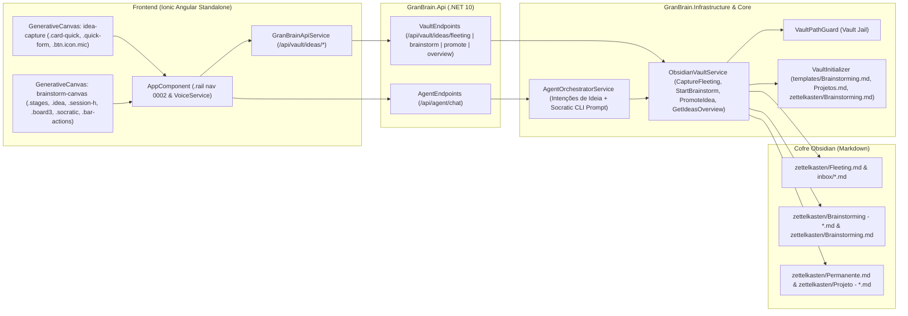

# WI 0002 — Motor de Brainstorming, Captura Rápida (Fleeting) e Gestão de Ideias

## 1. Fonte canônica
- **Especificação canônica:** [backlog/tasks/0002-brainstorming-fleeting-vault-engine.md](file:///C:/Users/igor.grandin/Documents/Projects/GranBrain/backlog/tasks/0002-brainstorming-fleeting-vault-engine.md)
- **Artefato Canônico do Claude Design:** [frontend/_imports/claude-design/granbrain-redesign/2026-10-30/original/granbrain-redesign.html](file:///C:/Users/igor.grandin/Documents/Projects/GranBrain/frontend/_imports/claude-design/granbrain-redesign/2026-10-30/original/granbrain-redesign.html) (linhas `298`, `332-333`, `341-358`, `751-766`, `827-832`, `1135-1204`).
- **ADR aplicável:** [docs/adr/0001-granbrain-architecture.md](file:///C:/Users/igor.grandin/Documents/Projects/GranBrain/docs/adr/0001-granbrain-architecture.md) e [CLAUDE.md](file:///C:/Users/igor.grandin/Documents/Projects/GranBrain/CLAUDE.md).
- **Precedência:** Em caso de divergência entre documentos, a seção `Decisões do dev` em `backlog/tasks/0002-brainstorming-fleeting-vault-engine.md` vence o ADR e este plano (`CLAUDE.md` §3). Onde a task expande o catálogo inicial de 5 blocos do `ADR-0001` §3 para incluir `idea-capture` e `brainstorm-canvas`, a especificação da task `0002` vence.

## 2. Decisões (não reabrir)
- **D1 (`backlog/tasks/0002-brainstorming-fleeting-vault-engine.md`):** Esteira em 3 fases (`Fleeting` ➔ `Brainstorming` ➔ `Permanente` / `Projeto` / `Descartada`) com 4 estados canônicos (`fleeting`, `brainstorm`, `promovida`, `descartada`) operados via `/api/vault/ideas/fleeting`, `/api/vault/ideas/brainstorm`, `/api/vault/ideas/promote` e `/api/vault/ideas/overview`.
- **D2 (`backlog/tasks/0002-brainstorming-fleeting-vault-engine.md`):** Persistência sempre direta no Markdown do cofre sob `VaultPathGuard` (`Vault Jail`), sanitizando delimitadores `---` duplicados no frontmatter de `zettelkasten/Fleeting.md` e `zettelkasten/Permanente.md` sem jamais apagar ou truncar anotações preexistentes do usuário.
- **D3 (`backlog/tasks/0002-brainstorming-fleeting-vault-engine.md`):** `VaultInitializer.EnsureInitializedAsync` garante de forma não-destrutiva a existência de `templates/Brainstorming.md`, `templates/Projetos.md`, `zettelkasten/Fleeting.md`, `zettelkasten/Permanente.md` e da central `zettelkasten/Brainstorming.md` com queries nativas `dataview`.
- **D4 (`backlog/tasks/0002-brainstorming-fleeting-vault-engine.md`):** Fidelidade visual integral ao recorte de `granbrain-redesign.html` via `/spec-frontend`, adotando as classes `.idea`, `.idea-main`, `.idea-side`, `.acts`, `.stages`, `.session-h`, `.board3`, `.hyp`, `.socratic`, `.socratic .q`, `.bar-actions`, `.hint` e `.note-line` sobre os tokens `:root` existentes.

## 3. Arquitetura

### Catálogo de Códigos de Erro Declarados
| Código | HTTP Status | Produtor | Cenário |
|---|---|---|---|
| `vault_path_violation` | 400 | `VaultPathGuard.ResolveSafePath` | Tentativa de path traversal (`..`, caminho externo) em qualquer operação de ideia |
| `idea_text_required` | 400 | `ObsidianVaultService.CaptureFleetingIdeaAsync` / `StartBrainstormSessionAsync` | Texto da ideia vazio ou apenas espaços ao capturar ou iniciar brainstorm sem `ideaId` |
| `invalid_promotion_target` | 400 | `ObsidianVaultService.PromoteIdeaAsync` | Destino de promoção diferente de `permanente`, `projeto` ou `descartada` |
| `idea_not_found` | 404 | `ObsidianVaultService.StartBrainstormSessionAsync` / `PromoteIdeaAsync` | `ideaId` informado não localizado em `Fleeting.md`, `inbox/` ou notas de `Brainstorming` |

## Manifesto de execução
- **SHA-base:** `27e4baacb1554d70a6232a4a81a67e28a87993e5` (o único commit entre o SHA-base e o `HEAD` da execução é o commit deste plano em `.cursor/plans/**` e da spec em `backlog/tasks/**`).
- **Invariantes:**
  - Nenhuma nota existente do usuário em `G:\Meu Drive\Softwares\Obsidian\Igor Grandin` (`daily/`, `zettelkasten/`, `assets/`, `templates/`) pode ser apagada ou truncada (`CLAUDE.md` §2).
  - Todo acesso ao sistema de arquivos passa obrigatoriamente por `VaultPathGuard.ResolveSafePath` (`Vault Jail`).
  - Todos os testes automatizados de backend executam sobre diretórios temporários isolados (`Path.GetTempPath()`), jamais tocando o cofre de produção.
  - Nenhum teste existente em `backend/tests/GranBrain.UnitTests/**` ou `frontend/src/app/app.spec.ts` pode ser removido ou ter seu nome alterado.
  - Não executar `git push` nem abrir PR sem autorização explícita do dev; relatórios de execução ficam fora do repo.
- **Seletores/contratos novos:**
  - Exceção: `VaultValidationException` em `backend/src/GranBrain.Core/Security/VaultPathGuard.cs` (mapeada para HTTP 400 em `backend/src/GranBrain.Api/Program.cs`).
  - Modelos C# em `backend/src/GranBrain.Core/Models/VaultModels.cs`: `IdeaItemDto`, `BrainstormHypothesisDto`, `BrainstormRiskDto`, `BrainstormSessionDto`, `IdeasOverviewDto`, `FleetingIdeaCaptureRequest`, `BrainstormStartRequest`, `IdeaPromoteRequest`, `IdeaPromotionResultDto`.
  - Constantes em `backend/src/GranBrain.Core/Models/GenerativeUiModels.cs`: `GenerativeUiBlockTypes.IdeaCapture = "idea-capture"`, `GenerativeUiBlockTypes.BrainstormCanvas = "brainstorm-canvas"`, e propriedade opcional `IdeasOverviewDto? IdeasOverview = null` em `GenerativeUiBlock`.
  - Métodos em `IVaultService` / `ObsidianVaultService`: `CaptureFleetingIdeaAsync`, `StartBrainstormSessionAsync`, `PromoteIdeaAsync`, `GetIdeasOverviewAsync`.
  - Rotas HTTP em `VaultEndpoints`: `POST /api/vault/ideas/fleeting`, `POST /api/vault/ideas/brainstorm`, `POST /api/vault/ideas/promote`, `GET /api/vault/ideas/overview`.
  - Seletores CSS em `frontend/src/styles.scss`: `.hint`, `.note-line`, `.idea`, `.idea-main`, `.idea-side`, `.acts`, `.stages`, `.session-h`, `.board3`, `.hyp`, `.socratic`, `.socratic .q`, `.bar-actions`.
  - Eventos `@Output()` em `GenerativeCanvasComponent`: `ideaCaptured`, `ideaVoiceTriggered`, `ideaBrainstormRequested`, `ideaPromoted`.

## Matriz de cobertura

| AC | Comportamento / cenário observável | Resultado esperado | Fronteira de produção | Teste ou check (planejado) | Discriminante |
|---|---|---|---|---|---|
| AC1 | `POST /api/vault/ideas/fleeting` insere ideia com timestamp, ID e links sob `#### Ideias Rápidas` em `zettelkasten/Fleeting.md` (ou cria nota estruturada em `inbox/` quando `target="inbox"`), sanitizando `---` duplicado no frontmatter sem perder notas existentes (e criando a subseção em cold-start se ausente); rejeita texto vazio com HTTP 400 (`idea_text_required`) e path traversal com HTTP 400 (`vault_path_violation`) | Entrada gravada em `zettelkasten/Fleeting.md` ou `inbox/*.md` com YAML único válido, notas anteriores intactas, HTTP 200 com `IdeaItemDto` (`status: "fleeting"`), e HTTP 400 para `idea_text_required` / `vault_path_violation` | `backend/src/GranBrain.Infrastructure/Vault/ObsidianVaultService.cs` (`CaptureFleetingIdeaAsync`) e `backend/src/GranBrain.Api/Endpoints/VaultEndpoints.cs` | `ObsidianVaultServiceTests.IdeasPipeline_CapturesFleeting_StartsBrainstorm_AndPromotesPreservingNotesAndBacklinks` e `ApiSecurityAndAgentTests.IdeasEndpoints_ExecuteFullPipeline_AndReturnExpectedErrorCodes` | Falha se `CaptureFleetingIdeaAsync` apagar linhas existentes de `Fleeting.md`, mantiver `---\n---` duplicado, não criar nota com YAML único em `inbox/` quando `target="inbox"`, ou se texto vazio não retornar HTTP 400 (`idea_text_required`) |
| AC2 | `VaultInitializer.EnsureInitializedAsync` garante de forma não-destrutiva `templates/Brainstorming.md`, `templates/Projetos.md`, `zettelkasten/Fleeting.md`, `zettelkasten/Permanente.md` e a central `zettelkasten/Brainstorming.md` (com queries `dataview`); `POST /api/vault/ideas/brainstorm` cria `zettelkasten/Brainstorming - <SafeTitle>.md` com YAML único (`type: brainstorming`, `status: em_analise`, `origem: fleeting`), Problema, Hipóteses (com confiança `alta`/`média`/`baixa`), Riscos levantados (com severidade `alto`/`médio`/`baixo`) e Pergunta Socrática, atualiza a ideia na origem para `brainstorm`, e retorna HTTP 404 (`idea_not_found`) se `ideaId` não existir | Central `zettelkasten/Brainstorming.md` e templates existem; nota `Brainstorming - <SafeTitle>.md` criada com seções completas e backlinks `[[Fleeting]]` / `[[inbox]]`; `BrainstormSessionDto` retornado com `Problem`, `Hypotheses`, `Risks` e `SocraticQuestion`; HTTP 404 (`idea_not_found`) para ID inexistente | `backend/src/GranBrain.Infrastructure/Vault/VaultInitializer.cs`, `backend/src/GranBrain.Infrastructure/Vault/ObsidianVaultService.cs` (`StartBrainstormSessionAsync`) e `backend/src/GranBrain.Api/Endpoints/VaultEndpoints.cs` | `VaultInitializerTests.EnsureInitializedAsync_CreatesGovernanceFiles_FixesTemplates_AndPreservesExistingNotes`, `ObsidianVaultServiceTests.IdeasPipeline_CapturesFleeting_StartsBrainstorm_AndPromotesPreservingNotesAndBacklinks` e `ApiSecurityAndAgentTests.IdeasEndpoints_ExecuteFullPipeline_AndReturnExpectedErrorCodes` | Falha se `zettelkasten/Brainstorming.md` não contiver bloco `dataview`, se a nota de brainstorm não tiver `type: brainstorming` e as seções de problema, hipóteses (com confiança), riscos (com severidade) e pergunta socrática, se a ideia não mudar para `brainstorm`, ou se `ideaId` inexistente não retornar 404 (`idea_not_found`) |
| AC3 | `POST /api/vault/ideas/promote` valida `target` antes de mutar qualquer arquivo (HTTP 400 `invalid_promotion_target` sem mutação parcial; HTTP 404 `idea_not_found` para ID inexistente), atualiza a origem para `promovida` ou `descartada` e: (a) em `permanente`, adiciona `[[<SafeTitle>]]` sob `#### Ideias Maduras` em `zettelkasten/Permanente.md` sem duplicar em retry nem apagar notas existentes e cria `zettelkasten/<SafeTitle>.md` com backlinks; (b) em `projeto`, cria `zettelkasten/Projeto - <SafeTitle>.md` via `templates/Projetos.md` (`type: projeto`, `status: ativo`) com backlinks; (c) em `descartada`, marca descarte sem criar nota em `Permanente` ou `Projeto`. `GET /api/vault/ideas/overview` consolida todas as ideias, contagens por estágio e sessão ativa | Arquivos de origem e destino atualizados com backlinks intactos nos 3 destinos (`permanente`, `projeto`, `descartada`), idempotência em `Permanente.md`, e `IdeasOverviewDto` refletindo contagens exatas (`FleetingCount`, `BrainstormCount`, `PromotedCount`, `DiscardedCount`) | `backend/src/GranBrain.Infrastructure/Vault/ObsidianVaultService.cs` (`PromoteIdeaAsync`, `GetIdeasOverviewAsync`) e `backend/src/GranBrain.Api/Endpoints/VaultEndpoints.cs` | `ObsidianVaultServiceTests.IdeasPipeline_CapturesFleeting_StartsBrainstorm_AndPromotesPreservingNotesAndBacklinks` e `ApiSecurityAndAgentTests.IdeasEndpoints_ExecuteFullPipeline_AndReturnExpectedErrorCodes` | Falha se `target` inválido mutar a origem antes de lançar 400 (`invalid_promotion_target`), se qualquer um dos 3 destinos (`permanente`, `projeto`, `descartada`) não produzir o estado/arquivo esperado, se retry duplicar link em `Permanente.md`, ou se `GET /api/vault/ideas/overview` divergir das contagens reais |
| AC4 | `styles.scss` declara `.idea`, `.idea-main`, `.idea-side`, `.acts`, `.stages`, `.session-h`, `.board3`, `.hyp`, `.socratic`, `.socratic .q`, `.bar-actions`, `.hint`, `.note-line`; `<app-generative-canvas>` renderiza `idea-capture` (com `.input.big-in` e `.btn.icon.mic`) e `brainstorm-canvas` (com `.stages` de 4 tons, `.idea` ocultando `.acts` em promovida/descartada, `.session-h`, `.board3` com Problema/Hipóteses/Riscos, `.socratic .q` e `.bar-actions`); `AppComponent` navega pelo item `.rail` `0002`, integra com `GranBrainApiService` e `VoiceService` e exibe `.toast`; `AgentOrchestratorService` processa `"ideia: ..."` via `CaptureFleetingIdeaAsync` e retorna `idea-capture` e `brainstorm-canvas` | Estilos computados (`getComputedStyle`) batem com o mockup; eventos de captura por texto/voz, brainstorm e promoção/descarte disparam as rotas HTTP e exibem `.toast`; `/api/agent/chat` para prompts de ideias retorna os 2 novos blocos populados | `frontend/src/styles.scss`, `frontend/src/app/components/generative-canvas/generative-canvas.component.*`, `frontend/src/app/app.component.*` e `backend/src/GranBrain.Infrastructure/Agents/AgentOrchestratorService.cs` | `frontend/src/app/app.spec.ts` (`GenerativeCanvasComponent renders idea-capture and brainstorm-canvas blocks and dispatches idea actions` e `AppComponent navigates to Ideas 0002 view and executes idea capture, brainstorm and promotion flows`) e `ApiSecurityAndAgentTests.IdeasEndpoints_ExecuteFullPipeline_AndReturnExpectedErrorCodes` | Falha se `getComputedStyle` de `.board3` não for `grid` ou `.socratic .q` não tiver `21px` / `Bricolage Grotesque`, se `.btn.icon.mic` não acionar voz, se `.acts` aparecer para ideia promovida/descartada, se o clique no menu `0002` ou ações não chamarem `/api/vault/ideas/*` com `.toast`, ou se `/api/agent/chat` não retornar `idea-capture` e `brainstorm-canvas` |

### Dimensões de risco
- **Fronteira e falha (Aplicável):**
  - Títulos ou textos de ideias com caracteres inválidos de arquivo (`:`, `?`, `*`, `"`, `<`, `>`, `|`) são sanitizados por `SanitizeFileName` ao gerar `Brainstorming - <SafeTitle>.md`, `Projeto - <SafeTitle>.md` e `<SafeTitle>.md`, enquanto tentativas de traversal (`..`, caminhos absolutos) em `target` ou campos de caminho são bloqueadas por `VaultPathGuard.ResolveSafePath` com HTTP 400 (`vault_path_violation`).
  - `zettelkasten/Fleeting.md` e `zettelkasten/Permanente.md` em cold-start (arquivo ausente ou sem o cabeçalho `#### Ideias Rápidas` / `#### Ideias Maduras`) ou com delimitador `---` duplicado no frontmatter são tratados sem perda de linhas existentes.
  - `POST /api/vault/ideas/brainstorm` e `POST /api/vault/ideas/promote` com `ideaId` inexistente retornam HTTP 404 (`idea_not_found`).
- **Transação e atomicidade entre arquivos (Aplicável):**
  - `PromoteIdeaAsync` valida `target` (`permanente`, `projeto`, `descartada`) e a existência da ideia de origem **antes** de realizar qualquer escrita em disco, garantindo zero mutação parcial em caso de erro 400 (`invalid_promotion_target`) ou 404 (`idea_not_found`).
- **Retry, recuperação e idempotência (Aplicável):**
  - Promover a mesma ideia mais de uma vez para `permanente` verifica se `[[<SafeTitle>]]` já consta em `zettelkasten/Permanente.md` antes de inserir, evitando duplicatas.
  - `VaultInitializer.EnsureInitializedAsync` só cria `templates/Brainstorming.md`, `templates/Projetos.md`, `zettelkasten/Brainstorming.md`, `Fleeting.md` e `Permanente.md` quando ausentes e sanitiza `---` duplicado de forma idempotente.
- **Autorização e isolamento de tenant (Aplicável):**
  - Todas as 4 rotas `/api/vault/ideas/*` são mapeadas dentro do grupo `/api/vault` que exige `.RequireAuthorization()` (JWT Bearer, retornando HTTP 401 para chamadas anônimas) e isoladas no `VaultRoot` via `VaultPathGuard`.
- **Concorrência (Excluída com justificativa):**
  - O GranBrain é um sistema local-first single-owner (`ADR-0001`), onde um único usuário opera o cofre local por vez.

## Fronteiras
- **Produtor → Consumidor 1 (`ObsidianVaultService` → `VaultEndpoints` / `AgentOrchestratorService` → `GranBrainApiService` → `GenerativeCanvasComponent`):** `GetIdeasOverviewAsync` e `StartBrainstormSessionAsync` produzem `IdeasOverviewDto` (`ideas`, `fleetingCount`, `brainstormCount`, `promotedCount`, `discardedCount`, `activeSession`) e `BrainstormSessionDto` (`idea`, `notePath`, `problem`, `hypotheses` com `text` + `confidence` em `alta|média|baixa`, `risks` com `text` + `severity` em `alto|médio|baixo`, `socraticQuestion`, `socraticAnswer`), serializados em camelCase no JSON HTTP e consumidos diretamente pelos blocos `idea-capture` e `brainstorm-canvas` (`block.ideasOverview`).
- **Produtor → Consumidor 2 (`ObsidianVaultService` → Obsidian Dataview em `zettelkasten/Brainstorming.md`):** `StartBrainstormSessionAsync` grava notas em `zettelkasten/` com frontmatter YAML contendo `type: brainstorming`, `status: em_analise` (ou `promovida`/`descartada`), `projeto` e `created`, e `PromoteIdeaAsync` grava projetos com `type: projeto`, `status: ativo` e `area`, exatamente os campos lidos pelas queries `dataview` de `zettelkasten/Brainstorming.md`.
- **Entrada externa (`POST /api/vault/ideas/*`):** Textos livres ditados por voz ou digitados pelo usuário e parâmetros `target` / `ideaId` passam por validação de domínio (`VaultValidationException`) e confinamento de caminho (`VaultPathGuard.ResolveSafePath`).

---

## 4. Fatias

### Fatia 1: Contratos de Ideias, Bootstrap de Templates/Central Dataview (`VaultInitializer`) e Motor de Ideias (`ObsidianVaultService`)
- **Pré-requisitos:** nenhum.
- **Dono de escrita:** sessão principal (`main`).
- **Pode rodar em paralelo:** não (define os contratos em `GranBrain.Core` e a implementação em `GranBrain.Infrastructure`).
- **Critérios de aceite entregues:** AC1, AC2, AC3 (camada Core & Infrastructure).
- **Contratos compartilhados produzidos:**
  - `VaultValidationException` em `backend/src/GranBrain.Core/Security/VaultPathGuard.cs` (com `ErrorCode` e `Message`).
  - DTOs em `backend/src/GranBrain.Core/Models/VaultModels.cs`:
    - `IdeaItemDto(string Id, string Text, string Time, string Status, string SourcePath, IReadOnlyList<string>? Links = null)`
    - `BrainstormHypothesisDto(string Text, string Confidence)`
    - `BrainstormRiskDto(string Text, string Severity)`
    - `BrainstormSessionDto(IdeaItemDto Idea, string NotePath, string Problem, IReadOnlyList<BrainstormHypothesisDto> Hypotheses, IReadOnlyList<BrainstormRiskDto> Risks, string SocraticQuestion, string? SocraticAnswer = null)`
    - `IdeasOverviewDto(IReadOnlyList<IdeaItemDto> Ideas, int FleetingCount, int BrainstormCount, int PromotedCount, int DiscardedCount, BrainstormSessionDto? ActiveSession)`
    - `FleetingIdeaCaptureRequest(string Text, string? Target = "fleeting", IReadOnlyList<string>? Links = null, IReadOnlyList<string>? Tags = null)`
    - `BrainstormStartRequest(string? IdeaId = null, string? IdeaText = null, string? Problem = null, IReadOnlyList<BrainstormHypothesisDto>? Hypotheses = null, IReadOnlyList<BrainstormRiskDto>? Risks = null, string? SocraticQuestion = null, string? Project = null)`
    - `IdeaPromoteRequest(string IdeaId, string Target = "permanente", string? Summary = null, string? Area = "profissional", string? SocraticAnswer = null)`
    - `IdeaPromotionResultDto(IdeaItemDto Idea, string OriginPath, string? TargetPath, string Status)`
  - Constantes e propriedade em `backend/src/GranBrain.Core/Models/GenerativeUiModels.cs`:
    - `GenerativeUiBlockTypes.IdeaCapture = "idea-capture"`
    - `GenerativeUiBlockTypes.BrainstormCanvas = "brainstorm-canvas"`
    - Parâmetro opcional `IdeasOverviewDto? IdeasOverview = null` em `GenerativeUiBlock`.
  - Métodos em `backend/src/GranBrain.Core/Interfaces/IVaultService.cs` e `backend/src/GranBrain.Infrastructure/Vault/ObsidianVaultService.cs`:
    - `Task<IdeaItemDto> CaptureFleetingIdeaAsync(FleetingIdeaCaptureRequest request, CancellationToken ct = default)`
    - `Task<BrainstormSessionDto> StartBrainstormSessionAsync(BrainstormStartRequest request, CancellationToken ct = default)`
    - `Task<IdeaPromotionResultDto> PromoteIdeaAsync(IdeaPromoteRequest request, CancellationToken ct = default)`
    - `Task<IdeasOverviewDto> GetIdeasOverviewAsync(CancellationToken ct = default)`
- **Write-set:**
  - `backend/src/GranBrain.Core/Security/VaultPathGuard.cs`
  - `backend/src/GranBrain.Core/Models/VaultModels.cs`
  - `backend/src/GranBrain.Core/Models/GenerativeUiModels.cs`
  - `backend/src/GranBrain.Core/Interfaces/IVaultService.cs`
  - `backend/src/GranBrain.Infrastructure/Vault/VaultInitializer.cs`
  - `backend/src/GranBrain.Infrastructure/Vault/ObsidianVaultService.cs`
  - `backend/tests/GranBrain.UnitTests/VaultInitializerTests.cs`
  - `backend/tests/GranBrain.UnitTests/ObsidianVaultServiceTests.cs`
- **Checks focados:** `dotnet test backend/tests/GranBrain.UnitTests/GranBrain.UnitTests.csproj --filter "FullyQualifiedName~VaultInitializerTests|FullyQualifiedName~ObsidianVaultServiceTests"`
- **Discriminante da fatia:** `ObsidianVaultServiceTests.IdeasPipeline_CapturesFleeting_StartsBrainstorm_AndPromotesPreservingNotesAndBacklinks` — o `/execute-ig` tem de reportá-lo como `[visto]`.

**Reuso:**
| Artefato do plano | Busca (termos · onde) | Candidato encontrado | Decisão |
|---|---|---|---|
| `VaultValidationException` | `Exception`, `VaultEntityNotFoundException`, `VaultPathViolationException` · `backend/src/GranBrain.Core/Security/VaultPathGuard.cs` | `VaultEntityNotFoundException` (`VaultPathGuard.cs:54`) | estender: adicionar `VaultValidationException(string errorCode, string message)` no mesmo arquivo `VaultPathGuard.cs` para erros de validação 400 (`idea_text_required`, `invalid_promotion_target`) |
| `SanitizeTemplateFrontmatter` e bootstrap de `Brainstorming.md` / `Projetos.md` / `Fleeting.md` / `Permanente.md` | `EnsureInitializedAsync`, `SanitizeTemplateFrontmatter` · `backend/src/GranBrain.Infrastructure/Vault/VaultInitializer.cs` | `VaultInitializer.EnsureInitializedAsync` (`VaultInitializer.cs:22`) | estender: garantir criação não-destrutiva de `templates/Brainstorming.md`, `templates/Projetos.md`, `zettelkasten/Brainstorming.md`, `zettelkasten/Fleeting.md` e `zettelkasten/Permanente.md` e sanitizar `---` duplicado também em `Fleeting.md` e `Permanente.md` |
| Métodos de ideias em `ObsidianVaultService` | `CreateStructuredNoteAsync`, `SanitizeFileName` · `backend/src/GranBrain.Infrastructure/Vault/ObsidianVaultService.cs` | `ObsidianVaultService` (`ObsidianVaultService.cs:10`) | estender: adicionar `CaptureFleetingIdeaAsync`, `StartBrainstormSessionAsync`, `PromoteIdeaAsync` e `GetIdeasOverviewAsync` reusando `_guard.ResolveSafePath` e `SanitizeFileName` |

---

### Fatia 2: Endpoints HTTP (`/api/vault/ideas/*`), Exception Handler 400 e Orquestrador Multi-CLI (`AgentOrchestratorService`)
- **Pré-requisitos:** `fatia-1-backend-vault-ideas-engine`.
- **Dono de escrita:** sessão principal (`main`).
- **Pode rodar em paralelo:** não (depende dos contratos e métodos da Fatia 1).
- **Critérios de aceite entregues:** AC1, AC2, AC3 (exposição HTTP) e AC4 (blocos `idea-capture` e `brainstorm-canvas` no `AgentOrchestratorService`).
- **Composição:** `backend/src/GranBrain.Api/Program.cs` registra `GranBrainOptions`, `VaultPathGuard`, `VaultInitializer`, `IVaultService` (`ObsidianVaultService`), `IAgentOrchestrator` (`AgentOrchestratorService`), exception handler global e `app.MapVaultEndpoints()` / `app.MapAgentEndpoints()`; o harness de teste `ApiSecurityAndAgentTests.CreateTestFactory` usa `WebApplicationFactory<Program>` executando exatamente esse mesmo registro de produção.
- **Contratos compartilhados produzidos:**
  - Endpoints em `backend/src/GranBrain.Api/Endpoints/VaultEndpoints.cs`:
    - `POST /api/vault/ideas/fleeting` → chama `vaultService.CaptureFleetingIdeaAsync(request, ct)` e retorna `200 OK` com `IdeaItemDto`.
    - `POST /api/vault/ideas/brainstorm` → chama `vaultService.StartBrainstormSessionAsync(request, ct)` e retorna `200 OK` com `BrainstormSessionDto`.
    - `POST /api/vault/ideas/promote` → chama `vaultService.PromoteIdeaAsync(request, ct)` e retorna `200 OK` com `IdeaPromotionResultDto`.
    - `GET /api/vault/ideas/overview` → chama `vaultService.GetIdeasOverviewAsync(ct)` e retorna `200 OK` com `IdeasOverviewDto`.
  - Mapeamento de `VaultValidationException` para HTTP 400 (`{ code = validationEx.ErrorCode, message = validationEx.Message }`) no `UseExceptionHandler` de `backend/src/GranBrain.Api/Program.cs`.
  - Atualização de `backend/src/GranBrain.Infrastructure/Agents/AgentOrchestratorService.cs`:
    - Em `ApplyVaultIntentMutationsAsync`: quando o prompt começar com `ideia:` ou `fleeting:`, chamar `_vaultService.CaptureFleetingIdeaAsync(new FleetingIdeaCaptureRequest(text, "fleeting"), ct)` e registrar `touchedFiles.Add(captured.SourcePath)`.
    - Em `BuildDynamicUiBlocksForPromptAsync`: detectar intenção de ideias/brainstorming (`wantsIdeas = lower.Contains("ideia") || lower.Contains("fleeting") || lower.Contains("brainstorm") || lower.Contains("socrático") || lower.Contains("socratico") || lower.Contains("hipótese") || lower.Contains("hipotese") || lower.Contains("promover")`) e adicionar os blocos `GenerativeUiBlockTypes.IdeaCapture` e `GenerativeUiBlockTypes.BrainstormCanvas` preenchidos com `await _vaultService.GetIdeasOverviewAsync(ct)`.
    - Em `InvokeSelectedCliAsync`: quando o prompt envolver brainstorming/ideias, instruir a CLI a atuar com o método socrático da skill `/brainstorming` e `templates/Brainstorming.md` (desafiando premissas, levantando hipóteses com confiança e riscos com severidade).
- **Write-set:**
  - `backend/src/GranBrain.Api/Program.cs`
  - `backend/src/GranBrain.Api/Endpoints/VaultEndpoints.cs`
  - `backend/src/GranBrain.Infrastructure/Agents/AgentOrchestratorService.cs`
  - `backend/tests/GranBrain.UnitTests/ApiSecurityAndAgentTests.cs`
- **Checks focados:** `dotnet test backend/tests/GranBrain.UnitTests/GranBrain.UnitTests.csproj --filter "FullyQualifiedName~ApiSecurityAndAgentTests"`
- **Discriminante da fatia:** `ApiSecurityAndAgentTests.IdeasEndpoints_ExecuteFullPipeline_AndReturnExpectedErrorCodes` — o `/execute-ig` tem de reportá-lo como `[visto]`.

**Reuso:**
| Artefato do plano | Busca (termos · onde) | Candidato encontrado | Decisão |
|---|---|---|---|
| Rotas `/api/vault/ideas/*` | `MapVaultEndpoints`, `MapGroup("/api/vault")` · `backend/src/GranBrain.Api/Endpoints/VaultEndpoints.cs` | `VaultEndpoints.MapVaultEndpoints` (`VaultEndpoints.cs:13`) | estender: adicionar as 4 rotas de ideias dentro do mesmo `group` autenticado `/api/vault` |
| Handler HTTP 400 para `VaultValidationException` | `UseExceptionHandler`, `VaultPathViolationException` · `backend/src/GranBrain.Api/Program.cs` | `app.UseExceptionHandler` (`Program.cs:76`) | estender: adicionar ramo `if (ex is VaultValidationException validation)` retornando 400 com `{ code, message }` |
| Geração de blocos `idea-capture` e `brainstorm-canvas` | `BuildDynamicUiBlocksForPromptAsync`, `ApplyVaultIntentMutationsAsync` · `backend/src/GranBrain.Infrastructure/Agents/AgentOrchestratorService.cs` | `AgentOrchestratorService` (`AgentOrchestratorService.cs:201, 238`) | estender: integrar `CaptureFleetingIdeaAsync` e `GetIdeasOverviewAsync` no orquestrador existente |

---

### Fatia 3: Estilos Canônicos (`styles.scss`), Blocos `idea-capture` e `brainstorm-canvas` (`GenerativeCanvasComponent`) e Navegação `0002` (`AppComponent`)
- **Pré-requisitos:** `fatia-2-api-endpoints-and-orchestrator`.
- **Dono de escrita:** sessão principal (`main`).
- **Pode rodar em paralelo:** não (consome os endpoints e DTOs produzidos na Fatia 2).
- **Critérios de aceite entregues:** AC4.
- **Contratos compartilhados consumidos:** DTOs e rotas de `/api/vault/ideas/fleeting`, `/api/vault/ideas/brainstorm`, `/api/vault/ideas/promote`, `/api/vault/ideas/overview` e blocos `idea-capture` / `brainstorm-canvas` de `/api/agent/chat`.
- **Write-set:**
  - `frontend/src/styles.scss`
  - `frontend/src/app/models/granbrain.models.ts`
  - `frontend/src/app/services/granbrain-api.service.ts`
  - `frontend/src/app/components/generative-canvas/generative-canvas.component.ts`
  - `frontend/src/app/components/generative-canvas/generative-canvas.component.html`
  - `frontend/src/app/app.component.ts`
  - `frontend/src/app/app.component.html`
  - `frontend/src/app/app.spec.ts`
- **Detalhes de implementação obrigatórios:**
  1. `frontend/src/styles.scss`: acrescentar exatamente as regras de `granbrain-redesign.html:298, 332, 341-358`:
     - `.note-line { margin-top: 16px; }`
     - `.hint { margin: 10px 2px 0; font-size: 13px; color: var(--fg-3); }`
     - `.idea { display: flex; justify-content: space-between; align-items: center; gap: 14px 18px; padding: 14px 0; border-bottom: 1px solid var(--line); flex-wrap: wrap; }`
     - `.idea:last-child { border-bottom: 0; padding-bottom: 0; }`
     - `.idea-main { min-width: 0; flex: 1 1 260px; }`
     - `.idea-main p { margin: 0 0 4px; font-weight: 500; }`
     - `.idea-side { display: flex; gap: 10px; align-items: center; flex-wrap: wrap; }`
     - `.acts { display: flex; gap: 6px; flex-wrap: wrap; }`
     - `.stages { display: flex; gap: 6px; flex-wrap: wrap; }`
     - `.session-h { display: flex; justify-content: space-between; gap: 16px; align-items: center; flex-wrap: wrap; }`
     - `.session-h h2 { font-size: 21px; margin-top: 4px; }`
     - `.board3 { display: grid; grid-template-columns: repeat(3, minmax(0, 1fr)); gap: 16px; margin-top: 16px; }`
     - `.hyp { display: flex; justify-content: space-between; align-items: flex-start; gap: 10px; padding: 11px 0; border-bottom: 1px solid var(--line); }`
     - `.hyp:last-child { border-bottom: 0; }`
     - `.hyp p { margin: 0; font-size: 14px; }`
     - `.socratic { display: grid; gap: 10px; margin-top: 16px; }`
     - `.socratic .q { font: 600 21px/1.3 var(--font-display); margin: 4px 0 0; color: var(--fg); max-width: 40ch; text-wrap: balance; }`
     - `.bar-actions { display: flex; gap: 8px; flex-wrap: wrap; margin-top: 16px; }`
  2. `frontend/src/app/models/granbrain.models.ts`: estender `GenerativeUiBlockType` com `'idea-capture' | 'brainstorm-canvas'`; adicionar interfaces `IdeaItem`, `BrainstormHypothesis`, `BrainstormRisk`, `BrainstormSession`, `IdeasOverview`, `FleetingIdeaCaptureRequest`, `BrainstormStartRequest`, `IdeaPromoteRequest`, `IdeaPromotionResult`; adicionar `ideasOverview?: IdeasOverview;` em `GenerativeUiBlock`.
  3. `frontend/src/app/services/granbrain-api.service.ts`: adicionar métodos `getIdeasOverview()`, `captureFleetingIdea(req)`, `startBrainstorm(req)` e `promoteIdea(req)`.
  4. `frontend/src/app/components/generative-canvas/generative-canvas.component.*`:
     - Receber `@Input() public isListening = false;`
     - Emitir `@Output() public ideaCaptured = new EventEmitter<{ text: string; target?: string; blockId: string }>()`
     - Emitir `@Output() public ideaVoiceTriggered = new EventEmitter<{ blockId: string }>()`
     - Emitir `@Output() public ideaBrainstormRequested = new EventEmitter<{ ideaId: string; ideaText: string; blockId: string }>()`
     - Emitir `@Output() public ideaPromoted = new EventEmitter<{ ideaId: string; target: 'permanente' | 'projeto' | 'descartada'; socraticAnswer?: string; blockId: string }>()`
     - Renderizar `[data-block-type="idea-capture"]` com `section.card.card-quick > form.quick-form` contendo `input.input.big-in[data-idea-input]`, `button.btn.icon.mic[data-idea-voice]` (com `[class.live]="isListening"`), `button.btn.primary[data-idea-submit]` (`Capturar`) e `p.hint` (`Gravada com horário em zettelkasten/Fleeting.md.`).
     - Renderizar `[data-block-type="brainstorm-canvas"]` com:
       - `section.card` de `Ideias ativas` + `.stages` com as 4 pills (`Fleeting` `.pill.info`, `Em brainstorm` `.pill.accent`, `Promovida` `.pill.ok`, `Descartada` `.pill`) e lista `.idea` com `.idea-main`, `.idea-side`, status pill e `.acts` contendo botões `[data-idea-brainstorm]` (apenas `status === 'fleeting'`), `[data-idea-promote]` e `[data-idea-discard]` (apenas `status === 'fleeting' || status === 'brainstorm'`);
       - `section.card.session-h` com `Ideia em revisão`, `<h2>` e pill de status;
       - `div.board3` com os 3 cards (`Problema`, `Hipóteses` com `.hyp` e pill `alta`→`ok`/`média`→`warn`/`baixa`→neutra, `Riscos levantados` com `.hyp` e pill `alto`→`danger`/`médio`→`warn`/`baixo`→neutra);
       - `section.card.socratic` com `.eyebrow` `"Próxima pergunta da IA"`, `
` e `<textarea class="input" rows="3" [(ngModel)]="socraticAnswer">`;
       - `div.bar-actions` com `.btn.primary[data-session-promote="permanente"]` (`Promover para Permanente`), `.btn[data-session-promote="projeto"]` (`Promover para Projeto`), `.btn.ghost[data-session-promote="descartada"]` (`Descartar`) e `
`.
  5. `frontend/src/app/app.component.*`:
     - No `.rail`, trocar o `(click)` do item `0002` (`Ideias & Fleeting`) para `openIdeasView()`, alternando `[class.on]="currentView === 'ideas'"` (e `[class.on]="currentView === 'dashboard'"` no item `0001`), atualizando o breadcrumb na `.topbar` e carregando `api.getIdeasOverview()` em `currentBlocks` (`idea-capture` + `brainstorm-canvas`).
     - Conectar `(ideaCaptured)="onIdeaCaptured($event)"`, `(ideaVoiceTriggered)="onIdeaVoiceTriggered($event)"`, `(ideaBrainstormRequested)="onIdeaBrainstormRequested($event)"` e `(ideaPromoted)="onIdeaPromoted($event)"` no `<app-generative-canvas>`, invocando os métodos do `GranBrainApiService`, atualizando a visão de ideias e disparando `showToast(...)`.
- **Checks focados:** `npm --prefix frontend test -- --watch=false` e `npm --prefix frontend run build`
- **Discriminante da fatia:** `frontend/src/app/app.spec.ts` (`GenerativeCanvasComponent renders idea-capture and brainstorm-canvas blocks and dispatches idea actions`) — o `/execute-ig` tem de reportá-lo como `[visto]`.

**Reuso:**
| Artefato do plano | Busca (termos · onde) | Candidato encontrado | Decisão |
|---|---|---|---|
| Classes CSS `.idea`, `.board3`, `.hyp`, `.socratic`, `.bar-actions`, `.hint`, `.note-line` | `.idea`, `.board3`, `.socratic` · `frontend/_imports/claude-design/granbrain-redesign/2026-10-30/original/granbrain-redesign.html` e `frontend/src/styles.scss` | Regras canônicas em `granbrain-redesign.html:298, 332, 341-358` | reusar: copiar as regras exatas do mockup para `frontend/src/styles.scss` |
| `GranBrainApiService` | `createNote`, `queryNotes`, `getOverview` · `frontend/src/app/services/granbrain-api.service.ts` | `GranBrainApiService` (`granbrain-api.service.ts:19`) | estender: adicionar `getIdeasOverview`, `captureFleetingIdea`, `startBrainstorm` e `promoteIdea` usando `this.getAuthHeaders()` |
| `GenerativeCanvasComponent` | `data-block-type`, `blocks` · `frontend/src/app/components/generative-canvas/generative-canvas.component.ts` | `GenerativeCanvasComponent` (`generative-canvas.component.ts:22`) | estender: adicionar renderização de `idea-capture` e `brainstorm-canvas` sem alterar os 5 blocos existentes |

---

### Fatia 4: Gate Final
- **Pré-requisitos:** `fatia-1-backend-vault-ideas-engine`, `fatia-2-api-endpoints-and-orchestrator`, `fatia-3-frontend-generative-ui-ideas`.
- **Dono de escrita:** sessão principal (`main`).
- **Pode rodar em paralelo:** não.
- **Critérios de aceite entregues:** AC1, AC2, AC3, AC4 (validação ponta a ponta sobre árvore limpa).
- **Write-set:** nenhum arquivo de código (somente verificação de árvore limpa e execução integral das suítes).
- **Checks focados:**
  - `dotnet build backend/GranBrain.sln`
  - `dotnet test backend/GranBrain.sln`
  - `npm --prefix frontend test -- --watch=false`
  - `npm --prefix frontend run build`
- **Discriminante da fatia:** Nenhuma propriedade nova; esta fatia é exclusivamente a verificação de gate final sobre árvore limpa, portanto nenhum `[visto]` adicional fica devido além dos discriminantes das Fatias 1, 2 e 3.

**Reuso:**
A fatia não cria artefato novo.

---

## 5. Testes

1. **`VaultInitializerTests.EnsureInitializedAsync_CreatesGovernanceFiles_FixesTemplates_AndPreservesExistingNotes`** (`backend/tests/GranBrain.UnitTests/VaultInitializerTests.cs` — teste existente estendido):
   - **Linha de produção alvo:** `backend/src/GranBrain.Infrastructure/Vault/VaultInitializer.cs` (criação não-destrutiva de `templates/Brainstorming.md`, `templates/Projetos.md`, `zettelkasten/Brainstorming.md`, `zettelkasten/Fleeting.md`, `zettelkasten/Permanente.md` e sanitização de `---` duplicado).
   - **Caminho do fixture:** Cria cofre temporário com `zettelkasten/Fleeting.md` contendo `---\ncreated: 2025-01-15\n---\n---\n#### Ideias Rápidas\n- Ideia AEVO existente\n` → chama `EnsureInitializedAsync` duas vezes → comprova que `templates/Brainstorming.md`, `templates/Projetos.md` e `zettelkasten/Brainstorming.md` (contendo query `dataview` para `type = "brainstorming"`) foram criados, que `zettelkasten/Fleeting.md` teve o `---` duplicado removido mantendo `- Ideia AEVO existente` intacto, e que a segunda execução é idempotente.
2. **`ObsidianVaultServiceTests.IdeasPipeline_CapturesFleeting_StartsBrainstorm_AndPromotesPreservingNotesAndBacklinks`** (`backend/tests/GranBrain.UnitTests/ObsidianVaultServiceTests.cs` — novo `[Fact]` no arquivo existente):
   - **Linha de produção alvo:** `backend/src/GranBrain.Infrastructure/Vault/ObsidianVaultService.cs` (`CaptureFleetingIdeaAsync`, `StartBrainstormSessionAsync`, `PromoteIdeaAsync`, `GetIdeasOverviewAsync`).
   - **Caminho do fixture:**
     - (a) Cofre temporário com `zettelkasten/Fleeting.md` contendo `- Software AEVO existente` e `---\n---` duplicado, e `zettelkasten/Permanente.md` contendo `- [[GranFramework]]` → chama `CaptureFleetingIdeaAsync(new FleetingIdeaCaptureRequest("App de leitura com resumos por voz", "fleeting"))` → verifica que `- Software AEVO existente` continua em `Fleeting.md`, o `---` duplicado foi limpo, e a nova ideia com timestamp e ID foi adicionada sob `#### Ideias Rápidas`;
     - (b) Chama `CaptureFleetingIdeaAsync(new FleetingIdeaCaptureRequest("Ideia rápida para triagem", "inbox"))` → verifica criação de nota `.md` em `inbox/` com frontmatter YAML único (`type: fleeting`, `status: fleeting`, backlink `[[Fleeting]]`);
     - (c) Chama `StartBrainstormSessionAsync` para a ideia 1 com problema, 3 hipóteses (`alta`, `média`, `baixa`), 3 riscos (`alto`, `médio`, `baixo`) e pergunta socrática → verifica criação de `zettelkasten/Brainstorming - App de leitura com resumos por voz.md` com YAML único (`type: brainstorming`, `status: em_analise`), seções de Problema, Hipóteses, Riscos e Grilling Socrático, e atualização do status da ideia para `brainstorm`;
     - (d) Chama `PromoteIdeaAsync` para `permanente` (duas vezes seguidas para provar idempotência) → verifica que `Brainstorming - App de leitura com resumos por voz.md` muda para `status: promovida` com `- [x] **Promover a Conceito:**`, `zettelkasten/Permanente.md` preserva `- [[GranFramework]]` e contém uma única ocorrência de `[[App de leitura com resumos por voz]]`, e `zettelkasten/App de leitura com resumos por voz.md` existe com backlinks;
     - (e) Inicia brainstorm na ideia 2 e chama `PromoteIdeaAsync` para `projeto` → verifica criação de `zettelkasten/Projeto - Ideia rápida para triagem.md` com `type: projeto`, `status: ativo` e backlinks;
     - (f) Captura ideia 3 e chama `PromoteIdeaAsync` para `descartada` → verifica status `descartada` sem criar nota em `Permanente.md` nem `Projeto - *.md`;
     - (g) Provoca validações negativas: `CaptureFleetingIdeaAsync` com texto vazio lança `VaultValidationException` (`idea_text_required`); `PromoteIdeaAsync` com `target: "invalido"` lança `VaultValidationException` (`invalid_promotion_target`) sem mutar a nota de origem; `StartBrainstormSessionAsync` e `PromoteIdeaAsync` com `ideaId: "inexistente"` lançam `VaultEntityNotFoundException` (`idea_not_found`);
     - (h) Chama `GetIdeasOverviewAsync()` → comprova `PromotedCount == 2`, `DiscardedCount == 1` e estrutura completa de `ActiveSession`.
3. **`ApiSecurityAndAgentTests.IdeasEndpoints_ExecuteFullPipeline_AndReturnExpectedErrorCodes`** (`backend/tests/GranBrain.UnitTests/ApiSecurityAndAgentTests.cs` — novo `[Fact]` no arquivo existente):
   - **Linha de produção alvo:** `backend/src/GranBrain.Api/Endpoints/VaultEndpoints.cs` (`/api/vault/ideas/*`), `backend/src/GranBrain.Api/Program.cs` (`VaultValidationException` → 400) e `backend/src/GranBrain.Infrastructure/Agents/AgentOrchestratorService.cs`.
   - **Caminho do fixture:** `WebApplicationFactory<Program>` com cofre temporário → verifica que `GET /api/vault/ideas/overview` sem token retorna 401 → autentica via `/api/auth/login` → `POST /api/vault/ideas/fleeting` cria ideia (200) → `POST /api/vault/ideas/brainstorm` inicia sessão (200) → `POST /api/vault/ideas/promote` promove ideia (200) → `GET /api/vault/ideas/overview` retorna a esteira consolidada (200) → `POST /api/agent/chat` com `"ideia: Nova ideia por comando de voz"` captura a ideia em `Fleeting.md` e retorna `uiBlocks` contendo `idea-capture` e `brainstorm-canvas` → valida respostas de erro HTTP: texto vazio em `/api/vault/ideas/fleeting` → 400 (`idea_text_required`); destino inválido em `/api/vault/ideas/promote` → 400 (`invalid_promotion_target`); `ideaId` inexistente em `/api/vault/ideas/brainstorm` e `/api/vault/ideas/promote` → 404 (`idea_not_found`); path traversal `../../evil` em `target` → 400 (`vault_path_violation`).
4. **`frontend/src/app/app.spec.ts`** (novos testes adicionados à suíte existente sem renomear nenhum teste anterior):
   - **`GenerativeCanvasComponent renders idea-capture and brainstorm-canvas blocks and dispatches idea actions`:**
     - **Linha de produção alvo:** `frontend/src/styles.scss`, `frontend/src/app/components/generative-canvas/generative-canvas.component.ts` e `generative-canvas.component.html`.
     - **Caminho do fixture:** Passa blocos `idea-capture` e `brainstorm-canvas` (com 4 ideias nos estágios `fleeting`, `brainstorm`, `promovida`, `descartada` e `activeSession` contendo `problem`, `hypotheses`, `risks`, `socraticQuestion`) → verifica renderização de `[data-block-type="idea-capture"]`, `.input.big-in`, `.btn.icon.mic`, `.hint`, `[data-block-type="brainstorm-canvas"]`, `.stages` (4 pills com classes `.info`, `.accent`, `.ok`), `.idea` (ocultando botões `.acts` nas ideias `promovida` e `descartada`), `.session-h`, `.board3` (3 cards: Problema, Hipóteses com `.hyp`, Riscos levantados com `.hyp`), `.socratic .q` e `.bar-actions` → verifica via `getComputedStyle` que `.board3` tem `display === 'grid'`, `.idea` tem `display === 'flex'` e `.socratic .q` tem `fontSize === '21px'` e `fontFamily` contendo `Bricolage Grotesque` → aciona submit de captura, botão de microfone, botão de brainstorm e botões de promoção/descarte comprovando a emissão de `ideaCaptured`, `ideaVoiceTriggered`, `ideaBrainstormRequested` e `ideaPromoted`.
   - **`AppComponent navigates to Ideas 0002 view and executes idea capture, brainstorm and promotion flows`:**
     - **Linha de produção alvo:** `frontend/src/app/app.component.ts` e `frontend/src/app/app.component.html`.
     - **Caminho do fixture:** Com `AppComponent` autenticado e `HttpTestingController`, clica no item `.rail` `0002` (`openIdeasView()`) → responde ao `GET /api/vault/ideas/overview` → verifica que `currentView === 'ideas'` e que `currentBlocks` contém `idea-capture` e `brainstorm-canvas` → invoca `onIdeaCaptured`, `onIdeaBrainstormRequested` e `onIdeaPromoted` → verifica as requisições `POST /api/vault/ideas/fleeting`, `POST /api/vault/ideas/brainstorm` e `POST /api/vault/ideas/promote` no `HttpTestingController` e a exibição de notificação `.toast`.

## 6. Gate por gatilho
- **Gatilho Backend (`.NET 10`):** Alteração em `backend/**` dispara `dotnet build backend/GranBrain.sln` e `dotnet test backend/GranBrain.sln` completos e sem filtro sobre o commit final.
- **Gatilho Frontend (`Ionic Angular`):** Alteração em `frontend/**` dispara `npm --prefix frontend test -- --watch=false` e `npm --prefix frontend run build` completos sobre o commit final.
- **Gatilhos NÃO disparados:**
  - `Pipeline 158 / Postgres / Integration.Tests do BrixBroker`: não aplicável (repositório GranBrain em modo local com persistência em arquivos Markdown do cofre Obsidian, conforme `ADR-0001`).
  - `Docker Build Gate`: não aplicável (nenhum Dockerfile alterado; deploy pertence à WI 0004).

# Verificações feitas antes de entregar este plano

| Passe | O que verifiquei | Onde |
|---|---|---|
| **Manifesto** | Bloco `## Manifesto de execução` antes da primeira fatia; `SHA-base` = `27e4baacb1554d70a6232a4a81a67e28a87993e5` obtido via `git rev-parse HEAD` | Seção Manifesto de execução |
| Encanamento | Inspecionados `IVaultService.cs`, `VaultModels.cs`, `GenerativeUiModels.cs`, `VaultPathGuard.cs`, `VaultInitializer.cs`, `ObsidianVaultService.cs`, `AgentOrchestratorService.cs`, `VaultEndpoints.cs`, `Program.cs`, `granbrain.models.ts`, `granbrain-api.service.ts`, `generative-canvas.component.*`, `app.component.*` e `styles.scss` | Raio-X completo na sessão de planejamento |
| **Ambiente** | ✅ `git ls-files` confirmou o versionamento de `granbrain-redesign.html` e `0002-brainstorming-fleeting-vault-engine.md`; ✅ templates reais `templates/Brainstorming.md`, `templates/Projetos.md`, `zettelkasten/Brainstorming.md`, `zettelkasten/Fleeting.md` e `zettelkasten/Permanente.md` lidos no cofre `G:\Meu Drive\Softwares\Obsidian\Igor Grandin` | Comandos executados na sessão |
| Merge | Branch `feature/wi-0002-brainstorming-fleeting-vault-engine` criada diretamente a partir do `HEAD` de `master` (`27e4baacb1554d70a6232a4a81a67e28a87993e5`); plano não envolve `git merge` | `git status` / `git rev-parse HEAD` |
| Testes | Para cada teste planejado: linha de produção alvo nomeada, caminho completo do fixture traçado (incluindo `target="inbox"`, 3 destinos de promoção, idempotência, cold-start e `getComputedStyle`), asserções negativas de código de erro (400/404) e discriminante eleito por fatia | Seção 5 (Testes) |
| **Projeto do teste** | Projetos existentes na branch: `backend/tests/GranBrain.UnitTests` (vizinhos: `VaultInitializerTests.cs`, `ObsidianVaultServiceTests.cs`, `ApiSecurityAndAgentTests.cs`) e `frontend/src/app/app.spec.ts` | `backend/tests/GranBrain.UnitTests` e `frontend/src/app/app.spec.ts` |
| Gate | Gatilhos de backend (`dotnet build` + `dotnet test`) e frontend (`npm test` + `npm run build`) declarados; gatilhos de Docker e BrixBroker dispensados com justificativa | Seção 6 (Gate por gatilho) |
| **ADR/Rules** | `CLAUDE.md` (§1–§3: Vault Jail, preservação do cofre, `/spec-frontend`) e `docs/adr/0001-granbrain-architecture.md` abertos e conferidos | `CLAUDE.md` e `docs/adr/0001-granbrain-architecture.md` |
| **Guarda/sentinela** | `VaultPathGuard.ResolveSafePath` protege todos os acessos a disco da esteira de ideias e é provocado com `../../evil` em `IdeasEndpoints_ExecuteFullPipeline_AndReturnExpectedErrorCodes` | Fatia 1 / Fatia 2 |
| **Cápsula** | Todos os caminhos escritos completos a partir da raiz do repositório, sem reticências e sem `parent_plan:` | Plano inteiro |
| **Cobertura** | Grafo de fatias (F1 → F2 → F3 → F4), matriz AC1..AC4 completa, 5 dimensões de risco e desafio independente executado pelo subagente `reviewer` (`520b0ff3-97bb-41c2-87fb-3a501284cac2`), com todos os 10 achados incorporados na matriz e nas fatias | Seção Matriz de cobertura |
| **Reuso** | Bloco `**Reuso:**` presente em todas as 4 fatias com termos buscados, candidatos encontrados e decisão reusar/estender | Fatias 1 a 4 |
| Contradição | Passada final realizada: alinhamento verificado entre DTOs C#, endpoints HTTP, modelos TypeScript, seletores CSS de `granbrain-redesign.html` e asserções de teste | Plano inteiro |
| **Erros declarados** | Todos os códigos de erro exigidos (`vault_path_violation`, `idea_text_required`, `invalid_promotion_target`, `idea_not_found`) constam no catálogo com status HTTP e produtor | Catálogo de Códigos de Erro Declarados |
