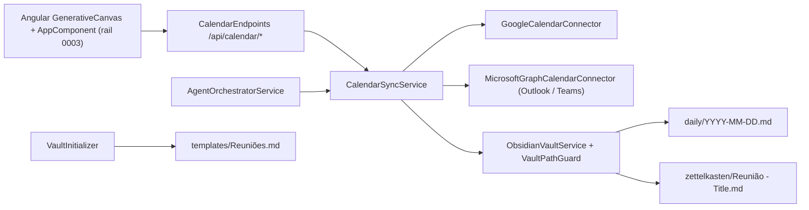

## 1. Fonte canônica

- Especificação da task e reconciliação `/spec-frontend`: [`backlog/tasks/0003-active-calendar-sync-google-microsoft.md`](../../backlog/tasks/0003-active-calendar-sync-google-microsoft.md)
- Mockup canônico aprovado: [`frontend/_imports/claude-design/granbrain-redesign/2026-10-30/original/granbrain-redesign.html`](../../frontend/_imports/claude-design/granbrain-redesign/2026-10-30/original/granbrain-redesign.html)
- Governança e arquitetura: [`CLAUDE.md`](../../CLAUDE.md) e [`docs/adr/0001-granbrain-architecture.md`](../../docs/adr/0001-granbrain-architecture.md)

## 2. Decisões (não reabrir)

| ID | Decisão | Regra vinculante na execução |
| :--- | :--- | :--- |
| D1 | `GoogleCalendarConnector` + `MicrosoftGraphCalendarConnector` unificado (`/me/calendar/events`) | Refresh apenas em memória via `IHttpClientFactory`; zero segredos em `appsettings.json` ou vault; Teams detectado por `isOnlineMeeting == true` ou URL contendo `teams.microsoft.com`; fallback determinístico de 5 eventos quando credenciais estão vazias |
| D2 | Marcador `<!-- cal-id:<id> -->` em lista sem checkbox na Nota Diária | Inserir em `#### Cronograma` (ordem cronológica) e em `## 🤝🏻 Reuniões` antes de `dataview` (ou criar `## 🤝🏻 Reuniões` no final se ausente); `ParseHabitsFromLines` e `ToggleHabitAsync` ignoram `<!-- cal-id:` e operam apenas dentro de `#### Cronograma` |
| D3 | `templates/Reuniões.md` não destrutivo + ata em `zettelkasten/Reunião - <SafeTitle>.md` | `VaultInitializer` só cria `templates/Reuniões.md` se faltar; `CreateMeetingNoteAsync` valida `TargetFolder` bruto com `VaultPathGuard.ResolveSafePath` antes de sanitizar título e preserva `## 📝 Discussão & Anotações` e `## ✅ Plano de Ação & Tarefas` |
| D4 | Bloco `agenda-timeline` completo (Lista + Calendário, filtros, conflitos, `nowline`) | Seguir `.seg`, `.chips`, `.conflict`, `.timeline`, `.ev`, `.nowline`, `.calwrap`, `.cal-grid`, `.cal-ev` com tokens `:root` existentes (Bucket A) e conectar item `0003` em `AppComponent` |
| D5 | Autenticação JWT Bearer (`.RequireAuthorization()`) em `/api/calendar/*` | Mesma autenticação JWT Bearer de `VaultEndpoints`/`AgentEndpoints` (`401` sem token válido); `GranBrainApiService` envia `Authorization: Bearer` |
| D6 | CSS canônico de `granbrain-redesign.html` + `styles.scss` | `.ev` em `56px 14px minmax(0, 1fr)`, `.ev.now .dot` (`var(--ok)`), `.cal-ev` com `--info`/`--accent`/`--warn`/`--danger` |

## 3. Arquitetura



### Catálogo de Códigos de Erro Declarados

Todos os códigos abaixo respeitam o middleware de exceções em `backend/src/GranBrain.Api/Program.cs` (`VaultPathViolationException` -> 400, `VaultValidationException` -> 400, `VaultEntityNotFoundException` -> 404):

| Código | Exceção .NET | Status HTTP | Condição de disparo |
| :--- | :--- | :--- | :--- |
| `vault_path_violation` | `VaultPathViolationException` | `400 Bad Request` | `TargetFolder` bruto com `..`, caminho absoluto ou saída fora de `VaultRoot` |
| `invalid_calendar_date` | `VaultValidationException` | `400 Bad Request` | Parâmetro `date` fora de `yyyy-MM-dd` em `/api/calendar/today` ou `/api/calendar/sync` |
| `calendar_auth_failed` | `VaultValidationException` | `400 Bad Request` | Credenciais parciais (ex.: `ClientId` sem `RefreshToken`) ou falha OAuth HTTP `401`/`403` no refresh/fetch remoto |
| `calendar_event_not_found` | `VaultEntityNotFoundException` | `404 Not Found` | `id` ausente na agenda resolvida ao chamar `POST /api/calendar/events/{id}/note` |

## Manifesto de execução

- **SHA-base:** `818dc09250c7af15da922c6f709a6fc30f5cee8b`
- **Invariantes transversais:**
  - Nenhuma credencial, refresh token ou access token pode ser gravada em `appsettings.json`, disco ou vault (`VaultRoot`).
  - Toda escrita de nota diária ou nota de reunião passa obrigatoriamente por `VaultPathGuard.ResolveSafePath` validando `TargetFolder` antes da sanitização do nome do arquivo.
  - Conflitos exigem sobreposição temporal estrita (`a.Start < b.End && b.Start < a.End`): eventos apenas adjacentes (`09:00–09:30` e `09:30–10:30`) têm `HasConflict == false`.
  - Conversão de UTC para horário local usa `TimeZoneInfo` com suporte a `America/Sao_Paulo` e fallback `E. South America Standard Time` (Windows).
  - `ObsidianVaultService.ParseHabitsFromLines` e `ToggleHabitAsync` nunca leem ou alteram linhas fora de `#### Cronograma` nem linhas contendo `<!-- cal-id:`.
- **Contratos / Seletores novos introduzidos nesta WI:**
  - C# enums/DTOs: `CalendarProvider`, `CalendarEventDto`, `CalendarTodayDto`, `CalendarSyncResultDto`, `CalendarNoteResultDto`, `CalendarOptions`.
  - Backend endpoints: `GET /api/calendar/today`, `POST /api/calendar/sync`, `POST /api/calendar/events/{id}/note`.
  - Bloco Generativo: `GenerativeUiBlockTypes.AgendaTimeline = "agenda-timeline"` + `GenerativeUiBlock.CalendarAgenda`.
  - Angular interfaces/métodos: `CalendarProvider`, `CalendarEvent`, `CalendarToday`, `CalendarSyncResult`, `CalendarNoteResult`, `GranBrainApiService.getCalendarToday`, `syncCalendar`, `createCalendarEventNote`.
  - Seletores CSS / DOM obrigatórios em `GenerativeCanvasComponent` + `styles.scss`: `.seg`, `.conflict`, `.timeline`, `.ev`, `.ev.past`, `.ev.now`, `.ev.next`, `.nowline`, `.calwrap`, `.cal-grid`, `.cal-line`, `.cal-hour`, `.cal-now`, `.cal-ev.p-google`, `.cal-ev.p-teams`, `.cal-ev.p-outlook`, `.cal-ev.clash`, `[data-event-join]`, `[data-event-note]`.

## Matriz de cobertura

| AC | Fatia dona | Comportamento exato exigido | Verificação vinculada (nome + comportamento + sinal negativo) |
| :--- | :--- | :--- | :--- |
| AC1 | Fatia 1 & Fatia 2 | `GET /api/calendar/today` e `POST /api/calendar/sync` autenticam por JWT Bearer (`.RequireAuthorization()`, `401` sem token); conectores renovam token só em memória, usam fallback determinístico de 5 eventos sem segredos, filtram data em TZ SP/Windows e não marcam adjacência estrita (`09:00–09:30` + `09:30–10:30`) como conflito; credencial parcial ou `401` OAuth gera `calendar_auth_failed` (400) | `CalendarSyncServiceTests` + `ApiSecurityAndAgentTests`: `401` sem JWT Bearer, zero arquivos de token em `tempVault`, `appsettings.json` com credenciais vazias, `2026-10-30T13:30:00Z` -> `10:30`, adjacentes sem conflito, `calendar_auth_failed` -> 400 |
| AC2 | Fatia 1 | `SyncAsync` insere `<!-- cal-id:<id> -->` em `#### Cronograma` e `## 🤝🏻 Reuniões` antes de `dataview` (ou cria `## 🤝🏻 Reuniões` no fallback daily note); re-sync não duplica linhas e `ParseHabitsFromLines`/`ToggleHabitAsync` isolam `#### Cronograma` ignorando `<!-- cal-id:` | `CalendarSyncServiceTests` + `ObsidianVaultServiceTests`: sequência `SyncAsync` -> `ToggleHabitAsync` -> `SyncAsync`, `ToggleHabitAsync("Revisão de arquitetura")` lança `habit_not_found`, parser não lê fora de `#### Cronograma` mesmo com `habits.Count == 0` |
| AC3 | Fatia 1 & Fatia 2 | `VaultInitializer` garante `templates/Reuniões.md` não destrutivamente; `CreateMeetingNoteAsync` gera/atualiza `zettelkasten/Reunião - <SafeTitle>.md` preservando `## 📝 Discussão & Anotações` e `## ✅ Plano de Ação & Tarefas`; id desconhecido lança `calendar_event_not_found` (404) | `VaultInitializerTests` + `CalendarSyncServiceTests` + `ApiSecurityAndAgentTests`: template preservado se existente, anotações manuais intactas após re-sync, `POST /api/calendar/events/inexistente/note` -> 404 |
| AC4 | Fatia 1 & Fatia 2 | `TargetFolder` bruto validado por `VaultPathGuard.ResolveSafePath` antes de sanitizar título; `date` inválido retorna `invalid_calendar_date` (400) | `CalendarSyncServiceTests` + `ApiSecurityAndAgentTests`: `TargetFolder = "../../evil"` -> 400 `vault_path_violation`, `date=30-10-2026` -> 400 `invalid_calendar_date` |
| AC5 | Fatia 2 & Fatia 3 | `AgentOrchestratorService` emite `agenda-timeline`; Angular fia rail `0003`, renderiza Lista/Calendário, `.ev.past`/`.ev.now`/`.ev.next`, `.nowline`, `.cal-now`, `.conflict`, filtros `.chips` (`aria-pressed="true"` + redução DOM de `.ev`/`.cal-ev`), `[data-event-join]`/`[data-event-note]`, parity de DTO C#/TS e `getComputedStyle` | `ApiSecurityAndAgentTests` + `frontend/src/app/app.spec.ts`: intenção de agenda -> bloco `agenda-timeline`; rail `0003` -> HTTP + renderização Lista/Calendário, clique em filtro reduz `.ev`/`.cal-ev`, `getComputedStyle` valida `.ev`, `.ev.now .dot`, `.conflict`, `.cal-ev.p-google`, `.cal-ev.p-teams`, `.cal-ev.p-outlook`, `.cal-ev.clash` |

### Dimensões de risco

| Dimensão | Risco identificado | Mitigação planejada |
| :--- | :--- | :--- |
| Segurança / Autenticação | Exposição de `/api/calendar/*` sem JWT ou gravação acidental de tokens em disco | `CalendarEndpoints` com `.RequireAuthorization()` (JWT Bearer, igual a `VaultEndpoints`/`AgentEndpoints`); tokens apenas em `ConcurrentDictionary` em memória e teste assertando `appsettings.json` + ausência de arquivos extra em `tempVault` |
| Vault Jail / Traversal | `SanitizeFileName` remover `../` de `TargetFolder` antes de validar limite do vault | Validar `options.MeetingNotesFolder` / `TargetFolder` bruto via `VaultPathGuard.ResolveSafePath` antes de concatenar `Reunião - <SafeTitle>.md` |
| Corrupção de Hábitos | Eventos sincronizados interpretados como hábitos em `ObsidianVaultService` | Exigir marcador `<!-- cal-id:` sem checkbox, filtrar `<!-- cal-id:` em `ParseHabitsFromLines` e `ToggleHabitAsync`, e restringir escopo estritamente à seção `#### Cronograma` (corrigindo bug da linha 1070 quando `habits.Count == 0`) |
| Fuso horário e Adjacência | Eventos perto da meia-noite UTC caírem no dia errado no Windows/Linux ou back-to-back virarem conflito | Resolver TZ com fallback `America/Sao_Paulo` / `E. South America Standard Time`; usar `a.Start < b.End && b.Start < a.End` (estrito `<`) |

## Fronteiras

| Fronteira | Produtor | Consumidor | Regra de contrato |
| :--- | :--- | :--- | :--- |
| Producer→Consumer 1 | `CalendarSyncService` (`CalendarTodayDto` em `GranBrain.Core`) | `CalendarEndpoints` + `AgentOrchestratorService` (`GenerativeUiBlock.CalendarAgenda`) -> JSON camelCase -> `GranBrainApiService` (`CalendarToday` em `granbrain.models.ts`) | Nomes exatos em JSON: `date`, `timeZone`, `lastSyncedAt`, `conflictsCount`, `providersConnected`, `events[]` (`id`, `provider`, `title`, `startIso`, `endIso`, `startTime`, `endTime`, `durationMinutes`, `location`, `attendees`, `joinUrl`, `notePath`, `status`, `hasConflict`, `calendarTopPx`, `calendarHeightPx`, `calendarColumn`, `calendarTotalColumns`) |
| Producer→Consumer 2 | `CalendarSyncService` (linhas Markdown com `<!-- cal-id:<id> -->` em `daily/YYYY-MM-DD.md`) | `ObsidianVaultService` (`ParseHabitsFromLines`, `ToggleHabitAsync`) e Obsidian Dataview (`## 🤝🏻 Reuniões`) | Linhas sincronizadas nunca possuem `[ ]`/`[x]` e sempre ficam antes do bloco ```` ```dataview ````; `ParseHabitsFromLines` ignora `<!-- cal-id:` e não sai de `#### Cronograma` |
| External input | Payloads OAuth + eventos JSON do Google Calendar e Microsoft Graph, parâmetros HTTP `date`/`id`/`TargetFolder` | `GoogleCalendarConnector`, `MicrosoftGraphCalendarConnector`, `CalendarSyncService` | `date` validado estritamente com `DateOnly.TryParseExact(..., "yyyy-MM-dd")`; `TargetFolder` validado em valor bruto por `VaultPathGuard.ResolveSafePath`; OAuth HTTP `401`/`403` convertido em `VaultValidationException("calendar_auth_failed", ...)` |

## 4. Fatias

### Fatia 1 — Núcleo de Calendário, Conectores e Sincronização Idempotente no Vault

- **Pre-requisitos:** nenhum (base `818dc09250c7af15da922c6f709a6fc30f5cee8b`)
- **Owner:** executor backend C#
- **Parallel:** `false` (Fatia 2 depende dos serviços e DTOs desta fatia)
- **ACs:** AC1 (conectores, fallback, timezone, conflito estrito, zero tokens em disco), AC2 (sync idempotente + fix do parser de hábitos), AC3 (`templates/Reuniões.md` + criação/preservação de ata), AC4 (`VaultPathGuard` no `TargetFolder` bruto e validação de `date`)
- **Shared contracts:**
  - `backend/src/GranBrain.Core/Configuration/CalendarOptions.cs` (`Google`, `Microsoft`, `TimeZoneId`, `DailyNotesFolder`, `MeetingNotesFolder`)
  - `backend/src/GranBrain.Core/Models/CalendarModels.cs` (`CalendarProvider`, `CalendarEventDto`, `CalendarTodayDto`, `CalendarSyncResultDto`, `CalendarNoteResultDto`, `CalendarSyncRequest`)
  - `backend/src/GranBrain.Core/Interfaces/ICalendarConnector.cs` e `ICalendarSyncService.cs`
- **Write-set:**
  - `backend/src/GranBrain.Core/Configuration/CalendarOptions.cs`
  - `backend/src/GranBrain.Core/Models/CalendarModels.cs`
  - `backend/src/GranBrain.Core/Interfaces/ICalendarConnector.cs`
  - `backend/src/GranBrain.Core/Interfaces/ICalendarSyncService.cs`
  - `backend/src/GranBrain.Core/Models/GenerativeUiModels.cs` (adicionar `AgendaTimeline = "agenda-timeline"` e `CalendarTodayDto? CalendarAgenda = null`)
  - `backend/src/GranBrain.Infrastructure/Calendar/CalendarTimeZoneResolver.cs`
  - `backend/src/GranBrain.Infrastructure/Calendar/GoogleCalendarConnector.cs`
  - `backend/src/GranBrain.Infrastructure/Calendar/MicrosoftGraphCalendarConnector.cs`
  - `backend/src/GranBrain.Infrastructure/Calendar/CalendarSyncService.cs`
  - `backend/src/GranBrain.Infrastructure/Vault/VaultInitializer.cs`
  - `backend/src/GranBrain.Infrastructure/Vault/ObsidianVaultService.cs`
  - `backend/tests/GranBrain.UnitTests/VaultInitializerTests.cs`
  - `backend/tests/GranBrain.UnitTests/ObsidianVaultServiceTests.cs`
  - `backend/tests/GranBrain.UnitTests/CalendarSyncServiceTests.cs`
- **Discriminante:** Sem `MicrosoftGraphCalendarConnector` classificar `Teams` vs `Outlook` e sem a guarda de `#### Cronograma` + `<!-- cal-id:` em `ObsidianVaultService.ParseHabitsFromLines`, ou conectores duplicam código ou reuniões quebram o módulo de hábitos.
- **Focused checks:**
  - `dotnet test backend/GranBrain.sln --filter "FullyQualifiedName~CalendarSyncServiceTests|FullyQualifiedName~ObsidianVaultServiceTests|FullyQualifiedName~VaultInitializerTests"` -> todos verdes, zero warnings de nullability ou falhas.
- **Reuso:**

| Símbolo / Padrão Existente | Caminho | Como reutilizar nesta fatia |
| :--- | :--- | :--- |
| `VaultPathGuard.ResolveSafePath` & `SanitizeFileName` | `backend/src/GranBrain.Core/Security/VaultPathGuard.cs` | Validar `TargetFolder` bruto e destino `daily/` / `zettelkasten/` antes de qualquer IO |
| `VaultValidationException` / `VaultEntityNotFoundException` | `backend/src/GranBrain.Core/Security/VaultPathGuard.cs` | Disparar códigos declarados `invalid_calendar_date`, `calendar_auth_failed`, `calendar_event_not_found` |
| `ObsidianVaultService.EnsureDailyNoteExistsAsync` | `backend/src/GranBrain.Infrastructure/Vault/ObsidianVaultService.cs` | Garantir a Nota Diária via template existente antes de aplicar atualização aditiva |

---

### Fatia 2 — Endpoints REST `/api/calendar/*` e Orquestração de Agenda

- **Pre-requisitos:** Fatia 1 concluída
- **Owner:** executor backend API C#
- **Parallel:** `false` (depende dos DTOs e interfaces da Fatia 1)
- **ACs:** AC1 (autenticação `401` sem JWT Bearer, HTTP 400 para `calendar_auth_failed`), AC3 (`404` para `calendar_event_not_found`), AC4 (`400` para `vault_path_violation` e `invalid_calendar_date`), AC5 (`AgentOrchestratorService` emitindo `agenda-timeline`)
- **Shared contracts:**
  - `GET /api/calendar/today?date=YYYY-MM-DD` -> `CalendarTodayDto`
  - `POST /api/calendar/sync` -> `CalendarSyncResultDto`
  - `POST /api/calendar/events/{id}/note` -> `CalendarNoteResultDto`
  - `GenerativeUiBlockTypes.AgendaTimeline` emitido por `AgentOrchestratorService`
- **Write-set:**
  - `backend/src/GranBrain.Api/Endpoints/CalendarEndpoints.cs`
  - `backend/src/GranBrain.Api/Program.cs` (DI de `CalendarOptions`, `HttpClient` nomeado, conectores, `ICalendarSyncService`, `MapCalendarEndpoints()`)
  - `backend/src/GranBrain.Api/appsettings.json` (seção `"Calendar"` com credenciais explicitamente vazias `""`)
  - `backend/src/GranBrain.Infrastructure/Agents/AgentOrchestratorService.cs` (injeção de `ICalendarSyncService` e branch de intenção de agenda)
  - `backend/tests/GranBrain.UnitTests/ApiSecurityAndAgentTests.cs`
- **Composição:** `Program.cs` registra `IHttpClientFactory`, `CalendarOptions`, `GoogleCalendarConnector`, `MicrosoftGraphCalendarConnector`, `CalendarSyncService` e `CalendarEndpoints` sob `.RequireAuthorization()` (JWT Bearer) e tratamento de exceções (`400`/`401`/`404`), ligando HTTP + `AgentOrchestratorService` + `CalendarSyncService` + `ObsidianVaultService` sem mocks no núcleo do vault.
- **Discriminante:** Sem registrar os endpoints no pipeline autenticado e injetar `ICalendarSyncService` no `AgentOrchestratorService`, a UI Angular (`0003`) e o chat permanecem desconectados do backend real.
- **Focused checks:**
  - `dotnet test backend/GranBrain.sln --filter "FullyQualifiedName~ApiSecurityAndAgentTests"` -> testa HTTP `401`, `200`, `400`, `404` via `WebApplicationFactory` e emissão do bloco `agenda-timeline`.
- **Reuso:**

| Símbolo / Padrão Existente | Caminho | Como reutilizar nesta fatia |
| :--- | :--- | :--- |
| Grupo autenticado + mapeamento em `Program.cs` | `backend/src/GranBrain.Api/Program.cs` | Reutilizar exatamente a mesma autenticação JWT Bearer (`.RequireAuthorization()`) e mapeador de exceções existente |
| `VaultEndpoints.cs` | `backend/src/GranBrain.Api/Endpoints/VaultEndpoints.cs` | Seguir convenção Minimal API (`MapGroup("/api/calendar")`, `WithName`, `Produces`) |
| `AgentOrchestratorService` intenções e resposta | `backend/src/GranBrain.Infrastructure/Agents/AgentOrchestratorService.cs` | Seguir o padrão do branch de `Brainstorm` / `HabitChecklist` ao compor `AgentChatResponse` com `GenerativeUiBlock` |

---

### Fatia 3 — Frontend Angular: Bloco `agenda-timeline`, Rail `0003` e Reconciliação Visual

- **Pre-requisitos:** Fatia 2 concluída (ou contrato DTO congelado em paralelo na reta final)
- **Owner:** executor frontend Angular/Ionic
- **Parallel:** `false` (Fatia 2 consolida endpoints reais consumidos por `GranBrainApiService`)
- **ACs:** AC5 (rail `0003` funcional, renderização Lista + Calendário idêntica ao mockup, filtros `.chips`, `.conflict`, `.ev.past`/`.now`/`.next`, `.nowline`/`.cal-now`, `[data-event-join]` e `[data-event-note]`, parity DTO e `getComputedStyle`)
- **Shared contracts:**
  - `frontend/src/app/models/granbrain.models.ts`: `CalendarProvider`, `CalendarEvent`, `CalendarToday`, `CalendarSyncResult`, `CalendarNoteResult`, extensão de `GenerativeUiBlock` (`type: '...' | 'agenda-timeline'`, `calendarAgenda?: CalendarToday`)
  - `frontend/src/app/services/granbrain-api.service.ts`: `getCalendarToday(date?: string)`, `syncCalendar(date?: string, targetFolder?: string)`, `createCalendarEventNote(eventId: string, targetFolder?: string)`
- **Write-set:**
  - `frontend/src/styles.scss` (classes `.seg`, `.conflict`, `.timeline`, `.ev`, `.ev-card`, `.ev-top`, `.ev-meta`, `.link`, `.nowline`, `.calwrap`, `.cal-grid`, `.cal-line`, `.cal-hour`, `.cal-ev`, `.p-google`, `.p-teams`, `.p-outlook`, `.clash`, `.cal-now` usando tokens existentes Bucket A)
  - `frontend/src/app/models/granbrain.models.ts`
  - `frontend/src/app/services/granbrain-api.service.ts`
  - `frontend/src/app/components/generative-canvas/generative-canvas.component.ts`
  - `frontend/src/app/components/generative-canvas/generative-canvas.component.html`
  - `frontend/src/app/app.component.ts`
  - `frontend/src/app/app.component.html` (ligar rail `0003` ao carregamento de agenda e estado ativo)
  - `frontend/src/app/app.spec.ts`
- **Discriminante:** Sem as classes do mockup reconciliadas em `styles.scss` e os seletores `.ev`/`.cal-ev`/`[aria-pressed="true"]`/`[data-event-join]`/`[data-event-note]`, o bloco `agenda-timeline` perde paridade visual e falha nos testes de `getComputedStyle` e DOM.
- **Focused checks:**
  - `npm --prefix frontend test -- --watch=false` -> todos os specs passam, incluindo alternância Lista/Calendário, filtro por provedor e `getComputedStyle`.
- **Reuso:**

| Símbolo / Padrão Existente | Caminho | Como reutilizar nesta fatia |
| :--- | :--- | :--- |
| `.chips`, `.chip`, `.chip[aria-pressed="true"]`, `.toasts` | `frontend/src/styles.scss` | Reaproveitar exatamente os pills e tokens `:root` existentes para filtros e toasts |
| `GenerativeCanvasComponent` dispatch `@switch (block.type)` | `frontend/src/app/components/generative-canvas/generative-canvas.component.html` | Adicionar `@case ('agenda-timeline')` seguindo o padrão dos blocos `brainstorm-canvas` e `kpi-grid` |
| `AppComponent.showToast` + rail navigation | `frontend/src/app/app.component.ts` | Substituir stub do rail `0003` pelo método `openAgenda()` usando `GranBrainApiService.getCalendarToday()` e feedback via `showToast` |

---

### Fatia 4 — Gate Final em Árvore Limpa

- **Pre-requisitos:** Fatias 1, 2 e 3 commitadas na branch de trabalho
- **Owner:** executor / verificador independente
- **Parallel:** `false`
- **ACs:** AC1, AC2, AC3, AC4, AC5 (cobertura integral contra o último commit em árvore limpa)
- **Shared contracts:** todos os contratos das Fatias 1 a 3
- **Write-set:** somente diagnóstico/verificação (nenhum arquivo editado nesta fatia; correções vão para slice dedicado antes do re-run)
- **Discriminante:** Valida que o último commit compila do zero e passa em todas as suítes .NET e Angular sem depender de artefatos locais não commitados.
- **Focused checks:**
  - `dotnet build backend/GranBrain.sln -c Release`
  - `dotnet test backend/GranBrain.sln -c Release`
  - `npm --prefix frontend test -- --watch=false`
  - `npm --prefix frontend run build`
- **Reuso:**

| Símbolo / Padrão Existente | Caminho | Como reutilizar nesta fatia |
| :--- | :--- | :--- |
| Solução `GranBrain.sln` e scripts Angular | `backend/GranBrain.sln` e `frontend/package.json` | Executar build e test oficiais do repositório no commit final |

## 5. Testes

1. **Testes de conectores, OAuth in-memory, fallback, timezone e conflitos (`CalendarSyncServiceTests` — alvo: `GoogleCalendarConnector.cs`, `MicrosoftGraphCalendarConnector.cs`, `CalendarSyncService.cs`)**
   - Fixture rastreável: `frontend/_imports/claude-design/granbrain-redesign/2026-10-30/original/granbrain-redesign.html` (5 eventos de fallback); JSON mockado de `HttpMessageHandler` com timestamp `2026-10-30T13:30:00Z` -> horário local `10:30` e evento `2026-10-31T01:30:00Z` -> dia `2026-10-30` em `America/Sao_Paulo`.
   - Asserts positivos: classificação automática `Teams` vs `Outlook` no `MicrosoftGraphCalendarConnector`; adjacência `09:00–09:30` e `09:30–10:30` com `HasConflict == false`; sobreposição parcial marcada com `HasConflict == true`; zero arquivos de token criados em `tempVault`; `appsettings.json` sem segredos.
   - Asserts negativos: configuração parcial (`ClientId` preenchido sem `RefreshToken`) ou resposta HTTP `401 Unauthorized` no endpoint de refresh lança `VaultValidationException("calendar_auth_failed", ...)`.
2. **Testes de idempotência na Nota Diária e isolamento de hábitos (`CalendarSyncServiceTests` & `ObsidianVaultServiceTests` — alvo: `CalendarSyncService.cs` & `ObsidianVaultService.cs`)**
   - Fixture rastreável: cópia temporária baseada em `templates/Notas Diárias.md` (com `#### Cronograma` + `## 🤝🏻 Reuniões` + bloco ```` ```dataview ````) e nota de fallback sem `## 🤝🏻 Reuniões`.
   - Asserts positivos: executar `SyncAsync` -> `ToggleHabitAsync` (um hábito real) -> `SyncAsync` preserva `[x]` do hábito, não duplica `<!-- cal-id:... -->` e posiciona reuniões antes do bloco ```` ```dataview ````; `ParseHabitsFromLines` não captura checkboxes fora de `#### Cronograma` mesmo com `habits.Count == 0`.
   - Asserts negativos: `ToggleHabitAsync("Revisão de arquitetura")` após sincronização lança `VaultEntityNotFoundException("habit_not_found", ...)`.
3. **Testes de template, geração/preservação de atas e Vault Jail (`VaultInitializerTests` & `CalendarSyncServiceTests` — alvo: `VaultInitializer.cs`, `CalendarSyncService.cs`, `VaultPathGuard.cs`)**
   - Fixture rastreável: `templates/Reuniões.md`.
   - Asserts positivos: `VaultInitializer` cria `templates/Reuniões.md` quando ausente e nunca sobrescreve conteúdo customizado existente; `CreateMeetingNoteAsync` gera `zettelkasten/Reunião - <SafeTitle>.md` e preserva edições manuais em `## 📝 Discussão & Anotações` e `## ✅ Plano de Ação & Tarefas` após nova chamada.
   - Asserts negativos: `TargetFolder = "../../evil"` lança `VaultPathViolationException("vault_path_violation", ...)` (antes da sanitização de título); id inexistente lança `VaultEntityNotFoundException("calendar_event_not_found", ...)`; data `"30-10-2026"` lança `VaultValidationException("invalid_calendar_date", ...)`.
4. **Testes de API HTTP e Orquestrador (`ApiSecurityAndAgentTests` — alvo: `CalendarEndpoints.cs`, `Program.cs`, `AgentOrchestratorService.cs`)**
   - Asserts positivos: chamada autenticada `GET /api/calendar/today` e `POST /api/calendar/sync` retorna `200 OK` com `CalendarTodayDto` válido; prompt de agenda em `POST /api/agent/chat` retorna `GenerativeUiBlock` com `type == "agenda-timeline"` e `calendarAgenda` populado.
   - Asserts negativos: requisição sem `X-Api-Key` retorna `401 Unauthorized`; `POST /api/calendar/events/inexistente/note` retorna `404 Not Found`; `date=invalida` ou `targetFolder="../../evil"` retorna `400 Bad Request`; falha OAuth simulada retorna `400 Bad Request` com `error = "calendar_auth_failed"`.
5. **Testes Frontend Angular + Paridade Visual (`/spec-frontend`) (`frontend/src/app/app.spec.ts` — alvo: `AppComponent`, `GenerativeCanvasComponent`, `styles.scss`)**
   - Fixture: JSON compatível propriedade-a-propriedade com o contrato camelCase de `CalendarTodayDto` (`.ev.past`, `.ev.now`, `.ev.next`, 1 conflito).
   - Asserts positivos: clique no rail `0003` chama `GET /api/calendar/today`; modo Lista renderiza `.ev.past`, `.ev.now`, `.ev.next`, `.nowline`, `.conflict`, `[data-event-join]` e `[data-event-note]`; alternância `.seg` para `Calendário` renderiza `.calwrap`, `.cal-grid`, `.cal-now` e `.cal-ev`; clique no filtro `.chips` (`Teams`) define `aria-pressed="true"` e reduz a quantidade de `.ev`/`.cal-ev` no DOM; `getComputedStyle` valida `grid-template-columns` de `.ev` (`56px 14px ...`), cores de `.cal-ev.p-google`, `.cal-ev.p-teams`, `.cal-ev.p-outlook`, `.ev.now .dot`, `.conflict` e borda `dashed` em `.cal-ev.clash`.

## 6. Gate por gatilho

| Gatilho | Aplicável? | Comando / Justificativa |
| :--- | :--- | :--- |
| `.NET 10` (`backend/**`) | **Sim (Obrigatório)** | `dotnet build backend/GranBrain.sln -c Release` e `dotnet test backend/GranBrain.sln -c Release` |
| `Ionic Angular` (`frontend/**`) | **Sim (Obrigatório)** | `npm --prefix frontend test -- --watch=false` e `npm --prefix frontend run build` |
| `Pipeline 158 / BrixBroker` | Dispensado | Repositório atual é `GranBrain` (`.NET 10` + `Angular`), não o monólito BrixBroker |
| `Docker / Containers` | Dispensado | WI 0003 não altera `Dockerfile` ou `docker-compose` |

# Verificações feitas antes de entregar este plano

| Verificação | Resultado | Evidência concreta |
| :--- | :--- | :--- |
| Manifesto | Passou | `SHA-base` `818dc09250c7af15da922c6f709a6fc30f5cee8b` obtido via `git rev-parse HEAD` |
| Encanamento | Passou | Fluxo completo `CalendarEndpoints` + `AgentOrchestratorService` <-> `CalendarSyncService` <-> Conectores + `ObsidianVaultService` + `VaultInitializer` e `GranBrainApiService` <-> `AppComponent`/`GenerativeCanvasComponent` mapeado sem ponta solta |
| Ambiente | Passou | SDK `.NET` + `Angular`/`Vitest` presentes no repositório `GranBrain` |
| Testes | Passou | 5 blocos de teste cobrindo comportamento positivo e códigos de erro negativos (`400`/`401`/`404`) em `backend/tests/GranBrain.UnitTests` e `frontend/src/app/app.spec.ts` |
| Projeto do teste | Passou | Todos os nomes de testes pertencem aos projetos reais `backend/tests/GranBrain.UnitTests/` e `frontend/src/app/app.spec.ts` |
| Gate | Passou | Gatilhos `.NET 10` e `Ionic Angular` declarados com comandos reais do repo; Pipeline 158 e Docker dispensados com justificativa |
| ADR/Rules | Passou | `CLAUDE.md` (`Vault Jail`, preservação do vault, `/spec-frontend`, link canônico) e `docs/adr/0001-granbrain-architecture.md` respeitados integralmente |
| Cápsula | Passou | `TargetFolder` bruto validado por `VaultPathGuard.ResolveSafePath`, zero tokens em disco/appsettings, fallback determinístico sem rede |
| Cobertura | Passou | Revisão independente da matriz de cobertura executada por subagente `reviewer` (`8bb0758d-3dd3-4fce-b507-00503882d24b`); todos os 13 achados incorporados (401 auth, regressão `SyncAsync`+`ToggleHabitAsync`, fallback sem `## 🤝🏻 Reuniões`, adjacência sem conflito, `.ev.past`/`now`/`next`/links/filtros DOM, `getComputedStyle` por provedor/clash, zero tokens em disco, traversal antes de `SanitizeFileName`, parity DTO C#/TS, fix linha 1070 com `habits.Count == 0`, TZ Windows/Linux meia-noite UTC, `calendar_auth_failed` 400) |
| Reuso | Passou | Cada fatia referencia `VaultPathGuard`, `ObsidianVaultService.EnsureDailyNoteExistsAsync`, `Program.cs`, `.chips`/`.chip` e `GenerativeCanvasComponent` existentes |
| Contradição | Passou | Nenhuma contradição entre `D1`–`D4`, especificação `/spec-frontend` e fatias |
| Erros declarados | Passou | Catálogo explícito com `vault_path_violation` (400), `invalid_calendar_date` (400), `calendar_auth_failed` (400) e `calendar_event_not_found` (404) alinhado a `Program.cs` |
