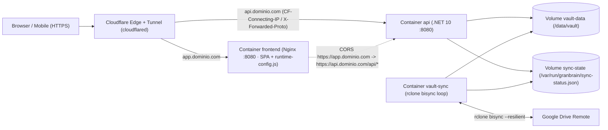

## 1. Fonte canônica

- Especificação da task e reconciliação `/spec-frontend`: [`backlog/tasks/0004-contabo-deploy-docker-tunnel.md`](../../backlog/tasks/0004-contabo-deploy-docker-tunnel.md) (vence qualquer documento anterior em caso de divergência)
- Mockup canônico aprovado: [`frontend/_imports/claude-design/granbrain-redesign/2026-10-30/original/granbrain-redesign.html`](../../frontend/_imports/claude-design/granbrain-redesign/2026-10-30/original/granbrain-redesign.html)
- Governança e arquitetura: [`CLAUDE.md`](../../CLAUDE.md) e [`docs/adr/0001-granbrain-architecture.md`](../../docs/adr/0001-granbrain-architecture.md)

## 2. Decisões (não reabrir)

| ID | Decisão | Regra vinculante na execução |
| :--- | :--- | :--- |
| D1 | Roteamento por hostname no Cloudflare Tunnel (`app.<dominio>` -> `http://frontend:8080`, `api.<dominio>` -> `http://api:8080`) na rede interna `granbrain-net` | Nunca publicar `ports:` de `api` ou `frontend` na VPS (`expose: ["8080"]` apenas); `apiBaseUrl` aponta para `https://api.<dominio>` em produção; CORS em produção permite apenas `GranBrain:AllowedOrigins` (`https://app.<dominio>`); `UseForwardedHeaders` + `CF-Connecting-IP`/`X-Forwarded-For` no `RateLimiter` (`login-policy`) |
| D2 | Container `vault-sync` (`rclone/rclone`) no `docker-compose.yml` com `rclone bisync` + lockfile + telemetria atômica | Compartilhar volumes `vault-data:/data/vault` e `sync-state:/var/run/granbrain` entre `api` e `vault-sync`; primeiro ciclo executa `--resync` se `/var/run/granbrain/.bisync-initialized` não existir; escrita atômica via `sync-status.json.tmp` + `mv -f` lida por `GET /api/health` |
| D3 | Fail-fast no startup em `Production` (`ProductionConfigurationValidator`) + `appsettings.Production.json` sem segredos | `ValidateOrThrow` roda antes de `VaultPathGuard` e `AddJwtBearer` em `Program.cs`, lançando `InvalidOperationException` se `JwtSecret`, senha admin, `VaultPath` ou `AllowedOrigins` usarem defaults ou forem inválidos; `AuthEndpoints.VerifyPassword` retorna `false` se `inputPassword` for vazio ou se `PasswordHash` e `DefaultPassword` forem vazios/nulos |
| D4 | Reconciliação `/spec-frontend` 100% Bucket A em `styles.scss` + `assets/runtime-config.js` no Nginx | Renderizar `[data-health-vault]`, `[data-health-tunnel]` e `[data-health-sync]` (`.pill.ok`, `.pill.warn`, `.pill.danger`) no `.rail-foot`; emitir `.toast.warn` na perda de conexão e `.toast` (`ok`) apenas na reconexão após falha; injetar `window.__GRANBRAIN_CONFIG__.apiBaseUrl` via `/docker-entrypoint.d/40-generate-runtime-config.sh` com `Cache-Control: no-store` |

- **Fronteiras operacionais do executor:**
  - Relatórios de execução ficam fora do checkout; nunca criar ou editar arquivos de build-log dentro do repositório.
  - Escopo é teto: implementar estritamente os contratos e arquivos declarados nas fatias abaixo.

## 3. Arquitetura

### Catálogo de Códigos de Erro Declarados

Além dos códigos HTTP já mapeados em `backend/src/GranBrain.Api/Program.cs` (`vault_path_violation` -> 400, `invalid_credentials` -> 401, `rate_limit_exceeded` -> 429, `internal_error` -> 500), esta WI declara os seguintes códigos determinísticos de falha de configuração no startup (`InvalidOperationException` lançada por `ProductionConfigurationValidator.ValidateOrThrow`):

| Código | Mecanismo | Condição de disparo |
| :--- | :--- | :--- |
| `production_secret_violation` | `InvalidOperationException` (startup fail-fast em `Production`) | `GranBrain:Auth:JwtSecret` vazio, `< 32` chars ou igual ao default `"GranBrain-Super-Secret-Key-2026-Obsidian-AI-OS-Min32Chars!"`, ou `PasswordHash` vazio com `DefaultPassword` vazia/igual a `"GranBrain@2026"` |
| `production_config_violation` | `InvalidOperationException` (startup fail-fast em `Production`) | `GranBrain:VaultPath` vazio ou iniciando com `G:\Meu Drive` em ambiente `Production` |
| `production_cors_violation` | `InvalidOperationException` (startup fail-fast em `Production`) | `GranBrain:AllowedOrigins` vazio, contendo `*` ou contendo URI que não seja `https://` absoluta em ambiente `Production` |
| `invalid_credentials` | HTTP `401 Unauthorized` (`AuthEndpoints.cs`) | Tentativa de login com usuário/senha inválidos ou quando `PasswordHash` e `DefaultPassword` estão vazios |
| `rate_limit_exceeded` | HTTP `429 Too Many Requests` (`Program.cs`) | Mais de `MaxLoginAttemptsPerWindow` tentativas por IP real (`CF-Connecting-IP` / primeiro IP de `X-Forwarded-For`) na janela configurada |

## Manifesto de execução

- **SHA-base:** `b85c6c187c84130f4672d98e0af37fabae55a425` (o único commit entre o SHA-base e o `HEAD` da execução é o commit deste plano e da spec atualizada da WI 0004)
- **Invariantes transversais:**
  - Nenhum segredo real (`JwtSecret`, `PasswordHash`, senha admin, token Cloudflare ou credencial OAuth/rclone) pode ser commitado em `appsettings*.json`, `docker-compose.yml` ou scripts.
  - Os serviços `api` e `frontend` no `docker-compose.yml` usam apenas `expose: ["8080"]` na rede interna `granbrain-net` e nunca declaram `ports:` publicados no host da VPS.
  - `ProductionConfigurationValidator.ValidateOrThrow(options, builder.Environment.IsProduction())` deve ser invocado em `Program.cs` imediatamente após o bind de `GranBrainOptions` (antes de `VaultPathGuard` e `AddJwtBearer`).
  - `AppComponent.ngOnInit()` só dispara `refreshHealth()` automaticamente quando `this.isAuthenticated === true` (ou quando `refreshHealth()` / `login()` é chamado explicitamente), preservando `httpMock.verify()` nos 5 testes legados de `frontend/src/app/app.spec.ts`.
  - O primeiro healthcheck bem-sucedido não emite toast; `.toast.warn` só dispara ao entrar em estado offline e `.toast` (`ok`) só dispara ao recuperar conexão após ter estado offline.
- **Contratos / Seletores novos introduzidos nesta WI:**
  - C# classes/DTOs: `ProductionConfigurationValidator`, `SystemHealthStatusDto`, `RcloneSyncStatePayload`, extensões em `GranBrainOptions` (`SyncStatusFilePath`, `AllowedOrigins`, `TunnelMode`) e `AuthEndpoints.VerifyPassword` (`public static`).
  - Backend endpoint atualizado: `GET /api/health` -> `SystemHealthStatusDto` (`status`, `service`, `environment`, `vaultAccessible`, `tunnelStatus`, `syncStatus`, `lastSyncedAtUtc`).
  - Infraestrutura: `backend/Dockerfile`, `frontend/Dockerfile`, `docker-compose.yml`, `.env.example`, `deploy/nginx/default.conf`, `deploy/nginx/40-generate-runtime-config.sh`, `deploy/cloudflare/config.yml.example`, `deploy/rclone/rclone-bisync-loop.sh`, `deploy/scripts/setup-vps.sh`.
  - Angular interfaces/métodos/seletores: `SystemHealthStatus`, `GranBrainRuntimeConfig`, `GranBrainApiService.resolveApiBaseUrl`, `GranBrainApiService.getHealth()`, `AppComponent.refreshHealth()`, seletores DOM `[data-health-vault]`, `[data-health-tunnel]`, `[data-health-sync]`, `[data-health-refresh]`.

## Matriz de cobertura

| AC | Comportamento / cenário observável | Resultado esperado | Fronteira de produção | Teste ou check (existente ou planejado) | Discriminante |
| :--- | :--- | :--- | :--- | :--- | :--- |
| AC1 | Stack Docker Compose (`api`, `frontend`, `cloudflared`, `vault-sync`) com `Dockerfile` multi-stage `.NET 10` (com `curl` instalado) e `Angular + Nginx`, limites de memória (`mem_limit`), volumes `vault-data` e `sync-state` compartilhados entre `api` e `vault-sync`, zero `ports:` no host e `GET /api/health` retornando `SystemHealthStatusDto` | `docker-compose.yml` define os 4 serviços em `granbrain-net` sem `ports:` em `api`/`frontend`, com `mem_limit` e volumes compartilhados; `GET /api/health` retorna `status`, `service`, `environment`, `vaultAccessible`, `tunnelStatus`, `syncStatus`, `lastSyncedAtUtc` | `backend/Dockerfile`, `frontend/Dockerfile`, `docker-compose.yml`, `backend/src/GranBrain.Api/Program.cs` | `DeployInfrastructureTests.DockerAndComposeArtifacts_EnforceInternalNetworkMemoryLimitsCurlHealthcheckAndSharedVolumes` + `ApiSecurityAndAgentTests.HealthEndpoint_ReturnsVaultTunnelAndSyncStatus` | Remover `curl` do `backend/Dockerfile`, publicar `ports:` em `api`/`frontend`, omitir volume compartilhado `sync-state` ou remover campos de `SystemHealthStatusDto` quebra o teste |
| AC2 | Roteamento separado `app.<dominio>` e `api.<dominio>` no Cloudflare Tunnel, `UseForwardedHeaders` (`X-Forwarded-Proto: https`) + `CF-Connecting-IP`/primeiro IP de `X-Forwarded-For` no `RateLimiter`, CORS preflight `OPTIONS` restrito a `AllowedOrigins` (`.TrimEnd('/')`), `runtime-config.js` com `Cache-Control: no-store`, normalização de `apiBaseUrl` e `.rail-foot` com 3 badges + toasts de queda/reconexão | Clientes com `CF-Connecting-IP` distintos têm buckets independentes no rate-limit de login; preflight `OPTIONS` para `https://app.dominio.com` (mesmo configurado com `/` final) retorna `Access-Control-Allow-Origin` e bloqueia outra origem; `GranBrainApiService` normaliza `https://api.dominio.com/`, `https://api.dominio.com/api` e `''`; `.rail-foot` atualiza `[data-health-vault]`, `[data-health-tunnel]`, `[data-health-sync]` (`.pill.ok`/`.warn`/`.danger`) e emite `.toast.warn` na queda e `.toast` (`ok`) só na reconexão | `backend/src/GranBrain.Api/Program.cs`, `deploy/cloudflare/config.yml.example`, `deploy/nginx/default.conf`, `frontend/src/index.html`, `frontend/src/app/services/granbrain-api.service.ts`, `frontend/src/app/app.component.ts`, `frontend/src/app/app.component.html` | `ApiSecurityAndAgentTests.ForwardedHeadersAndCors_EnforcesClientIpRateLimitAndOriginPolicy` + `DeployInfrastructureTests.CloudflareAndNginxConfigs_EnforceDualHostnameAndNoStoreRuntimeConfig` + `frontend/src/app/app.spec.ts` | Sem `KnownNetworks.Clear()`/`CF-Connecting-IP`, dois IPs dividem o mesmo limite 429; sem `.TrimEnd('/')` ou `.AllowAnyHeader()`, o preflight CORS falha; sem guarda de transição em `refreshHealth()`, o primeiro healthcheck emite toast indevido |
| AC3 | Loop `rclone bisync` com lockfile, bootstrap `--resync` na primeira execução, exclusão de `.granbrain-*`/`.obsidian/workspace*`, escrita atômica `sync-status.json.tmp` + `mv -f` e leitura resiliente em `GET /api/health` | `deploy/rclone/rclone-bisync-loop.sh` usa lock `/var/run/granbrain/bisync.lock`, roda `--resync` quando `.bisync-initialized` falta e `bisync --resilient --conflict-resolve newer --create-empty-src-dirs` depois, grava via `.tmp` + `mv -f`; `GET /api/health` retorna `syncStatus = "ok"|"pending"|"error"` e lida com arquivo ausente ou JSON corrompido sem lançar 500 | `deploy/rclone/rclone-bisync-loop.sh`, `backend/src/GranBrain.Api/Program.cs` | `DeployInfrastructureTests.RcloneBisyncScript_EnforcesLockFirstRunResyncResilienceAndAtomicStatusOutput` + `ApiSecurityAndAgentTests.HealthEndpoint_ReadsRcloneSyncStatusFileAndHandlesMissingOrCorruptFile` | Usar `rclone sync` unidirecional, omitir `--resync` inicial, escrever direto sem `.tmp` + `mv -f` ou deixar `JsonException` vazar em `/api/health` quebra o teste |
| AC4 | Fail-fast no startup de `Production` (`ProductionConfigurationValidator.ValidateOrThrow`) antes de `AddJwtBearer`, `appsettings.Production.json` com segredos vazios e guarda em `AuthEndpoints.VerifyPassword` contra senha/default vazia ou nula | Em `Production`, `ValidateOrThrow` lança `InvalidOperationException` com código `production_secret_violation`, `production_config_violation` ou `production_cors_violation` para qualquer default/vazio/HTTP; com variáveis válidas o host sobe; `AuthEndpoints.VerifyPassword("", new AuthOptions { PasswordHash = "", DefaultPassword = "" })` retorna `false` | `backend/src/GranBrain.Core/Configuration/ProductionConfigurationValidator.cs`, `backend/src/GranBrain.Api/Program.cs`, `backend/src/GranBrain.Api/Endpoints/AuthEndpoints.cs`, `backend/src/GranBrain.Api/appsettings.Production.json` | `ProductionSecurityTests` (`ValidateOrThrow_BlocksDefaultOrWeakConfigInProduction`, `Program_InProductionEnvironment_RefusesDefaultConfigAndBootsWithValidEnv`, `VerifyPassword_RejectsEmptyOrNullDefaultPassword`) | Remover qualquer validação em `ProductionConfigurationValidator` ou a guarda de string vazia em `VerifyPassword` faz o teste falhar |

### Dimensões de risco

| Dimensão | Aplicável? | Risco identificado e mitigação planejada |
| :--- | :--- | :--- |
| Fronteira e falha | **Sim** | Dessincronia entre `sync-status.json` escrito pelo container `vault-sync` e lido por `GET /api/health`, ou `apiBaseUrl` com barra duplicada (`//api`). Mitigado por escrita atômica (`.tmp` + `mv -f`), `try/catch` resiliente no leitor de `/api/health` e normalização determinística em `GranBrainApiService.resolveApiBaseUrl`. |
| Concorrência | **Sim** | Execução sobreposta de dois ciclos `rclone bisync` corrompendo os arquivos `.lst` de estado ou leitura concorrente de `sync-status.json` truncado. Mitigado por lock `/var/run/granbrain/bisync.lock` e substituição atômica via `mv -f`. |
| Autorização e isolamento | **Sim** | Inicialização acidental em produção com `JwtSecret` ou `DefaultPassword` públicos do repositório, CORS aberto (`*`) ou rate-limiter enxergando apenas o IP do container `cloudflared`. Mitigado por `ProductionConfigurationValidator` fail-fast antes de `AddJwtBearer`, CORS restrito a `AllowedOrigins` e particionamento por `CF-Connecting-IP` / `X-Forwarded-For`. |
| Transação | Não se aplica | O GranBrain persiste notas em Markdown puro no sistema de arquivos sob `VaultPathGuard`, sem banco de dados relacional transacional (`docs/adr/0001-granbrain-architecture.md`). |
| Retry e recuperação | **Sim** | Queda temporária de rede ou reinício do container `api` deixando a SPA sem feedback. Mitigado por `--resilient` no `rclone bisync`, `restart: unless-stopped` no Compose e máquina de estados de queda/reconexão em `AppComponent.refreshHealth()`. |

## Fronteiras

| Fronteira | Produtor | Consumidor | Regra de contrato |
| :--- | :--- | :--- | :--- |
| Producer→Consumer 1 | `deploy/rclone/rclone-bisync-loop.sh` (grava `/var/run/granbrain/sync-status.json` via `.tmp` + `mv -f`) | `GET /api/health` em `backend/src/GranBrain.Api/Program.cs` (`RcloneSyncStatePayload` -> `SystemHealthStatusDto`) | Campos JSON exatos em `sync-status.json`: `status` (`"ok"` \| `"pending"` \| `"error"`), `lastSyncedAtUtc` (ISO-8601 UTC string ou `null`) |
| Producer→Consumer 2 | `GET /api/health` (`SystemHealthStatusDto` serializado em camelCase pelo ASP.NET Core) | `GranBrainApiService.getHealth()` -> `AppComponent.refreshHealth()` (`SystemHealthStatus` em `frontend/src/app/models/granbrain.models.ts`) | Campos JSON camelCase exatos: `status`, `service`, `environment`, `vaultAccessible`, `tunnelStatus`, `syncStatus`, `lastSyncedAtUtc` |
| Producer→Consumer 3 | `deploy/nginx/40-generate-runtime-config.sh` + `frontend/src/assets/runtime-config.js` (`window.__GRANBRAIN_CONFIG__`) | `GranBrainApiService.resolveApiBaseUrl` (`frontend/src/app/services/granbrain-api.service.ts`) | Propriedade `window.__GRANBRAIN_CONFIG__.apiBaseUrl` carregada por `frontend/src/index.html` com `Cache-Control: no-store` e normalizada para `<origin>/api` (ou `/api` quando vazia) |
| Concorrência | Ciclos consecutivos de `deploy/rclone/rclone-bisync-loop.sh` + leituras simultâneas de `GET /api/health` | `/data/vault` e `/var/run/granbrain/sync-status.json` | Diretório/arquivo de trava `/var/run/granbrain/bisync.lock` impede dois `rclone bisync` simultâneos; escrita em `sync-status.json.tmp` seguida de `mv -f` impede leitura parcial |
| Entrada externa | Headers `CF-Connecting-IP`, `X-Forwarded-For`, `X-Forwarded-Proto`, `Origin` e variáveis `GRANBRAIN__*` | `Program.cs` (`ForwardedHeaders`, `RateLimiter`, `Cors`, `ProductionConfigurationValidator`) | `CF-Connecting-IP` e `X-Forwarded-For` têm apenas o primeiro token IP extraído e sanitizado; `Origin` precisa casar com `AllowedOrigins` (`https://` sem barra final) |

## 4. Fatias

### Fatia 1 — Backend: Guarda Fail-Fast de Produção, ForwardedHeaders/CORS, `VerifyPassword` e `GET /api/health` Rico

- **Pre-requisitos:** nenhum (base `b85c6c187c84130f4672d98e0af37fabae55a425`)
- **Owner:** executor backend C#
- **Parallel:** `false` (Fatia 2 e Fatia 3 consomem o contrato de `GET /api/health` e `appsettings.Production.json`)
- **ACs:** AC1 (`GET /api/health` com `SystemHealthStatusDto`), AC2 (`UseForwardedHeaders`, `CF-Connecting-IP`/`X-Forwarded-For` no `login-policy` e CORS restrito a `AllowedOrigins`), AC3 (leitura resiliente de `sync-status.json` em `GET /api/health`), AC4 (`ProductionConfigurationValidator.ValidateOrThrow`, `appsettings.Production.json` sem segredos e guarda em `AuthEndpoints.VerifyPassword`)
- **Shared contracts:**
  - `backend/src/GranBrain.Core/Configuration/GranBrainOptions.cs`: adicionar `SyncStatusFilePath`, `AllowedOrigins`, `TunnelMode`.
  - `backend/src/GranBrain.Core/Configuration/ProductionConfigurationValidator.cs`: `ValidateOrThrow(GranBrainOptions options, bool isProduction)`.
  - `backend/src/GranBrain.Core/Models/SystemHealthModels.cs`: `SystemHealthStatusDto(string Status, string Service, string Environment, bool VaultAccessible, string TunnelStatus, string SyncStatus, string? LastSyncedAtUtc)` e `RcloneSyncStatePayload(string? Status, string? LastSyncedAtUtc)`.
- **Write-set:**
  - `backend/src/GranBrain.Core/Configuration/GranBrainOptions.cs`
  - `backend/src/GranBrain.Core/Configuration/ProductionConfigurationValidator.cs`
  - `backend/src/GranBrain.Core/Models/SystemHealthModels.cs`
  - `backend/src/GranBrain.Api/Endpoints/AuthEndpoints.cs`
  - `backend/src/GranBrain.Api/Program.cs`
  - `backend/src/GranBrain.Api/appsettings.Production.json`
  - `backend/tests/GranBrain.UnitTests/ProductionSecurityTests.cs`
  - `backend/tests/GranBrain.UnitTests/ApiSecurityAndAgentTests.cs`
- **Composição:** `backend/src/GranBrain.Api/Program.cs` vincula `GranBrainOptions`, executa `ProductionConfigurationValidator.ValidateOrThrow(options, builder.Environment.IsProduction())` imediatamente antes de registrar `VaultPathGuard` e `AddJwtBearer`, configura `ForwardedHeadersOptions` (limpando `KnownIPNetworks`/`KnownNetworks` e `KnownProxies`), registra `AddCors` restrito a `options.AllowedOrigins` quando preenchido, usa `ResolveClientPartitionKey` (`CF-Connecting-IP` -> primeiro IP de `X-Forwarded-For` -> `RemoteIpAddress`) na política `login-policy` e expõe `GET /api/health` retornando `SystemHealthStatusDto`; os testes em `backend/tests/GranBrain.UnitTests/ApiSecurityAndAgentTests.cs` e `backend/tests/GranBrain.UnitTests/ProductionSecurityTests.cs` usam `WebApplicationFactory<Program>` exercitando esse mesmo pipeline real.
- **Discriminante:** `discriminante da fatia: ProductionSecurityTests.Program_InProductionEnvironment_RefusesDefaultConfigAndBootsWithValidEnv e ApiSecurityAndAgentTests.ForwardedHeadersAndCors_EnforcesClientIpRateLimitAndOriginPolicy — o /execute-ig tem de reportá-los como [visto]`.
- **Focused checks:**
  - `dotnet test backend/GranBrain.sln --filter "FullyQualifiedName~ProductionSecurityTests|FullyQualifiedName~ApiSecurityAndAgentTests"`
- **Reuso:**
| Artefato do plano | Busca (termos · onde) | Candidato encontrado | Decisão |
|---|---|---|---|
| `GranBrainOptions` (`SyncStatusFilePath`, `AllowedOrigins`, `TunnelMode`) | `GranBrainOptions`, `SectionName` · `backend/src/GranBrain.Core/Configuration/` | `backend/src/GranBrain.Core/Configuration/GranBrainOptions.cs` | estender: acrescentar propriedades mantendo defaults seguros para `Development` |
| `ProductionConfigurationValidator` | `Validate`, `Production`, `JwtSecret` · `backend/src/` | nenhum | criar novo em `backend/src/GranBrain.Core/Configuration/ProductionConfigurationValidator.cs` |
| `SystemHealthStatusDto` | `health`, `Status` · `backend/src/` | objeto anônimo em `backend/src/GranBrain.Api/Program.cs:122` | criar novo em `backend/src/GranBrain.Core/Models/SystemHealthModels.cs` preservando `status` e `service` e adicionando telemetria |
| `AuthEndpoints.VerifyPassword` | `VerifyPassword`, `ComputeSha256Hash` · `backend/src/GranBrain.Api/Endpoints/AuthEndpoints.cs` | `backend/src/GranBrain.Api/Endpoints/AuthEndpoints.cs:60` | estender: tornar `public static` e rejeitar `inputPassword` vazio ou `DefaultPassword` vazia/nula |
| `ProductionSecurityTests.cs` | `WebApplicationFactory`, `CreateTestFactory` · `backend/tests/GranBrain.UnitTests/` | `backend/tests/GranBrain.UnitTests/ApiSecurityAndAgentTests.cs` | criar novo no mesmo projeto `backend/tests/GranBrain.UnitTests` seguindo o molde de `ApiSecurityAndAgentTests.cs` |

---

### Fatia 2 — Infraestrutura Docker, Cloudflare Tunnel, Nginx, `rclone bisync` e Script da VPS Contabo

- **Pre-requisitos:** Fatia 1 concluída
- **Owner:** executor DevOps / Infra + testes C#
- **Parallel:** `false` (valida artefatos contra os contratos de variáveis e healthcheck da Fatia 1)
- **ACs:** AC1 (`backend/Dockerfile`, `frontend/Dockerfile`, `docker-compose.yml` sem `ports:` em `api`/`frontend`, `mem_limit`, `curl` instalado e volumes compartilhados), AC2 (`deploy/cloudflare/config.yml.example` com `app.<dominio>` e `api.<dominio>`, `deploy/nginx/default.conf` com `Cache-Control: no-store` em `/index.html` e `/assets/runtime-config.js`, `deploy/nginx/40-generate-runtime-config.sh`), AC3 (`deploy/rclone/rclone-bisync-loop.sh` com lock, `--resync` inicial, `--resilient --conflict-resolve newer` e escrita atômica `.tmp` + `mv -f`), AC4 (`.env.example` e `deploy/scripts/setup-vps.sh` exigindo segredos não-default)
- **Shared contracts:**
  - `docker-compose.yml`: serviços `api`, `frontend`, `cloudflared`, `vault-sync`, volumes `vault-data` (`/data/vault`) e `sync-state` (`/var/run/granbrain`), rede `granbrain-net`.
  - `deploy/nginx/40-generate-runtime-config.sh`: gera `/usr/share/nginx/html/assets/runtime-config.js` a partir de `GRANBRAIN_API_BASE_URL`.
  - `deploy/rclone/rclone-bisync-loop.sh`: produz `/var/run/granbrain/sync-status.json` no schema de `RcloneSyncStatePayload`.
- **Write-set:**
  - `backend/Dockerfile`
  - `frontend/Dockerfile`
  - `.dockerignore`
  - `docker-compose.yml`
  - `.env.example`
  - `deploy/nginx/default.conf`
  - `deploy/nginx/40-generate-runtime-config.sh`
  - `deploy/cloudflare/config.yml.example`
  - `deploy/rclone/rclone-bisync-loop.sh`
  - `deploy/scripts/setup-vps.sh`
  - `backend/tests/GranBrain.UnitTests/DeployInfrastructureTests.cs`
- **Discriminante:** `discriminante da fatia: DeployInfrastructureTests.DockerAndComposeArtifacts_EnforceInternalNetworkMemoryLimitsCurlHealthcheckAndSharedVolumes e DeployInfrastructureTests.RcloneBisyncScript_EnforcesLockFirstRunResyncResilienceAndAtomicStatusOutput — o /execute-ig tem de reportá-los como [visto]`.
- **Focused checks:**
  - `dotnet test backend/GranBrain.sln --filter "FullyQualifiedName~DeployInfrastructureTests"`
- **Reuso:**
| Artefato do plano | Busca (termos · onde) | Candidato encontrado | Decisão |
|---|---|---|---|
| `backend/Dockerfile` e `frontend/Dockerfile` | `Dockerfile`, `docker-compose` · repositório inteiro | nenhum | criar novos em `backend/Dockerfile`, `frontend/Dockerfile`, `.dockerignore`, `docker-compose.yml` e `.env.example` |
| `deploy/nginx/default.conf` e `40-generate-runtime-config.sh` | `nginx`, `runtime-config` · repositório inteiro | nenhum | criar novos em `deploy/nginx/` |
| `deploy/cloudflare/config.yml.example` | `cloudflared`, `tunnel` · repositório inteiro | nenhum | criar novo em `deploy/cloudflare/config.yml.example` |
| `deploy/rclone/rclone-bisync-loop.sh` e `deploy/scripts/setup-vps.sh` | `rclone`, `setup-vps` · repositório inteiro | nenhum | criar novos em `deploy/rclone/rclone-bisync-loop.sh` e `deploy/scripts/setup-vps.sh` |
| `DeployInfrastructureTests.cs` | `Tests.cs` · `backend/tests/GranBrain.UnitTests/` | `backend/tests/GranBrain.UnitTests/VaultInitializerTests.cs` | criar novo no projeto existente `backend/tests/GranBrain.UnitTests` |

---

### Fatia 3 — Frontend Angular: `runtime-config.js`, `apiBaseUrl`, Badges `.rail-foot` e Toasts de Reconexão

- **Pre-requisitos:** Fatia 1 concluída
- **Owner:** executor frontend Angular/Ionic
- **Parallel:** `false` (consome o contrato `SystemHealthStatusDto` da Fatia 1 e `runtime-config.js` da Fatia 2)
- **ACs:** AC2 (`frontend/src/index.html` carregando `assets/runtime-config.js`, `GranBrainApiService.resolveApiBaseUrl` normalizando `https://api.dominio.com`, badges `[data-health-vault]`, `[data-health-tunnel]`, `[data-health-sync]` em `.rail-foot` com `.pill.ok`/`.warn`/`.danger`, `getComputedStyle` dos tokens Bucket A e toasts de queda/reconexão), AC3 (exibição de `Drive Sync` / `Sync Pendente` / `Erro Sync` conforme `syncStatus` retornado por `/api/health`)
- **Shared contracts:**
  - `frontend/src/assets/runtime-config.js`: define `window.__GRANBRAIN_CONFIG__ = window.__GRANBRAIN_CONFIG__ || { apiBaseUrl: '' };`.
  - `frontend/src/app/models/granbrain.models.ts`: `SystemHealthStatus` e `GranBrainRuntimeConfig`.
  - `frontend/src/app/services/granbrain-api.service.ts`: `resolveApiBaseUrl(rawUrl?: string | null): string`, `baseUrl` dinâmico e `getHealth(): Observable<SystemHealthStatus>`.
  - `frontend/src/app/app.component.ts` e `frontend/src/app/app.component.html`: `systemHealth`, `isBackendOffline`, `refreshHealth()`, `vaultBadgeClass`/`vaultBadgeLabel`, `tunnelBadgeClass`/`tunnelBadgeLabel`, `syncBadgeClass`/`syncBadgeLabel`, atributos `[data-health-vault]`, `[data-health-tunnel]`, `[data-health-sync]`, `[data-health-refresh]`.
- **Write-set:**
  - `frontend/angular.json`
  - `frontend/src/index.html`
  - `frontend/src/assets/runtime-config.js`
  - `frontend/src/app/models/granbrain.models.ts`
  - `frontend/src/app/services/granbrain-api.service.ts`
  - `frontend/src/app/app.component.ts`
  - `frontend/src/app/app.component.html`
  - `frontend/src/app/app.spec.ts`
- **Discriminante:** `discriminante da fatia: AppComponent renders .rail-foot connectivity and sync badges from GET /api/health, normalizes runtime apiBaseUrl and emits warn/ok toasts on disconnect and reconnect — o /execute-ig tem de reportá-lo como [visto]`.
- **Focused checks:**
  - `npm --prefix frontend test -- --watch=false`
  - `npm --prefix frontend run build`
- **Reuso:**
| Artefato do plano | Busca (termos · onde) | Candidato encontrado | Decisão |
|---|---|---|---|
| `.rail-foot`, `.user-chip`, `.pill.ok`, `.pill.warn`, `.pill.danger`, `.toasts`, `.toast` | `.rail-foot`, `.pill.ok`, `.toast.warn` · `frontend/src/styles.scss` | `frontend/src/styles.scss:159-165, 223-234, 256, 270` | reusar: 100% Bucket A já implementado em `frontend/src/styles.scss` |
| `GranBrainApiService` (`baseUrl`, `getHealth`) | `baseUrl`, `HttpClient` · `frontend/src/app/services/` | `frontend/src/app/services/granbrain-api.service.ts:30` | estender: adicionar `resolveApiBaseUrl` lendo `window.__GRANBRAIN_CONFIG__?.apiBaseUrl` e método `getHealth()` |
| `AppComponent.showToast` e `.rail-foot` | `showToast`, `rail-foot` · `frontend/src/app/app.component.*` | `frontend/src/app/app.component.ts:122` e `frontend/src/app/app.component.html:137` | estender: ligar `.rail-foot` a `refreshHealth()` e emitir toasts via `showToast` existente |

---

### Fatia 4 — Gate Final em Árvore Limpa

- **Pre-requisitos:** Fatias 1, 2 e 3 commitadas na branch de trabalho
- **Owner:** executor / verificador independente (`verifier`)
- **Parallel:** `false`
- **ACs:** AC1, AC2, AC3, AC4 (validação integral contra o último commit em árvore limpa)
- **Shared contracts:** todos os contratos das Fatias 1 a 3
- **Write-set:** somente diagnóstico/verificação (nenhum arquivo editado nesta fatia)
- **Discriminante:** Sem discriminante de código próprio (fatia exclusivamente de gate final sobre o último commit em árvore limpa; nenhum `[visto]` adicional devido).
- **Focused checks:**
  - `dotnet build backend/GranBrain.sln -c Release`
  - `dotnet test backend/GranBrain.sln -c Release`
  - `npm --prefix frontend test -- --watch=false`
  - `npm --prefix frontend run build`
- **Reuso:** a fatia não cria artefato novo.

## 5. Testes

1. **`ProductionSecurityTests` (`backend/tests/GranBrain.UnitTests/ProductionSecurityTests.cs` — vizinho: `backend/tests/GranBrain.UnitTests/ApiSecurityAndAgentTests.cs`)**
   - **Alvo de produção:** `backend/src/GranBrain.Core/Configuration/ProductionConfigurationValidator.cs`, `backend/src/GranBrain.Api/Program.cs` (linhas de bootstrap antes de `AddJwtBearer`), `backend/src/GranBrain.Api/Endpoints/AuthEndpoints.cs:60-73` e `backend/src/GranBrain.Api/appsettings.Production.json`.
   - **Caminho do fixture:**
     - `ValidateOrThrow_BlocksDefaultOrWeakConfigInProduction`: instancia `GranBrainOptions` com: (a) `JwtSecret` default `"GranBrain-Super-Secret-Key-2026-Obsidian-AI-OS-Min32Chars!"`, vazio ou `"curto"`; (b) `PasswordHash = ""` e `DefaultPassword = "GranBrain@2026"` ou `""`; (c) `VaultPath = @"G:\Meu Drive\Softwares\Obsidian\Igor Grandin"` ou `""`; (d) `AllowedOrigins = []`, `["*"]` ou `["http://app.dominio.com"]`. Chama `ProductionConfigurationValidator.ValidateOrThrow(options, isProduction: true)` -> verifica `Assert.Throws<InvalidOperationException>` contendo respectivamente `production_secret_violation`, `production_config_violation` e `production_cors_violation`. Verifica que `isProduction: false` não lança exceção.
     - `Program_InProductionEnvironment_RefusesDefaultConfigAndBootsWithValidEnv`: usa `WebApplicationFactory<Program>.WithWebHostBuilder(b => b.UseEnvironment("Production"))` sem sobrescrever segredos -> `Assert.Throws<InvalidOperationException>` com `production_secret_violation` (provando que `ValidateOrThrow` roda antes de `SymmetricSecurityKey` em `AddJwtBearer`); em seguida configura `GranBrain:VaultPath` temporário, `GranBrain:Auth:JwtSecret` de 48 chars customizado, `GranBrain:Auth:PasswordHash = AuthEndpoints.ComputeSha256Hash("ProdStrongPass#2026")`, `GranBrain:Auth:DefaultPassword = ""` e `GranBrain:AllowedOrigins:0 = "https://app.granbrain.com.br"` -> `GET /api/health` retorna `200 OK` com `environment == "Production"` e login com `"ProdStrongPass#2026"` retorna `200 OK` enquanto `"GranBrain@2026"` retorna `401 Unauthorized`.
     - `VerifyPassword_RejectsEmptyOrNullDefaultPassword`: chama diretamente `AuthEndpoints.VerifyPassword("", new AuthOptions { PasswordHash = "", DefaultPassword = "" })` -> `false` e `AuthEndpoints.VerifyPassword("qualquer", new AuthOptions { PasswordHash = "", DefaultPassword = null! })` -> `false`.
2. **`ApiSecurityAndAgentTests` (`backend/tests/GranBrain.UnitTests/ApiSecurityAndAgentTests.cs` — arquivo existente)**
   - **Alvo de produção:** `backend/src/GranBrain.Api/Program.cs` (`UseForwardedHeaders`, `ResolveClientPartitionKey`, `AddCors`, `MapGet("/api/health")`).
   - **Caminho do fixture:**
     - `ForwardedHeadersAndCors_EnforcesClientIpRateLimitAndOriginPolicy`: configura `GranBrain:AllowedOrigins:0 = "https://app.granbrain.com.br/"` (com barra final para provar normalização `.TrimEnd('/')`). Envia 5 tentativas inválidas em `POST /api/auth/login` com header `CF-Connecting-IP: 198.51.100.77` -> `401`, e a 6ª com `CF-Connecting-IP: 198.51.100.77` -> `429 rate_limit_exceeded`; em seguida envia `POST /api/auth/login` válido com `X-Forwarded-For: 203.0.113.5, 172.18.0.2` -> `200 OK` (provando isolamento por IP real). Envia requisição preflight `OPTIONS /api/agent/chat` com `Origin: https://app.granbrain.com.br`, `Access-Control-Request-Method: POST` e `Access-Control-Request-Headers: authorization,content-type` -> verifica header `Access-Control-Allow-Origin: https://app.granbrain.com.br`; envia `OPTIONS /api/agent/chat` com `Origin: https://evil.example.com` -> verifica ausência de `Access-Control-Allow-Origin`.
     - `HealthEndpoint_ReadsRcloneSyncStatusFileAndHandlesMissingOrCorruptFile`: aponta `GranBrain:SyncStatusFilePath` para um arquivo temporário. (1) Arquivo ausente com `TunnelMode = "cloudflare-tunnel"` -> `GET /api/health` retorna `200 OK`, `tunnelStatus == "ok"`, `syncStatus == "pending"`; (2) grava JSON real `{"status":"ok","lastSyncedAtUtc":"2026-11-13T18:00:00Z"}` -> `GET /api/health` retorna `syncStatus == "ok"` e `lastSyncedAtUtc == "2026-11-13T18:00:00Z"`; (3) grava JSON truncado `"{corrupt"` -> `GET /api/health` retorna `200 OK`, `status == "degraded"` e `syncStatus == "error"`.
3. **`DeployInfrastructureTests` (`backend/tests/GranBrain.UnitTests/DeployInfrastructureTests.cs` — vizinho: `backend/tests/GranBrain.UnitTests/VaultInitializerTests.cs`)**
   - **Alvo de produção:** `backend/Dockerfile`, `frontend/Dockerfile`, `docker-compose.yml`, `.env.example`, `deploy/nginx/default.conf`, `deploy/nginx/40-generate-runtime-config.sh`, `deploy/cloudflare/config.yml.example`, `deploy/rclone/rclone-bisync-loop.sh`, `deploy/scripts/setup-vps.sh`.
   - **Caminho do fixture:**
     - `DockerAndComposeArtifacts_EnforceInternalNetworkMemoryLimitsCurlHealthcheckAndSharedVolumes`: lê os arquivos do repositório a partir da raiz e verifica que `backend/Dockerfile` usa `mcr.microsoft.com/dotnet/sdk:10.0` e `mcr.microsoft.com/dotnet/aspnet:10.0` e instala `curl` para o `HEALTHCHECK`; que `docker-compose.yml` declara `api`, `frontend`, `cloudflared` e `vault-sync` com `mem_limit`, sem seção `ports:` em `api` e `frontend`, com `expose` de `8080`, e monta `vault-data:/data/vault` e `sync-state:/var/run/granbrain` tanto em `api` quanto em `vault-sync`.
     - `CloudflareAndNginxConfigs_EnforceDualHostnameAndNoStoreRuntimeConfig`: verifica que `deploy/cloudflare/config.yml.example` roteia `app.` para `http://frontend:8080` e `api.` para `http://api:8080` com fallback `http_status:404`, que `deploy/nginx/default.conf` define `Cache-Control "no-store, no-cache, must-revalidate"` para `/index.html` e `runtime-config.js` e endpoint `/healthz`, e que `frontend/src/index.html` referencia `assets/runtime-config.js`.
     - `RcloneBisyncScript_EnforcesLockFirstRunResyncResilienceAndAtomicStatusOutput`: verifica que `deploy/rclone/rclone-bisync-loop.sh` usa lock `/var/run/granbrain/bisync.lock`, verifica `/var/run/granbrain/.bisync-initialized` para decidir entre `--resync` inicial e `rclone bisync` incremental com `--resilient --conflict-resolve newer --create-empty-src-dirs`, exclui `.granbrain-*` e `.obsidian/workspace*`, e escreve em `sync-status.json.tmp` seguido de `mv -f`.
4. **Testes Frontend Angular + `/spec-frontend` (`frontend/src/app/app.spec.ts` — arquivo existente)**
   - **Alvo de produção:** `frontend/src/app/services/granbrain-api.service.ts`, `frontend/src/app/app.component.ts`, `frontend/src/app/app.component.html`, `frontend/src/styles.scss`.
   - **Caminho do fixture:**
     - Verifica `GranBrainApiService.resolveApiBaseUrl`: `'https://api.granbrain.com.br'` -> `'https://api.granbrain.com.br/api'`, `'https://api.granbrain.com.br/'` -> `'https://api.granbrain.com.br/api'`, `'https://api.granbrain.com.br/api/'` -> `'https://api.granbrain.com.br/api'`, e `''`/`undefined` -> `'/api'`.
     - Com `component.isAuthenticated = true`, chama `component.refreshHealth()`, faz flush do `GET /api/health` com `{ status: 'ok', service: 'GranBrain.Api', environment: 'Production', vaultAccessible: true, tunnelStatus: 'ok', syncStatus: 'ok', lastSyncedAtUtc: '2026-11-13T18:00:00Z' }` -> verifica que nenhum toast é emitido no primeiro sucesso, que `[data-health-vault]` tem classe `.pill.ok` e texto `Ativo`, `[data-health-tunnel]` tem `.pill.ok` e `HTTPS · Tunnel`, e `[data-health-sync]` tem `.pill.ok` e `Drive Sync`.
     - Simula falha de rede em `component.refreshHealth()` (`req.error(new ProgressEvent('error'))`) -> verifica que `[data-health-vault]`, `[data-health-tunnel]` e `[data-health-sync]` mudam para `.pill.danger` e que um `.toast.warn` com `"Conexão com a API perdida. Tentando reconectar..."` é renderizado.
     - Simula novo `component.refreshHealth()` bem-sucedido -> verifica que os badges voltam para `.pill.ok` e que um `.toast` (`ok`) com `"Conexão segura restabelecida com o cofre."` é emitido.
     - Valida via `getComputedStyle` os tokens reconciliados em `.rail-foot`, `.user-chip`, `.pill.ok`, `.pill.warn` e `.pill.danger`.

## 6. Gate por gatilho

| Gatilho | Aplicável? | Comando / Justificativa |
| :--- | :--- | :--- |
| `.NET 10` (`backend/**`) | **Sim (Obrigatório)** | `dotnet build backend/GranBrain.sln -c Release` e `dotnet test backend/GranBrain.sln -c Release` |
| `Ionic Angular` (`frontend/**`) | **Sim (Obrigatório)** | `npm --prefix frontend test -- --watch=false` e `npm --prefix frontend run build` |
| `Validação Estática de Containers / Scripts` (`Dockerfile`, `docker-compose.yml`, `deploy/**`) | **Sim (Obrigatório)** | Exercitado de forma determinística por `DeployInfrastructureTests` dentro de `dotnet test backend/GranBrain.sln -c Release` (`⚠️ docker daemon na máquina local Windows: NÃO VERIFICADO — validação dos manifestos e scripts coberta em DeployInfrastructureTests`) |
| `Pipeline 158 / BrixBroker` | Dispensado | Repositório atual é `GranBrain` (modo local), não o monólito BrixBroker |

# Verificações feitas antes de entregar este plano

| Passe | O que verifiquei | Onde |
| :--- | :--- | :--- |
| **Manifesto** | Bloco `## Manifesto de execução` posicionado antes da Fatia 1 com `SHA-base` `b85c6c187c84130f4672d98e0af37fabae55a425` obtido via `git rev-parse HEAD` | Seção `Manifesto de execução` |
| **Encanamento** | `GranBrainOptions.cs`, `Program.cs`, `AuthEndpoints.cs`, `granbrain-api.service.ts`, `app.component.ts`, `app.component.html`, `styles.scss` e `angular.json` abertos e inspecionados linha a linha | `backend/src/GranBrain.Api/Program.cs:14-129`, `frontend/src/app/app.component.ts:43-464` |
| **Ambiente** | `.NET 10` e `Angular 18 / Karma` verificados no repositório; daemon Docker na máquina local marcado explicitamente como `⚠️ NÃO VERIFICADO` com cobertura por `DeployInfrastructureTests` | Seção `6. Gate por gatilho` |
| **Testes** | 4 suítes detalhadas com linha de produção alvo, caminho completo do fixture, asserções positivas/negativas e discriminantes explícitos por fatia | Seção `5. Testes` |
| **Projeto do teste** | Projeto existente `backend/tests/GranBrain.UnitTests` (vizinhos `ApiSecurityAndAgentTests.cs` e `VaultInitializerTests.cs`) e `frontend/src/app/app.spec.ts` | `backend/tests/GranBrain.UnitTests/GranBrain.UnitTests.csproj`, `frontend/src/app/app.spec.ts` |
| **Gate** | Gatilhos `.NET 10`, `Ionic Angular` e `Containers/Scripts` declarados; `Pipeline 158` dispensado por ser modo local GranBrain | Seção `6. Gate por gatilho` |
| **ADR/Rules** | `CLAUDE.md` (§2 `/spec-frontend`, `Vault Jail`, preservação do cofre) e `docs/adr/0001-granbrain-architecture.md` abertos e conferidos sem contradição | `CLAUDE.md:1-16`, `docs/adr/0001-granbrain-architecture.md:1-16` |
| **Cápsula** | Todos os caminhos escritos completos a partir da raiz do repositório, sem reticências e sem `parent_plan:` | Plano inteiro conferido |
| **Cobertura** | Grafo de 4 fatias, matriz AC1–AC4, dimensões de risco e desafio independente executado pelo subagente `reviewer` (`5fee8b77-a2da-4436-b6ea-21abb16f141f`), com todos os 10 achados incorporados (`runtime-config.js` em `index.html` + `no-store`, normalização `apiBaseUrl`, `--resync` inicial + `.tmp`/`mv -f` + volumes compartilhados, máquina de estados de toast sem falso positivo inicial, `curl` no `backend/Dockerfile`, teste direto de `VerifyPassword`, preflight CORS `OPTIONS` + `.TrimEnd('/')`, `KnownNetworks.Clear()` + `CF-Connecting-IP`, ordem de `ValidateOrThrow` antes de `AddJwtBearer`, compatibilidade com `httpMock.verify()`) | Seções `Matriz de cobertura`, `Fronteiras` e `5. Testes` |
| **Reuso** | Cada fatia contém o bloco `**Reuso:**` com busca, candidato encontrado e decisão reusar/estender/criar | Fatias 1 a 4 |
| **Contradição** | Passada final realizada; D1–D4, reconciliação `/spec-frontend`, matriz e fatias 100% alinhados (incluindo substituição de sync unidirecional por `rclone bisync` e separação `app.<dominio>` / `api.<dominio>`) | Plano e `backlog/tasks/0004-contabo-deploy-docker-tunnel.md` |
| **Erros declarados** | Catálogo explícito com `production_secret_violation`, `production_config_violation`, `production_cors_violation`, `invalid_credentials` e `rate_limit_exceeded` | Seção `Catálogo de Códigos de Erro Declarados` |
