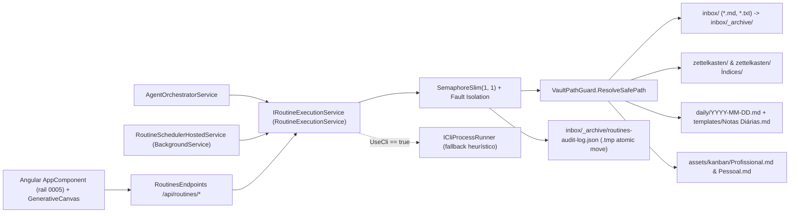

## 1. Fonte canônica

- Especificação da task e reconciliação `/spec-frontend`: [`backlog/tasks/0005-nightly-autonomous-worker-inbox-triage.md`](../../backlog/tasks/0005-nightly-autonomous-worker-inbox-triage.md)
- Mockup canônico aprovado: [`frontend/_imports/claude-design/granbrain-redesign/2026-10-30/original/granbrain-redesign.html`](../../frontend/_imports/claude-design/granbrain-redesign/2026-10-30/original/granbrain-redesign.html)
- Governança e arquitetura: [`CLAUDE.md`](../../CLAUDE.md) e [`docs/adr/0001-granbrain-architecture.md`](../../docs/adr/0001-granbrain-architecture.md)

## 2. Decisões (não reabrir)

| ID | Decisão | Regra vinculante na execução |
| :--- | :--- | :--- |
| D1 | Roteamento do `InboxTriageJob` para `zettelkasten/` (`Reunião - <SafeTitle>.md` ou `<SafeTitle>.md`), motor heurístico padrão + CLI opcional (`UseCli`), proteção contra sobrescrita e arquivamento em `inbox/_archive/` | Varrer apenas `inbox/` (`SearchOption.TopDirectoryOnly`) para `*.md` e `*.txt`, ignorando `inbox/_archive/` e arquivos `.json`; gerar nota com um único frontmatter YAML (`type`, `created`, `source_inbox`, `tags`), `[[Fleeting]]` e MOCs de `zettelkasten/Índices/`; usar sufixo colisão-seguro se o destino em `zettelkasten/` existir; usar `ICliProcessRunner` só com `UseCli = true` fazendo fallback automático para heurística; mover o original intacto para `inbox/_archive/` (com sufixo em colisão); atualizar `ObsidianVaultService.GetOverviewAsync` para contar `*.md` e `*.txt` |
| D2 | Idempotência em `daily/YYYY-MM-DD.md` por marcadores HTML nas seções de `templates/Notas Diárias.md` | `MorningPrepJob` (`06:00`) cria `daily/YYYY-MM-DD.md` via `templates/Notas Diárias.md` normalizando `- [x]` para `- [ ]` em `#### Cronograma` só na criação (preservando `[x]` em nota existente) e faz upsert `<!-- routine-id:morning-prep -->` sob `#### Tarefas` a partir de `To Do`/`Doing` de `Profissional.md` e `Pessoal.md`, preservando `- [[Profissional]]` e `- [[Pessoal]]`; `NightlyClosureJob` (`23:30`) lê hábitos de `#### Cronograma` ignorando `<!-- cal-id:` (`0/0` -> `0%`) e faz upsert de 1 linha `<!-- routine-id:nightly-closure -->` sob `#### Reflexões do Dia` (`> **Reflexões:**`) criando a seção se ausente e preservando 100% do conteúdo manual em `#### Diário`, `#### Reflexões do Dia`, `> **Agradecimentos:**`, `#### Cronograma` e `#### Anotações` |
| D3 | Serialização por `SemaphoreSlim(1, 1)`, isolamento de falhas por arquivo, auditoria atômica, `BackgroundService` configurável e JWT Bearer | Isolar falha de I/O por arquivo (`FailedCount++` + entrada de erro no log) propagando apenas `VaultPathViolationException`; serializar execução e gravar `inbox/_archive/routines-audit-log.json` atomicamente (`.tmp` + `File.Move(..., overwrite: true)`), tolerando JSON ausente ou corrompido; respeitar `RoutinesOptions.EnableBackgroundScheduler` em `RoutineSchedulerHostedService`; exigir `.RequireAuthorization()` nos endpoints `/api/routines/*` |
| D4 | Painel `/spec-frontend` 100% Balde A em `styles.scss`, rail `0005` e bloco `routines-panel` | Reconciliar `.routine`, `.routine p`, `.row`, `.row:last-child`, `button.row`, `button.row:last-child`, `button.row[aria-pressed="true"] strong`, `.empty`, `.code`, `.logrow`, `.logrow:last-child`, `.logrow p` e `@media (max-width: 640px)` usando tokens `:root` existentes; conectar rail `0005` (`Rotinas & Inbox`) em `AppComponent` e renderizar `routines-panel` em `GenerativeCanvasComponent` com `[data-routine-triage]` (`disabled` + `Triando…` em voo) e `[data-routine-run]` |

## 3. Arquitetura

### Catálogo de Códigos de Erro Declarados

Todos os códigos seguem o tratador global em `backend/src/GranBrain.Api/Program.cs` (`VaultPathViolationException` -> HTTP `400`, `VaultValidationException` -> HTTP `400`, `VaultEntityNotFoundException` -> HTTP `404`):

| Código | Exceção .NET | Status HTTP | Condição de disparo |
| :--- | :--- | :--- | :--- |
| `vault_path_violation` | `VaultPathViolationException` | `400 Bad Request` | Caminho bruto de `InboxFolder`, `ArchiveFolder`, `ZettelkastenFolder` ou override contendo `..`, caminho raiz ou escape fora de `VaultRoot` validado antes de sanitizar nomes de arquivo |
| `invalid_routine_date` | `VaultValidationException` | `400 Bad Request` | Parâmetro `date` inválido (fora de `yyyy-MM-dd`) na requisição de `POST /api/routines/triage` ou `POST /api/routines/{jobId}/run` |
| `invalid_request_body` | `VaultValidationException` | `400 Bad Request` | Payload JSON sintaticamente inválido no corpo de `POST /api/routines/triage` ou `POST /api/routines/{jobId}/run` (corpo vazio opcional continua aceito) |
| `routine_job_not_found` | `VaultEntityNotFoundException` | `404 Not Found` | `jobId` desconhecido em `POST /api/routines/{jobId}/run` (aceita apenas `MorningPrepJob`, `InboxTriageJob` e `NightlyClosureJob`, case-insensitive) |

## Manifesto de execução

- **SHA-base:** `69d10bc017a3756364fdda9396e4274ff38cc7c8`
- **Invariantes transversais:**
  - Nenhum arquivo do cofre é apagado pelo motor de rotinas: arquivos processados do `inbox/` vão intactos para `inbox/_archive/`, e notas preexistentes em `zettelkasten/` nunca são sobrescritas (usa-se sufixo incremental ` - 2`, ` - 3`, etc.).
  - Todo caminho relativo ou pasta configurada/enviada passa por `VaultPathGuard.ResolveSafePath` antes de qualquer `SanitizeFileName` ou operação de disco.
  - `MorningPrepJob` e `NightlyClosureJob` operam estritamente por marcadores `<!-- routine-id:morning-prep -->` e `<!-- routine-id:nightly-closure -->`, ignorando linhas `<!-- cal-id:` no cálculo de hábitos, tratando `0/0` como `0%` e preservando texto humano fora dos marcadores.
  - `ObsidianVaultService.GetOverviewAsync` e `RoutineExecutionService.GetOverviewAsync` enumeram ambos `*.md` e `*.txt` com `SearchOption.TopDirectoryOnly` em `inbox/` para manter `InboxPendingCount` consistente em todo o sistema.
  - Em execuções automatizadas via `WebApplicationFactory<Program>`, `GranBrain:Routines:EnableBackgroundScheduler` é configurado como `"false"` para evitar interferência de timers em segundo plano nos cofres temporários de teste.
- **Contratos / Seletores novos introduzidos nesta WI:**
  - C# opções e DTOs (`backend/src/GranBrain.Core/`): `RoutinesOptions`, `RoutineStatusCardDto`, `InboxQueueItemDto`, `RoutineExecutionLogDto`, `RoutinesOverviewDto`, `InboxTriageFileResultDto`, `RoutineRunResultDto`, `RoutineRunRequest`, `IRoutineExecutionService`, `GenerativeUiBlockTypes.RoutinesPanel = "routines-panel"`, `GenerativeUiBlock.RoutinesOverview`.
  - Endpoints backend (`backend/src/GranBrain.Api/Endpoints/RoutinesEndpoints.cs`): `GET /api/routines/overview`, `POST /api/routines/triage`, `POST /api/routines/{jobId}/run`.
  - Angular modelos/métodos (`frontend/src/app/`): `RoutineStatusCard`, `InboxQueueItem`, `RoutineExecutionLog`, `RoutinesOverview`, `InboxTriageFileResult`, `RoutineRunResult`, `RoutineRunRequest`, `GranBrainApiService.getRoutinesOverview`, `triageInboxNow`, `runRoutineJob`.
  - Seletores CSS/DOM obrigatórios (`frontend/src/styles.scss` e `GenerativeCanvasComponent`/`AppComponent`): `.routine`, `.row`, `.empty`, `.code`, `.logrow`, `.nav-item.on`, `.topbar .crumb`, `[data-block-type="routines-panel"]`, `[data-routine-triage]`, `[data-routine-run]`.

## Matriz de cobertura

| AC | Fatia dona | Comportamento exato exigido | Fronteira de produção | Verificação vinculada (nome + comportamento + sinal negativo) | Discriminante |
| :--- | :--- | :--- | :--- | :--- | :--- |
| AC1 | Fatia 1 | `InboxTriageJob` varre `*.md` e `*.txt` só na raiz de `inbox/` (ignorando `_archive/` e `.json`); roteia reuniões para `zettelkasten/Reunião - <SafeTitle>.md` e conceitos/ideias/capturas para `zettelkasten/<SafeTitle>.md` com YAML único (`type`, `created`, `source_inbox`, `tags`), `[[Fleeting]]` e MOCs de `zettelkasten/Índices/`; evita sobrescrita em `zettelkasten/` com sufixo colisão-seguro; suporta `UseCli = true` (JSON CLI + fallback heurístico); move original intacto para `inbox/_archive/`; alinha `ObsidianVaultService.GetOverviewAsync` (`*.md` + `*.txt`) | `backend/src/GranBrain.Infrastructure/Jobs/RoutineExecutionService.cs`, `backend/src/GranBrain.Infrastructure/Vault/ObsidianVaultService.cs` | `RoutineExecutionServiceTests.InboxTriageJob_PromotesMdAndTxtNotes_RoutesMeetings_PreservesExistingZettel_AndArchivesOriginals` + `InboxTriageJob_WithUseCliTrue_AppliesCliOutputAndFallsBackToHeuristicOnCliFailure` | Mistura `.txt`, `.md` com frontmatter duplicado `---` e nota pré-existente em `zettelkasten/`; sem sufixo ou sem `SearchOption.TopDirectoryOnly` ou sem fallback CLI o teste falha na asserção de conteúdo/contagem |
| AC2 | Fatia 1 | `NightlyClosureJob` calcula adesão só dentro de `#### Cronograma` ignorando `<!-- cal-id:` (com guarda `0/0 -> 0%`) e soma colunas Kanban; faz upsert de 1 linha `<!-- routine-id:nightly-closure -->` sob `#### Reflexões do Dia` (`> **Reflexões:**`), criando a seção se ausente e preservando anotações manuais; reexecução após novo hábito marcado atualiza o percentual na mesma linha | `backend/src/GranBrain.Infrastructure/Jobs/RoutineExecutionService.cs` | `RoutineExecutionServiceTests.NightlyClosureJob_UpsertsUpdatedMetricsIdempotently_IgnoresCalendarLines_AndPreservesUserDiary` | Marca um novo hábito `[x]` entre execução 1 (`1/3`, `33%`) e execução 2 (`2/3`, `67%`) e testa nota mínima com `0/0` (`0%`) e sem `#### Reflexões do Dia`; skip ingênuo ou divisão por zero falham imediatamente |
| AC3 | Fatia 1 | `VaultInitializer` garante `templates/Notas Diárias.md` sem sobrescrever existente; `MorningPrepJob` normaliza `- [x]` para `- [ ]` em `#### Cronograma` ao criar nova `daily/YYYY-MM-DD.md`, preserva `- [x]` se a nota já existir, e faz upsert `<!-- routine-id:morning-prep -->` sob `#### Tarefas` com `To Do`/`Doing` de `Profissional.md` e `Pessoal.md`, atualizando quando o Kanban muda | `backend/src/GranBrain.Infrastructure/Vault/VaultInitializer.cs`, `backend/src/GranBrain.Infrastructure/Jobs/RoutineExecutionService.cs` | `RoutineExecutionServiceTests.MorningPrepJob_NormalizesNewDailyHabits_PreservesExistingCheckedHabits_AndUpsertsKanbanTasks` + `VaultInitializerTests` | Fixture de template contém `- [x]` para provar normalização para `- [ ]` na criação; depois altera Kanban + marca hábito `[x]` e reexecuta para provar preservação de `[x]` e sincronização das linhas `<!-- routine-id:morning-prep -->` |
| AC4 | Fatia 1 & Fatia 2 | `VaultPathGuard.ResolveSafePath` bloqueia traversal bruto (`vault_path_violation` -> 400); erro de I/O em arquivo corrompido é isolado (`FailedCount++`); `SemaphoreSlim(1, 1)` serializa concorrência e persiste `inbox/_archive/routines-audit-log.json` atomicamente (tolerando JSON ausente/corrompido); `RoutineSchedulerHostedService` respeita `EnableBackgroundScheduler` e executa janelas com clock injetável; endpoints `/api/routines/*` exigem JWT (`401`), aceitam corpo vazio, validam `date` (`400 invalid_routine_date`), JSON inválido (`400 invalid_request_body`) e `jobId` desconhecido (`404 routine_job_not_found`) | `backend/src/GranBrain.Core/Security/VaultPathGuard.cs`, `backend/src/GranBrain.Infrastructure/Jobs/RoutineExecutionService.cs`, `backend/src/GranBrain.Infrastructure/Jobs/RoutineSchedulerHostedService.cs`, `backend/src/GranBrain.Api/Endpoints/RoutinesEndpoints.cs`, `backend/src/GranBrain.Api/Program.cs` | `RoutineExecutionServiceTests.FaultIsolationConcurrencyAndScheduler_IsolatesCorruptFile_SerializesLogs_AndRespectsSchedulerFlag` + `ApiSecurityAndAgentTests.RoutinesEndpoints_EnforceJwtAuth_ValidateInputs_RunJobs_AndEmitRoutinesPanelInAgentChat` | Dispara execução com arquivo travado/ilegível ao lado de arquivo válido, `Task.WhenAll` concorrente sobre `routines-audit-log.json` corrompido, teste de tick do scheduler com flag `false`/`true`, e chamadas HTTP `401`/`200`/`400`/`404` |
| AC5 | Fatia 2 & Fatia 3 | `AgentOrchestratorService` reconhece intenção de rotinas/triagem/inbox emitindo bloco `routines-panel`; Angular navega via rail `0005` para `currentView = 'rotinas'` (`.nav-item.on`), atualiza `.topbar .crumb` para `Rotinas & Inbox`, renderiza 3 `.card.routine`, `.pill.warn`/`ok`, `.row`, `.empty` e `.logrow`; `[data-routine-triage]` exibe `disabled` + `Triando…` em voo e atualiza UI + toast ao concluir; `getComputedStyle` valida classes Balde A | `backend/src/GranBrain.Infrastructure/Agents/AgentOrchestratorService.cs`, `frontend/src/styles.scss`, `frontend/src/app/models/granbrain.models.ts`, `frontend/src/app/services/granbrain-api.service.ts`, `frontend/src/app/app.component.ts`, `frontend/src/app/app.component.html`, `frontend/src/app/components/generative-canvas/generative-canvas.component.ts`, `frontend/src/app/components/generative-canvas/generative-canvas.component.html` | `ApiSecurityAndAgentTests.RoutinesEndpoints_EnforceJwtAuth_ValidateInputs_RunJobs_AndEmitRoutinesPanelInAgentChat` + `frontend/src/app/app.spec.ts` | Verifica emissão real de `"routines-panel"` em `POST /api/agent/chat`, verifica `[data-routine-triage].disabled === true` antes do `flush()`, transição `.pill.warn` -> `.pill.ok`, `.empty`, `.logrow` prepended, `.topbar .crumb` e `getComputedStyle` em `.routine`, `.logrow`, `.row`, `.empty`, `.code` |

### Dimensões de risco

| Dimensão | Risco identificado | Mitigação planejada |
| :--- | :--- | :--- |
| Fronteira e Falha | Arquivo corrompido ou bloqueado no `inbox/` abortar toda a triagem; nota mínima sem `#### Tarefas`/`#### Reflexões do Dia` ou sem hábitos causar exceção ou divisão por zero (`0/0`) | Envolver cada item do inbox em `try/catch` individual (re-lançando somente `VaultPathViolationException`), criar seções faltantes em `daily/YYYY-MM-DD.md` quando ausentes e aplicar guarda `HabitsTotal == 0 ? 0 : Math.Round(...)` |
| Concorrência e Persistência | Disparo simultâneo (scheduler + botão manual / múltiplas abas) corromper `daily/`, `inbox/` ou `inbox/_archive/routines-audit-log.json` | Proteger toda execução e IO de log com `SemaphoreSlim(1, 1)` em `RoutineExecutionService`, gravar log em arquivo `.tmp` seguido de `File.Move(..., overwrite: true)` e recuperar com segurança quando `routines-audit-log.json` estiver vazio ou inválido |
| Isolamento de Testes / Scheduler | `RoutineSchedulerHostedService` disparar timers em segundo plano sobre cofres temporários durante os testes `WebApplicationFactory<Program>` em `ApiSecurityAndAgentTests` | Expor `RoutinesOptions.EnableBackgroundScheduler` (`true` por padrão em `appsettings.json`, `"false"` injetado em `ApiSecurityAndAgentTests.CreateTestFactory`) e método testável `ExecuteTickAsync` com `Func<DateTimeOffset>` |
| Segurança / Vault Jail | Path traversal via configuração ou parâmetro `inboxFolder` passar por `SanitizeFileName` e burlar a prisão do cofre | Executar `VaultPathGuard.ResolveSafePath` no caminho bruto antes de sanitizar títulos ou concatenar nomes de arquivo |
| Preservação do Cofre | `InboxTriageJob` sobrescrever nota permanente homônima em `zettelkasten/` ou `MorningPrepJob` sobrescrever hábitos já marcados ou anotações humanas | Gerar sufixo incremental em `zettelkasten/` quando o arquivo existir, mover originais sempre para `inbox/_archive/` sem apagar e alterar apenas linhas marcadas com `<!-- routine-id:... -->` |

- Dimensões não aplicáveis: **Transação distribuída / Multi-banco** (armazenamento local em arquivos Markdown + JSON único sob `SemaphoreSlim`); **Isolamento de tenant** (instância pessoal single-user de Igor Grandin com autenticação JWT única).

## Fronteiras

| Fronteira | Produtor | Consumidor | Regra de contrato |
| :--- | :--- | :--- | :--- |
| Producer→Consumer 1 (HTTP/JSON C#→TS) | `RoutineExecutionService` (`RoutinesOverviewDto`, `RoutineRunResultDto`) | `RoutinesEndpoints` + `AgentOrchestratorService` (`GenerativeUiBlock.RoutinesOverview`) -> `GranBrainApiService` -> `GenerativeCanvasComponent` | Nomes exatos em JSON camelCase: `inboxPendingCount`, `routines[]` (`jobId`, `title`, `scheduleLabel`, `status`, `statusTone`, `lastRunSummary`), `inboxItems[]` (`fileName`, `relativePath`, `suggestedDestination`, `tag`, `extension`), `logs[]` (`id`, `jobId`, `executedAtIso`, `displayTime`, `status`, `message`, `itemsProcessed`, `itemsFailed`, `touchedFiles`), `fileResults[]` (`sourceFile`, `destinationNotePath`, `archivePath`, `category`, `succeeded`, `errorMessage`) |
| Producer→Consumer 2 (Markdown Vault) | `MorningPrepJob` & `NightlyClosureJob` | `ObsidianVaultService` (`ParseHabitsFromLines`, `ToggleHabitAsync`) e notas humanas em `daily/YYYY-MM-DD.md` | Marcadores exclusivos `<!-- routine-id:morning-prep -->` em `#### Tarefas` e `<!-- routine-id:nightly-closure -->` em `#### Reflexões do Dia`; linhas `<!-- cal-id:` nunca entram no cálculo de hábitos; `- [[Profissional]]`, `- [[Pessoal]]` e texto fora dos marcadores permanecem intactos |
| External input & CLI | Arquivos brutos `*.md`/`*.txt` no `inbox/`, saída JSON opcional do `ICliProcessRunner`, query/body HTTP | `InboxTriageJob`, `RoutinesEndpoints`, `VaultPathGuard` | `date` validado via `DateOnly.TryParseExact(..., "yyyy-MM-dd")` -> `invalid_routine_date` (`400`); JSON inválido -> `invalid_request_body` (`400`); caminho fora do vault -> `VaultPathViolationException` (`400`); falha/JSON inválido da CLI faz fallback silencioso para heurística |

## 4. Fatias

### Fatia 1 — Motor de Rotinas (`InboxTriageJob`, `NightlyClosureJob`, `MorningPrepJob`), Agendador e Auditoria no Vault

- **Pre-requisitos:** nenhum (base `69d10bc017a3756364fdda9396e4274ff38cc7c8`)
- **Owner:** executor backend C#
- **Parallel:** `false` (Fatia 2 depende das interfaces, DTOs e serviços desta fatia)
- **ACs:** AC1, AC2, AC3 e parte de núcleo de AC4 (isolamento de falhas, `SemaphoreSlim`, log atômico, `RoutineSchedulerHostedService`, `VaultPathGuard`)
- **Shared contracts:**
  - `backend/src/GranBrain.Core/Configuration/RoutinesOptions.cs` (`EnableBackgroundScheduler`, `MorningPrepTime`, `NightlyClosureTime`, `InboxIntervalMinutes`, `UseCli`, `InboxFolder`, `ArchiveFolder`, `ZettelkastenFolder`, `TimeZoneId`, `MaxAuditEntries`)
  - `backend/src/GranBrain.Core/Models/RoutineModels.cs` (`RoutineStatusCardDto`, `InboxQueueItemDto`, `RoutineExecutionLogDto`, `RoutinesOverviewDto`, `InboxTriageFileResultDto`, `RoutineRunResultDto`, `RoutineRunRequest`)
  - `backend/src/GranBrain.Core/Models/GenerativeUiModels.cs` (adicionar `GenerativeUiBlockTypes.RoutinesPanel = "routines-panel"` e propriedade `RoutinesOverviewDto? RoutinesOverview = null` ao `GenerativeUiBlock`)
  - `backend/src/GranBrain.Core/Interfaces/IRoutineExecutionService.cs` (`GetOverviewAsync`, `RunInboxTriageAsync`, `RunJobAsync`)
- **Write-set:**
  - `backend/src/GranBrain.Core/Configuration/RoutinesOptions.cs`
  - `backend/src/GranBrain.Core/Models/RoutineModels.cs`
  - `backend/src/GranBrain.Core/Models/GenerativeUiModels.cs`
  - `backend/src/GranBrain.Core/Interfaces/IRoutineExecutionService.cs`
  - `backend/src/GranBrain.Infrastructure/Jobs/RoutineExecutionService.cs`
  - `backend/src/GranBrain.Infrastructure/Jobs/RoutineSchedulerHostedService.cs`
  - `backend/src/GranBrain.Infrastructure/Vault/VaultInitializer.cs` (garantir criação não destrutiva de `templates/Notas Diárias.md`)
  - `backend/src/GranBrain.Infrastructure/Vault/ObsidianVaultService.cs` (enumerar `*.md` e `*.txt` com `SearchOption.TopDirectoryOnly` em `inbox/` dentro de `GetOverviewAsync`)
  - `backend/tests/GranBrain.UnitTests/RoutineExecutionServiceTests.cs`
  - `backend/tests/GranBrain.UnitTests/VaultInitializerTests.cs`
  - `backend/tests/GranBrain.UnitTests/ObsidianVaultServiceTests.cs`
- **Composição:** `RoutineExecutionService` compõe `VaultPathGuard`, `VaultInitializer`, `IVaultService`, `ICliProcessRunner`, `RoutinesOptions` e `CalendarTimeZoneResolver` sobre um cofre temporário real sem mocks de arquivo no núcleo; `RoutineSchedulerHostedService` consome `IRoutineExecutionService` com `RoutinesOptions` e `Func<DateTimeOffset>` injetável.
- **Discriminante:** `RoutineExecutionServiceTests.InboxTriageJob_PromotesMdAndTxtNotes_RoutesMeetings_PreservesExistingZettel_AndArchivesOriginals` (ao lado dos demais cenários em `RoutineExecutionServiceTests`, prova geração em `zettelkasten/`, sufixo não destrutivo, limpeza de YAML duplicado, movimento intacto para `_archive/` e paridade `*.md`+`*.txt` em `ObsidianVaultService.GetOverviewAsync`).
- **Focused checks:**
  - `dotnet test backend/GranBrain.sln -c Release --filter "FullyQualifiedName~RoutineExecutionServiceTests|FullyQualifiedName~VaultInitializerTests|FullyQualifiedName~ObsidianVaultServiceTests"` -> todos os testes verdes sem warnings.
- **Reuso:**

| Símbolo / Padrão Existente | Caminho | Como reutilizar nesta fatia |
| :--- | :--- | :--- |
| `VaultPathGuard.ResolveSafePath` & exceções `Vault*` | `backend/src/GranBrain.Core/Security/VaultPathGuard.cs` | Validar `InboxFolder`, `ArchiveFolder`, `ZettelkastenFolder` e `daily/` brutos antes de sanitizar títulos |
| `CalendarTimeZoneResolver.Resolve` & `ConvertToLocal` | `backend/src/GranBrain.Infrastructure/Calendar/CalendarTimeZoneResolver.cs` | Resolver data/hora local Windows e Linux (`America/Sao_Paulo` / `E. South America Standard Time`) no scheduler e nas rotinas |
| `VaultInitializer.SanitizeTemplateFrontmatter` | `backend/src/GranBrain.Infrastructure/Vault/VaultInitializer.cs` | Sanitizar `templates/Notas Diárias.md` e estender `EnsureInitializedAsync` para criá-lo quando ausente sem sobrescrever arquivo existente |
| `ObsidianVaultService` (`GetDailyHabitsAsync`, `GetKanbanBoardAsync`, `GetOverviewAsync`) | `backend/src/GranBrain.Infrastructure/Vault/ObsidianVaultService.cs` | Reaproveitar leitura de hábitos/Kanban e ajustar `GetOverviewAsync` para contar `*.md` e `*.txt` em `inbox/` (`SearchOption.TopDirectoryOnly`) |
| `ICliProcessRunner` & padrão de fallback | `backend/src/GranBrain.Core/Interfaces/ICliProcessRunner.cs` | Invocar CLI opcionalmente só quando `RoutinesOptions.UseCli == true`, mantendo classificação heurística como fallback automático |

---

### Fatia 2 — Endpoints `/api/routines/*`, Registro em `Program.cs` e `AgentOrchestratorService`

- **Pre-requisitos:** Fatia 1 concluída
- **Owner:** executor backend API C#
- **Parallel:** `false` (depende de `IRoutineExecutionService` e DTOs da Fatia 1)
- **ACs:** AC4 (rotas HTTP protegidas por JWT, validação de JSON/data/traversal/jobId) e AC5 (orquestrador emitindo bloco `routines-panel`)
- **Shared contracts:**
  - `GET /api/routines/overview` -> `RoutinesOverviewDto` (`401` sem JWT)
  - `POST /api/routines/triage` -> `RoutineRunResultDto` (corpo `RoutineRunRequest?` opcional; `400 invalid_request_body`, `400 invalid_routine_date`, `400 vault_path_violation`)
  - `POST /api/routines/{jobId}/run` -> `RoutineRunResultDto` (`404 routine_job_not_found`, `400 invalid_request_body`, `400 invalid_routine_date`)
  - `AgentOrchestratorService` emitindo `GenerativeUiBlock` com `Type = GenerativeUiBlockTypes.RoutinesPanel` e `RoutinesOverview` populado
- **Write-set:**
  - `backend/src/GranBrain.Api/Endpoints/RoutinesEndpoints.cs`
  - `backend/src/GranBrain.Api/Program.cs` (registrar `RoutinesOptions`, `IRoutineExecutionService`/`RoutineExecutionService`, `AddHostedService<RoutineSchedulerHostedService>()`, e `app.MapRoutinesEndpoints()`)
  - `backend/src/GranBrain.Api/appsettings.json` (adicionar seção `"Routines"` com `EnableBackgroundScheduler: true`, `UseCli: false`, `MorningPrepTime: "06:00"`, `NightlyClosureTime: "23:30"`, `InboxIntervalMinutes: 120`, `TimeZoneId: "America/Sao_Paulo"`)
  - `backend/src/GranBrain.Infrastructure/Agents/AgentOrchestratorService.cs` (injetar `IRoutineExecutionService`, reconhecer intenção `IsRoutinesIntent` e disparar triagem em comando explícito de triagem emitindo bloco `routines-panel`)
  - `backend/tests/GranBrain.UnitTests/ApiSecurityAndAgentTests.cs` (atualizar `CreateTestFactory` definindo `GranBrain:Routines:EnableBackgroundScheduler = "false"` e adicionar `RoutinesEndpoints_EnforceJwtAuth_ValidateInputs_RunJobs_AndEmitRoutinesPanelInAgentChat`)
- **Composição:** `Program.cs` registra `RoutinesOptions`, `RoutineExecutionService` (`IRoutineExecutionService`), `RoutineSchedulerHostedService` e `MapRoutinesEndpoints()` sob `.RequireAuthorization()` + middleware global de exceções (`400`/`401`/`404`), enquanto `ApiSecurityAndAgentTests.CreateTestFactory` instancia `WebApplicationFactory<Program>` real com `GranBrain:Routines:EnableBackgroundScheduler = "false"` para testar o pipeline HTTP + `AgentOrchestratorService` sem timers concorrentes.
- **Discriminante:** `ApiSecurityAndAgentTests.RoutinesEndpoints_EnforceJwtAuth_ValidateInputs_RunJobs_AndEmitRoutinesPanelInAgentChat` (garante `401` sem JWT, execução de `triage`, `MorningPrepJob` e `NightlyClosureJob`, códigos `400`/`404` e emissão real de `"routines-panel"` no chat).
- **Focused checks:**
  - `dotnet test backend/GranBrain.sln -c Release --filter "FullyQualifiedName~ApiSecurityAndAgentTests"` -> verdes todos os testes de API e segurança existentes + novo teste de rotinas.
- **Reuso:**

| Símbolo / Padrão Existente | Caminho | Como reutilizar nesta fatia |
| :--- | :--- | :--- |
| `CalendarEndpoints` (`MapGroup`, `.RequireAuthorization()`, `TryReadOptionalBodyAsync`) | `backend/src/GranBrain.Api/Endpoints/CalendarEndpoints.cs` | Seguir exatamente a assinatura Minimal API, leitura tolerante a corpo vazio e `VaultValidationException("invalid_request_body", ...)` |
| Pipeline DI e tratador de exceções em `Program.cs` | `backend/src/GranBrain.Api/Program.cs` | Reutilizar registro `GranBrainOptions`, `ProductionConfigurationValidator`, JWT Bearer e mapeamento de `VaultPathViolationException`/`VaultValidationException`/`VaultEntityNotFoundException` |
| `AgentOrchestratorService` (`BuildDynamicUiBlocksForPromptAsync` e mutações) | `backend/src/GranBrain.Infrastructure/Agents/AgentOrchestratorService.cs` | Preservar detecção de `wantsHabits` existente e adicionar `IsRoutinesIntent` sem quebrar blocos atuais |
| `ApiSecurityAndAgentTests.CreateTestFactory` | `backend/tests/GranBrain.UnitTests/ApiSecurityAndAgentTests.cs` | Reaproveitar fixture `WebApplicationFactory<Program>` acrescentando apenas a chave `GranBrain:Routines:EnableBackgroundScheduler = "false"` |

---

### Fatia 3 — Frontend Ionic Angular: Reconciliação `/spec-frontend` (`styles.scss`), Rail `0005` e Bloco `routines-panel`

- **Pre-requisitos:** Fatia 2 concluída
- **Owner:** executor frontend Angular/Ionic
- **Parallel:** `false` (consome os contratos JSON de `/api/routines/*` consolidados na Fatia 2)
- **ACs:** AC5 (fidelidade visual ao mockup Balde A, navegação pelo rail `0005`, fluxo de triagem com estado `Triando…`, atualização DOM, toast e verificação `getComputedStyle`)
- **Shared contracts:**
  - `frontend/src/app/models/granbrain.models.ts`: interfaces `RoutineStatusCard`, `InboxQueueItem`, `RoutineExecutionLog`, `RoutinesOverview`, `InboxTriageFileResult`, `RoutineRunResult`, `RoutineRunRequest`, extensão de `GenerativeUiBlockType` (`'routines-panel'`) e `GenerativeUiBlock.routinesOverview?: RoutinesOverview`
  - `frontend/src/app/services/granbrain-api.service.ts`: métodos `getRoutinesOverview()`, `triageInboxNow(request?: RoutineRunRequest)`, `runRoutineJob(jobId: string, request?: RoutineRunRequest)`
- **Write-set:**
  - `frontend/src/styles.scss` (adicionar `.row`, `.row:last-child`, `button.row`, `button.row:last-child`, `button.row[aria-pressed="true"] strong`, `.empty`, `.code`, `.logrow`, `.logrow:last-child`, `.logrow p`, `.routine`, `.routine p` e regra `@media (max-width: 640px) { .logrow { grid-template-columns: minmax(0, 1fr); gap: 4px; } }`)
  - `frontend/src/app/models/granbrain.models.ts`
  - `frontend/src/app/services/granbrain-api.service.ts`
  - `frontend/src/app/components/generative-canvas/generative-canvas.component.ts`
  - `frontend/src/app/components/generative-canvas/generative-canvas.component.html`
  - `frontend/src/app/app.component.ts`
  - `frontend/src/app/app.component.html` (adicionar item de rail `0005` `Rotinas & Inbox` ligado a `openRoutinesView()`, refletindo `currentView === 'rotinas'` no breadcrumb `.topbar .crumb`)
  - `frontend/src/app/app.spec.ts`
- **Discriminante:** `AppComponent navigates to Routines 0005 view, renders .routine/.logrow/.row and executes inbox triage with in-flight disable` em `frontend/src/app/app.spec.ts` (sem as classes Balde A em `styles.scss`, sem desabilitar `[data-routine-triage]` com `Triando…` antes do `flush`, ou sem atualizar `.topbar .crumb` / `.empty` / `.logrow`, o spec falha).
- **Focused checks:**
  - `npm --prefix frontend test -- --watch=false` -> todos os specs verdes incluindo estados in-flight e `getComputedStyle`.
  - `npm --prefix frontend run build` -> bundle Angular compila sem erros.
- **Reuso:**

| Símbolo / Padrão Existente | Caminho | Como reutilizar nesta fatia |
| :--- | :--- | :--- |
| Tokens `:root`, `.card`, `.card-h`, `.pill`, `.grid`, `.g-2`, `.g-3`, `.btn`, `.wi`, `.nt` | `frontend/src/styles.scss` | Reaproveitar 100% dos tokens existentes (Balde A) sem criar nenhuma nova variável `:root` |
| `GranBrainApiService` (`getHeaders`, `HttpClient`) | `frontend/src/app/services/granbrain-api.service.ts` | Seguir exatamente o padrão de `getCalendarToday()` e `syncCalendar()` |
| `AppComponent` (`openAgendaView`, `showToast`, topbar `.crumb`, rail) | `frontend/src/app/app.component.ts` e `frontend/src/app/app.component.html` | Seguir o padrão do item `0003` (`Agenda & Sincronia`) para ligar o item `0005` (`Rotinas & Inbox`) e eventos do `GenerativeCanvasComponent` |
| `GenerativeCanvasComponent` (`@switch`/`*ngIf` por `block.type`) | `frontend/src/app/components/generative-canvas/generative-canvas.component.html` | Adicionar bloco `[data-block-type="routines-panel"]` com `@Output()` `routineTriageRequested` e `routineJobRunRequested` |

---

### Fatia 4 — Gate Final em Árvore Limpa

- **Pre-requisitos:** Fatias 1, 2 e 3 concluídas e commitadas na branch de trabalho
- **Owner:** executor / verificador independente
- **Parallel:** `false`
- **ACs:** AC1, AC2, AC3, AC4 e AC5 verificados integralmente contra o último commit
- **Shared contracts:** Todos os contratos das Fatias 1 a 3
- **Write-set:** Nenhum arquivo editado nesta fatia (somente execução de checks e verificação visual/estrutural; qualquer correção exige slice próprio antes de reexecutar o gate)
- **Discriminante:** Nenhum (fatia exclusivamente de verificação de gate contra o último commit em árvore limpa; correções eventuais geram fatia dedicada antes de reexecutar).
- **Focused checks:**
  - `dotnet build backend/GranBrain.sln -c Release` -> exit code `0`, zero erros
  - `dotnet test backend/GranBrain.sln -c Release` -> 100% dos testes passando sem skips nem relaxamentos
  - `npm --prefix frontend test -- --watch=false` -> 100% dos specs verdes
  - `npm --prefix frontend run build` -> build de produção Angular verde e árvore git limpa
- **Reuso:** A fatia não cria artefato novo; reutiliza apenas a solução e scripts oficiais listados abaixo:

| Símbolo / Padrão Existente | Caminho | Como reutilizar nesta fatia |
| :--- | :--- | :--- |
| Solução .NET `GranBrain.sln` | `backend/GranBrain.sln` | Executar `dotnet build -c Release` e `dotnet test -c Release` no último commit |
| Scripts Angular em `package.json` | `frontend/package.json` | Executar `npm --prefix frontend test -- --watch=false` e `npm --prefix frontend run build` no último commit |

## 5. Testes

1. **Triagem do Inbox, Roteamento de Notas, Colisões e Modo CLI/Heurístico (`backend/tests/GranBrain.UnitTests/RoutineExecutionServiceTests.cs` — vizinho `backend/tests/GranBrain.UnitTests/CalendarSyncServiceTests.cs` no projeto `backend/tests/GranBrain.UnitTests/GranBrain.UnitTests.csproj`; alvos: `RoutineExecutionService.cs`, `ObsidianVaultService.cs`)**
   - `InboxTriageJob_PromotesMdAndTxtNotes_RoutesMeetings_PreservesExistingZettel_AndArchivesOriginals`
     - *Fixture rastreável:* cofre temporário com `zettelkasten/Índices/CSharp.md` e `Curso de Seguros - Confitec.md`, nota preexistente `zettelkasten/Estudo LINQ.md` (conteúdo manual protegido), arquivo bruto `inbox/Ideia sobre flashcards.txt`, `inbox/Ata da reunião arquitetura.md` (com blocos `---` duplicados de captura prévia), `inbox/Estudo LINQ.md` (para testar colisão em `zettelkasten/`), `inbox/Captura rápida.md` com tag `#mobile-capture` e arquivo já arquivado em `inbox/_archive/anterior.md`.
     - *Asserts positivos:* antes da triagem, tanto `ObsidianVaultService.GetOverviewAsync()` quanto `RoutineExecutionService.GetOverviewAsync()` retornam `InboxPendingCount == 4` (somando `.md` + `.txt` só na raiz de `inbox/`); após triagem, gera `zettelkasten/Reunião - Ata da reunião arquitetura.md`, `zettelkasten/Ideia sobre flashcards.md` e `zettelkasten/Estudo LINQ - 2.md` (preservando `zettelkasten/Estudo LINQ.md` original intacto), todos com exatamente um bloco YAML frontmatter (`type`, `created`, `source_inbox`, `tags`) + `[[Fleeting]]` + MOCs de `zettelkasten/Índices/` (`#mobile-capture` preservada); originais movidos intactos para `inbox/_archive/` (segunda passagem com mesmo nome gera sufixo em `_archive/`); contagens pós-triagem caem para `0` em ambos os serviços.
   - `InboxTriageJob_WithUseCliTrue_AppliesCliOutputAndFallsBackToHeuristicOnCliFailure`
     - *Asserts positivos e negativos:* com `UseCli = true` e `FakeCliProcessRunner` retornando JSON válido, aplica categoria/título/tags/MOCs sugeridos pela CLI; quando `FakeCliProcessRunner` retorna `Executed: false` ou stdout não-JSON, cai automaticamente no classificador heurístico determinístico gerando a nota em `zettelkasten/` e arquivando o bruto sem falha.

2. **Fechamento Noturno Idempotente (`backend/tests/GranBrain.UnitTests/RoutineExecutionServiceTests.cs`; alvo: `RoutineExecutionService.cs`)**
   - `NightlyClosureJob_UpsertsUpdatedMetricsIdempotently_IgnoresCalendarLines_AndPreservesUserDiary`
     - *Fixture rastreável:* `daily/2026-10-30.md` baseada em `templates/Notas Diárias.md` com `#### Cronograma` contendo 3 hábitos (`1` `[x]`, `2` `[ ]`) e 1 evento `- 09:00–09:30 · Daily <!-- cal-id:ms-daily -->`, além de texto manual em `#### Diário`, `> **Reflexões:**`, `> **Agradecimentos:**` e `#### Anotações`; também uma nota mínima sem `#### Reflexões do Dia` e com `0` hábitos.
     - *Asserts positivos:* execução 1 insere exatamente 1 linha `<!-- routine-id:nightly-closure -->` sob `#### Reflexões do Dia` com `1/3 (33%)`; após marcar um 2º hábito `[x]`, execução 2 atualiza a mesma linha para `2/3 (67%)` sem duplicar linhas nem apagar texto manual; na nota sem hábitos e sem `#### Reflexões do Dia`, cria a seção e registra `0/0 (0%)` sem erro.

3. **Preparação Matinal Idempotente e Template (`backend/tests/GranBrain.UnitTests/RoutineExecutionServiceTests.cs` e `VaultInitializerTests.cs`; alvos: `VaultInitializer.cs`, `RoutineExecutionService.cs`)**
   - `MorningPrepJob_NormalizesNewDailyHabits_PreservesExistingCheckedHabits_AndUpsertsKanbanTasks`
     - *Fixture rastreável:* `templates/Notas Diárias.md` contendo propositalmente `- [x] 07:30 - Orar/Ler Bíblia` e `- [ ] 08:15 - Exercícios Matinais` em `#### Cronograma`, mais `assets/kanban/Profissional.md` e `Pessoal.md` com tarefas em `To Do`, `Doing`, `Done` e `Blocked`.
     - *Asserts positivos:* execução 1 cria `daily/2026-10-30.md` normalizando `- [x]` para `- [ ]` em `#### Cronograma` e insere linhas `<!-- routine-id:morning-prep -->` sob `#### Tarefas` apenas de `To Do`/`Doing`, preservando `- [[Profissional]]` e `- [[Pessoal]]`; depois o usuário marca `- [x] 07:30 - Orar/Ler Bíblia` e move/adiciona uma tarefa no Kanban; execução 2 preserva `- [x]` e atualiza os blocos `<!-- routine-id:morning-prep -->` sem duplicar itens. `VaultInitializerTests` valida criação não destrutiva de `templates/Notas Diárias.md`.

4. **Isolamento de Falha, Concorrência, Log Atômico, Vault Jail e Scheduler (`backend/tests/GranBrain.UnitTests/RoutineExecutionServiceTests.cs`; alvos: `RoutineExecutionService.cs`, `RoutineSchedulerHostedService.cs`, `VaultPathGuard.cs`)**
   - `FaultIsolationConcurrencyAndScheduler_IsolatesCorruptFile_SerializesLogs_AndRespectsSchedulerFlag`
     - *Asserts negativos e de concorrência:* arquivo travado/ilegível em `inbox/` incrementa `FailedCount` e registra entrada de erro enquanto arquivo irmão é triado normalmente; `inbox/_archive/routines-audit-log.json` previamente preenchido com JSON inválido recupera sem lançar exceção; `Task.WhenAll` simultâneo de rotinas serializa em `SemaphoreSlim` sem `IOException` nem perda de entradas; `InboxFolder = "../../evil"` lança `VaultPathViolationException`; `RoutineSchedulerHostedService.ExecuteTickAsync` não dispara rotinas quando `EnableBackgroundScheduler = false` e dispara uma única vez por janela (`06:00`, intervalo inbox, `23:30`) quando `EnableBackgroundScheduler = true` usando clock controlado `Func<DateTimeOffset>`.

5. **API REST JWT e Orquestrador (`backend/tests/GranBrain.UnitTests/ApiSecurityAndAgentTests.cs`; alvos: `RoutinesEndpoints.cs`, `Program.cs`, `AgentOrchestratorService.cs`)**
   - `RoutinesEndpoints_EnforceJwtAuth_ValidateInputs_RunJobs_AndEmitRoutinesPanelInAgentChat`
     - *Asserts positivos e negativos:* `GET /api/routines/overview` e `POST /api/routines/triage` retornam `401 Unauthorized` sem JWT Bearer; com token válido retornam `200 OK` (inclusive `POST /api/routines/triage` com corpo vazio), executam `MorningPrepJob` e `NightlyClosureJob` via `POST /api/routines/{jobId}/run`; `date=31-10-2026` retorna `400 invalid_routine_date`; JSON malformado retorna `400 invalid_request_body`; `target`/`inboxFolder = "../../evil"` retorna `400 vault_path_violation`; `jobId` inexistente retorna `404 routine_job_not_found`; `POST /api/agent/chat` com `"Mostrar rotinas e triagem do inbox"` retorna bloco `type == "routines-panel"` com `routinesOverview` preenchido.

6. **Frontend Angular e Paridade `/spec-frontend` (`frontend/src/app/app.spec.ts`; alvos: `AppComponent`, `GenerativeCanvasComponent`, `styles.scss`)**
   - `AppComponent navigates to Routines 0005 view, renders .routine/.logrow/.row and executes inbox triage with in-flight disable`
     - *Fixture:* payload JSON camelCase compatível com `RoutinesOverview` (3 cartões, 2 itens de inbox, 3 logs) e resposta `RoutineRunResult` esvaziando `inboxItems`.
     - *Asserts DOM + `getComputedStyle`:* clicar no item `0005` do rail marca `.nav-item.on`, atualiza `.topbar .crumb` para conter `Rotinas & Inbox`, chama `GET /api/routines/overview` e renderiza 3 `.card.routine`, `.pill.warn` (`Pendente`), `.row` e `.logrow`; clicar em `[data-routine-triage]` dispara `POST /api/routines/triage` e, antes do `flush`, verifica `disabled === true` e texto `Triando…`; após `flush`, verifica transição para `.pill.ok` (`Em dia`), `.empty` contendo `"Inbox vazio. Tudo foi triado."`, nova `.logrow` no topo e toast; `getComputedStyle` valida `.routine` (`display: grid`), `.logrow` (`display: grid`, `grid-template-columns: 120px ...`), `.row` (`display: flex`), `.empty` (`border-style: dashed`) e `.code` (`white-space: pre-wrap`).

## 6. Gate por gatilho

| Gatilho | Aplicável? | Comando / Justificativa |
| :--- | :--- | :--- |
| `.NET 10` (`backend/**`) | **Sim (Obrigatório)** | `dotnet build backend/GranBrain.sln -c Release` e `dotnet test backend/GranBrain.sln -c Release` |
| `Ionic Angular` (`frontend/**`) | **Sim (Obrigatório)** | `npm --prefix frontend test -- --watch=false` e `npm --prefix frontend run build` |
| `Pipeline 158 / BrixBroker` | Dispensado | Repositório atual é `GranBrain` (`.NET 10` + `Ionic Angular`), não o monólito BrixBroker |
| `Docker / Containers` | Dispensado | WI 0005 não altera `Dockerfile`, `docker-compose.yml` nem arquivos de deploy |

# Verificações feitas antes de entregar este plano

| Verificação | Resultado | Evidência concreta |
| :--- | :--- | :--- |
| Manifesto | Passou | `SHA-base` `69d10bc017a3756364fdda9396e4274ff38cc7c8` verificado via `git rev-parse HEAD` antes de criar a branch `feature/wi-0005-nightly-autonomous-worker-inbox-triage` |
| Encanamento | Passou | Fluxo completo `RoutineSchedulerHostedService` / `RoutinesEndpoints` / `AgentOrchestratorService` <-> `RoutineExecutionService` (`SemaphoreSlim`, `VaultPathGuard`, `CalendarTimeZoneResolver`, `VaultInitializer`, `ObsidianVaultService`) e `GranBrainApiService` <-> `AppComponent` (rail `0005`) / `GenerativeCanvasComponent` (`routines-panel`) sem pontas soltas |
| Ambiente | Passou | SDK `.NET 10` (`backend/GranBrain.sln`) e toolchain `Ionic Angular` (`frontend/package.json`) verificados no repositório GranBrain |
| Testes | Passou | 6 blocos cobrindo cenários positivos, idempotência sob mudança de estado, normalização de template, concorrência (`Task.WhenAll`), falhas (`400`/`401`/`404`, JSON/arquivo corrompido), scheduler opt-out e specs DOM + `getComputedStyle` no Angular |
| Projeto do teste | Passou | Todos os novos testes vivem no projeto existente `backend/tests/GranBrain.UnitTests/GranBrain.UnitTests.csproj` (vizinho de `CalendarSyncServiceTests.cs`) e em `frontend/src/app/app.spec.ts` |
| Gate | Passou | Gatilhos `.NET 10` (`backend/**`) e `Ionic Angular` (`frontend/**`) declarados com comandos reais; `Pipeline 158 / BrixBroker` e `Docker / Containers` dispensados com justificativa |
| ADR/Rules | Passou | Regras de `CLAUDE.md` (`/spec-frontend` fiel a `granbrain-redesign.html`, `Vault Jail` via `VaultPathGuard`, preservação não destrutiva de `daily/` e `zettelkasten/`) e `docs/adr/0001-granbrain-architecture.md` integralmente preservadas |
| Cápsula | Passou | Todos os caminhos e nomes em crases escritos por extenso a partir da raiz do repositório sem abreviações (`...` / `…`) e sem `parent_plan:` |
| Cobertura | Passou | Matriz desafiada em contexto limpo pelo subagente `reviewer` (`b8987c63-0020-49d2-a7f3-aaa1efdaac99`); todos os 14 achados incorporados (`UseCli` + fallback, roteamento `Reunião - <SafeTitle>.md` vs `<SafeTitle>.md` + `.txt`/frontmatter duplicado, colisão não destrutiva em `zettelkasten/`, paridade `*.md`+`*.txt` em `ObsidianVaultService.GetOverviewAsync`, testes de `RoutineSchedulerHostedService`, `POST /api/routines/{jobId}/run` + `AgentOrchestratorService` sem quebrar `"rotina"`, discriminantes de idempotência após mudança de hábito/Kanban e template com `[x]`, `disabled`+`Triando…` + `.topbar .crumb` + `.nav-item.on`, seções ausentes + `0/0 -> 0%`, log JSON corrompido + `Task.WhenAll`, opt-out do scheduler em `CreateTestFactory`, `400 invalid_request_body`, fronteiras completas de AC4/AC5 e `@media (max-width: 640px)` `.logrow`) |
| Reuso | Passou | Todas as fatias reutilizam símbolos existentes: `VaultPathGuard`, `CalendarTimeZoneResolver`, `VaultInitializer.SanitizeTemplateFrontmatter`, `ObsidianVaultService`, `ICliProcessRunner`, `CalendarEndpoints` pattern, `Program.cs`, tokens `:root` de `styles.scss` e `GenerativeCanvasComponent` / `AppComponent` |
| Contradição | Passou | Nenhuma contradição entre `D1`–`D4` de `backlog/tasks/0005-nightly-autonomous-worker-inbox-triage.md`, `/spec-frontend` e fatias 1–4 do plano |
| Erros declarados | Passou | Catálogo completo alinhado a `Program.cs`: `vault_path_violation` (`400`), `invalid_routine_date` (`400`), `invalid_request_body` (`400`) e `routine_job_not_found` (`404`), além de `401 Unauthorized` sem JWT |
